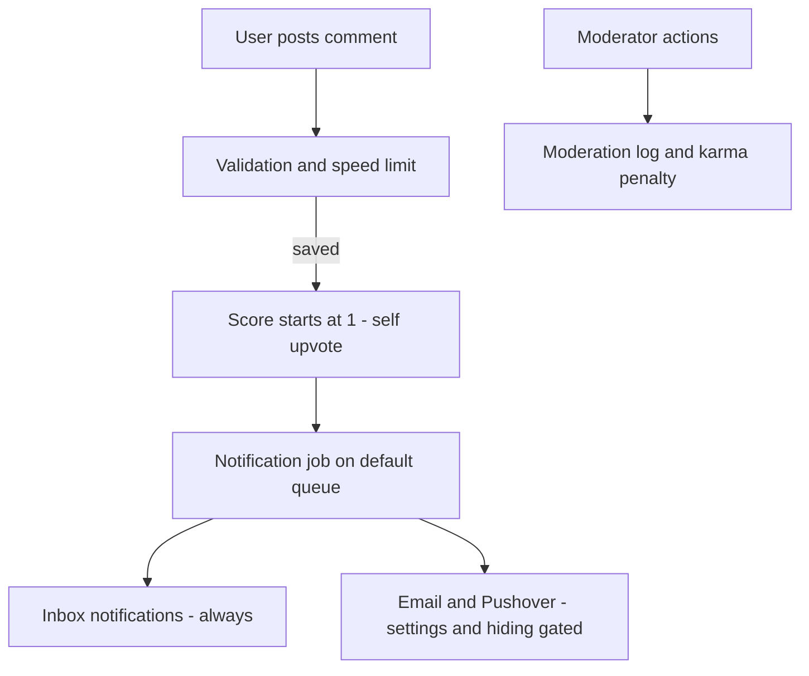

# Comments

> **Status**: ✅ Active
> **Generated**: 2026-10-24T00:00:00Z
> **Last Updated**: 2026-10-24T00:00:00Z
---

## Overview

### What It Does
The commenting system handles all story discussion: posting and threaded replies (to depth 18), editing, deletion/undeletion/disowning, upvotes and reason-coded flags, confidence-based thread ordering, site-wide comment listings and RSS feeds, read tracking, and reply/mention notification delivery by inbox, email, and Pushover.

### Why It Exists
Discussion quality is actively managed by the system itself: automatic rejection of low-effort comments, flag-driven speed limits in heated threads, score hiding on young comments, and collapse of heavily flagged ones. Operations staff mostly monitor these self-operating mechanisms and handle the cases they escalate.

### Key Capabilities (operations view)
- Self-service user actions bounded by time windows (edit 6 h, delete 14 d, flag 7 d)
- Moderator removal with public logging and automatic karma penalty
- Background notification delivery with per-user settings and story-hiding suppression
- Scheduled maintenance: daily comment-score averages, yearly read-ribbon expiry
- Caching: public RSS (2 min), permanent permalink cache, optional page caching

---

## Architecture

### High-Level Design

### Components
| Component | Operational relevance |
|-----------|----------------------|
| Comments controller | All user-facing comment actions; returns 400s for out-of-window attempts |
| Comment model | Encodes every rule and time window listed in this manual |
| Notification job | Runs on the default queue; delivery failures are swallowed, not retried |
| Reply/mention mailer | Threaded emails users can reply to by email |
| Read ribbons | Per-user read tracking; needs periodic expiry |
| Comment stats | Daily average table; needs a daily fill job |
| Views | Comment byline exposes mod controls ("mod delete") to moderators |

### Technology Stack
Rails application with MySQL; background jobs on the default ActiveJob queue; outbound email via the app mailer; Pushover for push notifications.

---

## Model Details

### Rules and time windows (the numbers staff get asked about)
| Rule | Value |
|---|---|
| Edit window | 6 hours from last edit ("edited" label if >1 min after posting) |
| Self-delete window | 14 days; afterwards only disown |
| Flag window | 7 days; blocked below score −10 |
| Collapse threshold | score −5 and below |
| Score hiding | <36 h old and score −2..4; always hidden from a viewer who flagged it; moderators always see scores |
| Max reply depth | 18; a mod note is filed when users hit it |
| Speed limit | `2 + flags-in-chain + user's-own-flags (counted twice)` minutes between a user's comments in a flagged thread; moderators exempt |
| Listing page size | 20 |

### State transitions
- **Active → deleted (author)**: body shows "Comment removed by author"; author may undelete.
- **Active → moderated (moderator)**: logged in the public moderation log with reason; author karma reduced by 2 × the comment's vote count; only moderators can undelete.
- **Active → disowned (author, >14 d)**: reassigned to the inactive-user account; content stays.
- **Banned author**: removed comments show "Comment from banned user removed".
- Moderators can read removed comment text in place; regular users see only the placeholder.

### Automatic content rejection
Empty, "this", "me too"/"nice"/"+1", "tl;dr", "bump", quote-only, spaced-caps shouting, and emoji-only comments are refused with tailored messages. No staff action or logging — by design.

---

## Database Schema

Tables staff should know exist (columns inferred from the application code):

| Table | Purpose | Growth/maintenance |
|---|---|---|
| `comments` | All comments, scores, flags, thread structure | Grows indefinitely; deletions are soft |
| `votes` | Every up/down vote with optional reason | Deleted with their comment |
| `comment_stats` | One row per day: average comment score | Filled by a daily job (30-day self-healing window) |
| `read_ribbons` | One row per user per story read | Purge rows idle >1 year via the expiry task |
| `notifications` | Inbox entries from replies/mentions | Created even for users hiding a story |

---

## API Endpoints

Endpoints relevant to support and monitoring:

| Method/Path | Action | Operational notes |
|---|---|---|
| `POST /comments` | create | 400 when logged out or story gone; identical resubmits silently accepted (no duplicate reports expected) |
| `PATCH /comments/:id` | update | 400 outside the 6 h window |
| `POST /comments/:id/delete`, `/undelete`, `/disown` | lifecycle | Window rules above; 400 outside them |
| `POST /comments/:id/upvote`, `/unvote`, `/flag` | voting | flag requires a reason from the fixed list |
| `GET /comments(.rss)` | newest listing | public RSS cached 120 s; private token feeds uncached and personalized — token is a credential |
| `GET /comments/upvoted` | upvoted listing | does NOT respect hidden stories (known TODO) |
| `GET /c/:short_id` | permalink | resolved via a permanent cache entry; follows merged stories |
| `GET /threads/:user` | user threads | 20 most recent threads |

Admins may look up comments by numeric database id; general traffic uses short ids only (anti-enumeration).

---

## Authorization

| Role | Can do |
|---|---|
| Anonymous | Read only; comment box disabled ("You must be logged in to leave a comment.") |
| Logged-in user | Post/reply/upvote/flag; edit/delete/disown/undelete own within windows |
| Moderator | Remove and restore any comment (logged); see removed text, hidden scores, and **flagger usernames**; exempt from speed limit and collapse |
| Admin | Numeric-id comment lookup |

**Confidentiality note:** comment authors see flag reason *counts* only; moderators see flagger usernames. Treat flagger identity as confidential.

---

## Configuration

- `CACHE_PAGE` gates page caching of the comments index and story threads — after an urgent removal, confirm caches no longer serve the content.
- Notification email/push behavior is per-user settings (reply email, mention email, Pushover equivalents); there are no feature-specific environment variables.
- Site name and domain appear in email subjects and threading headers.

---

## Usage Examples

**Removing a rule-breaking comment:** use **mod delete** in the comment byline, supply a reason. Expect: public moderation log entry, author karma −2 per vote the comment had, body replaced by "Comment removed by moderator <you>: <reason>".

**Restoring a wrongly removed comment:** undelete from the byline. Restoring someone else's comment as a moderator is also logged.

**"Why can't this user reply here?"** — check, in order: thread depth (18), whether they flagged the parent, the thread speed limit message, and whether the story stopped accepting comments.

---

## Testing

Before relying on behavior in an incident, reproduce on a staging user: the windows (6 h/14 d/7 d) are enforced server-side and return 400s, so UI absence of a link is matched by API refusal.

---

## Known Issues & Caveats

| Issue | Impact |
|---|---|
| Upvoted listing ignores hidden stories | Users may see comments they intended to hide; known TODO |
| Vote race on simultaneous votes | Confidence ranking momentarily off; self-corrects on next vote |
| Notification delivery errors swallowed | Missing individual emails are expected behavior, not incidents |
| Inlined partial in threads view | Developers must sync edits; ops: rendering divergence between story page and other pages hints at this |
| Deletes bypass validation and timestamps | Deleted/undeleted comments keep original timestamps |

---

## Performance

- Viewer-specific vote data is batch-loaded per page (no per-comment queries).
- Thread ordering is precomputed into a 3-byte sort key with a deterministic tiebreaker — thread order is stable across reloads; reports of "comments jumping around" are genuinely anomalous.
- Public RSS cached 2 minutes; permalink resolutions cached permanently.

### Scheduled tasks to keep running
| Task | Cadence | If it stops |
|---|---|---|
| Comment-stats daily fill | Daily (30-day window self-heals) | "Above average" queries fall back to a default average of 3 |
| Read-ribbon expiry | Periodic | Table bloat only |
| Default job queue | Continuous | All comment notifications stall |

---

## Troubleshooting

### User: "I can't edit/delete my comment"
**Cause:** outside the 6-hour edit or 14-day delete window, or the comment was moderated.
**Solution:** none for edit; for old comments offer disown. Moderated comments are only restorable by moderators.

### User: "I'm being told to wait before commenting"
**Cause:** flag-driven thread speed limit.
**Solution:** expected behavior; consider reviewing the thread for moderation instead.

### User: "I never got the reply email"
**Cause:** reply email setting off, story hidden by the user, or a swallowed delivery error.
**Solution:** verify settings and hidden stories; point them to the in-app notification, which is always created.

### Removed content still visible in feeds
**Cause:** public RSS cache (2 min) or page cache.
**Solution:** wait out or purge the cache; verify with a logged-out request.

---

## Related Features

- **Moderation** — moderation log, mod notes (depth-limit tattles), flagged-comment review
- **Stories** — story merge affects where permalinks land; stories close to comments by age
- **Inbox/Notifications** — downstream of the comment notification job
- **Users** — karma penalties, banned-user placeholders, inactive-user disowning

---

**Generated:** 2026-10-24T00:00:00Z
**Last Updated:** 2026-10-24T00:00:00Z
**Status:** ✅ Active
