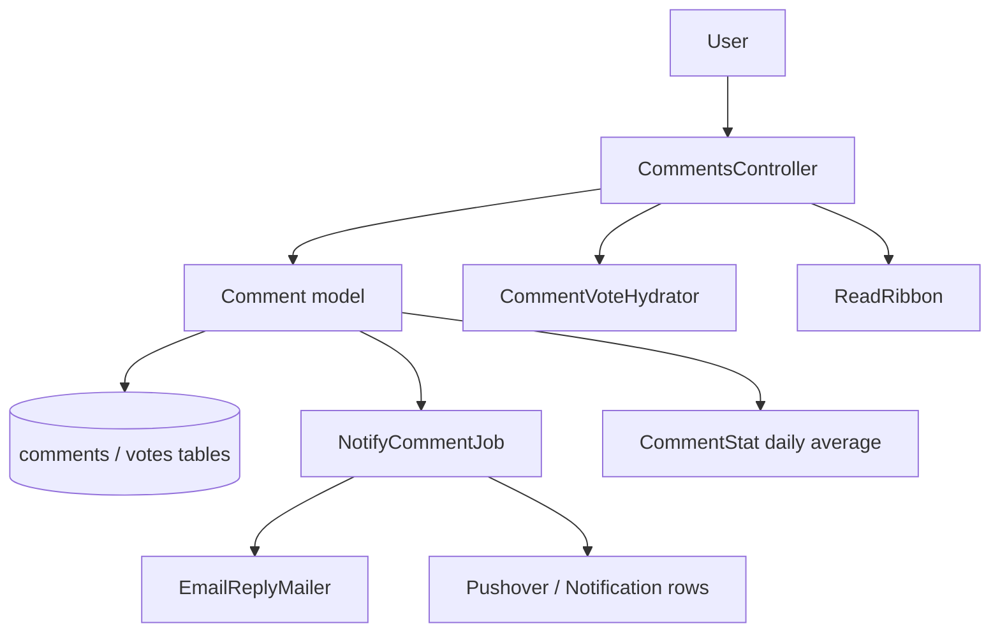
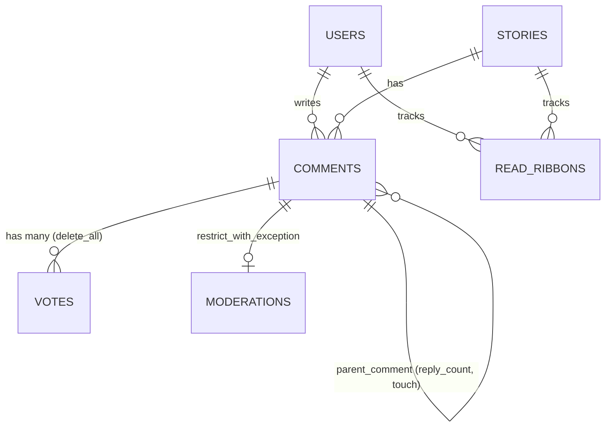

# Comments

> **Status**: ✅ Active
> **Generated**: 2026-10-24T00:00:00Z
> **Last Updated**: 2026-10-24T00:00:00Z
---

## Overview

### What It Does
Threaded commenting on stories: logged-in users post comments (optionally wearing a hat), reply up to 18 levels deep, preview before posting, edit within a time window, delete/undelete/disown their comments, and upvote or flag others' comments with a reason. Sibling comments are ordered by a Wilson-score confidence value encoded into a binary sort key; reply and @mention notifications are delivered in-app, by email, and by Pushover via a background job. Site-wide listings (newest, upvoted, per-user threads) and RSS feeds round out the feature.

### Why It Exists
Discussion is the core of a link-aggregation community. The design choices — confidence ordering, score hiding on young comments, flag-driven speed limits, low-effort comment rejection, and a hard depth cap — all exist to keep discussion substantive and to dampen flamewars.

### Key Capabilities
- Create / preview / edit / delete / undelete / disown comments with validation and duplicate-resubmit tolerance
- Threaded rendering in confidence order via recursive CTEs and a fixed-width `confidence_order_path`
- Upvote, unvote, and reason-coded flagging with per-audience vote summaries
- Reply and mention notifications (in-app `Notification`, threaded email, Pushover)
- Newest/upvoted comment listings with pagination, "Last Read" marker, and public/private RSS
- Per-user per-story read tracking (`ReadRibbon`) with reply-following toggle

---

## Architecture

### High-Level Design


### Components

#### Backend Components
| Component | File Path | Purpose |
|-----------|-----------|---------|
| CommentsController | `app/controllers/comments_controller.rb` | create, show, show_short_id, redirect_from_short_id, edit, reply, delete, undelete, disown, update, unvote, upvote, flag, index, upvoted, user_threads |
| Comment | `app/models/comment.rb` | Core model: validations, threading, confidence, permissions, recursive thread queries |
| CommentStat | `app/models/comment_stat.rb` | Daily average score rows for the `above_average` scope |
| CommentVoteHydrator | `app/models/comment_vote_hydrator.rb` | Batch-decorates comment collections with the viewer's votes/summaries/replies |
| ReadRibbon | `app/models/read_ribbon.rb` | Per-user per-story read tracking and reply-following |
| EmailReplyMailer | `app/mailers/email_reply_mailer.rb` | `reply` and `mention` emails with threading headers |
| NotifyCommentJob | `app/jobs/notify_comment_job.rb` | Delivers reply then mention notifications |

#### Frontend Components
| Component | File Path | Purpose |
|-----------|-----------|---------|
| Comment partial | `app/views/comments/_comment.html.erb` | Byline, action links, collapse checkbox, score, body |
| Comment box | `app/views/comments/_commentbox.html.erb` | Post/Update, Preview, Cancel, hat selector, markdown help |
| Threads renderer | `app/views/comments/_threads.html.erb` | Depth-walk into nested `<ol>` trees; contains an inlined copy of the comment partial |
| Preview | `app/views/comments/_preview.html.erb` | Renders the comment partial when valid |
| Posted reply | `app/views/comments/_postedreply.html.erb` | Wrapper for a freshly created comment |
| Too deep notice | `app/views/comments/_too_deep.html.erb` | "Max reply depth reached." |
| Index | `app/views/comments/index.html.erb` | Newest/upvoted listing with "Last Read" line and pagination |
| RSS | `app/views/comments/index.rss.builder` | RSS 2.0, ttl 120 |
| User threads | `app/views/comments/user_threads.html.erb` | Recent threads for a user |
| Mailer views | `app/views/email_reply_mailer/{reply,mention}.text.erb` | Plain-text bodies, 72-col word wrap |

### Technology Stack
- **Backend**: Rails (ActiveRecord, ActiveJob, ActionMailer), raw SQL recursive CTEs, BigDecimal confidence math
- **Frontend**: ERB partials, CSS-checkbox comment folding, XHR form posts
- **Database**: MySQL (`concat/lpad/char ... using binary`, `insert low_priority`, `on duplicate key update`)
- **External Services**: Pushover (push), outbound SMTP

---

## Model Details

### Comment

#### Associations
```ruby
belongs_to :user
belongs_to :story,
  inverse_of: :comments,
  touch: true
has_many :votes,
  dependent: :delete_all
belongs_to :parent_comment,
  class_name: "Comment",
  inverse_of: false,
  optional: true,
  counter_cache: :reply_count,
  touch: true
has_one :moderation,
  class_name: "Moderation",
  inverse_of: :comment,
  dependent: :restrict_with_exception
belongs_to :hat,
  optional: true
has_many :taggings, through: :story
has_many :links, inverse_of: :from_comment, dependent: :restrict_with_exception
has_many :incoming_links,
  class_name: "Link",
  inverse_of: :to_comment,
  dependent: :restrict_with_exception
has_many :notifications, as: :notifiable
```

#### Concerns
| Concern | Purpose |
|---------|---------|
| `Token` | Token generation (included via `include Token`) |

#### Callbacks
| Callback | Method | Purpose |
|----------|--------|---------|
| `before_validation` (create) | `:assign_initial_attributes` | short_id, score default 1, confidence, placeholder confidence_order, thread_id/depth from parent or Keystore |
| `after_save` | `:log_hat_use` | Moderation entry "used <hat> hat" when hat has `modlog_use` |
| `after_commit` (create) | `:mark_submitter` | Increment `user:<id>:comments_posted` keystore |
| `after_commit` (create) | `:record_initial_upvote` | Create author's Vote(vote: 1), then `update_score_and_recalculate!` |
| `after_commit` | `:recreate_links` | `Link.recreate_from_comment!` when body changed |
| `after_commit` | `:update_associated_caches` | `story.update_cached_columns`; `user.refresh_counts!` |

#### Key Constants
| Constant | Value |
|---|---|
| `FLAGGABLE_DAYS` | 7 |
| `DELETEABLE_DAYS` | 14 |
| `FLAGGABLE_MIN_SCORE` | −10 |
| `COLLAPSE_SCORE` | −5 |
| `MAX_EDIT_MINS` | 360 |
| `COP_LENGTH` | 93 (31 × 3) |
| `MAX_DEPTH` | 18 |
| `SCORE_RANGE_TO_HIDE` | (−2..4) |

#### Key Methods
| Method | Returns | Purpose | Notes |
|--------|---------|---------|-------|
| `calculated_confidence` | BigDecimal 0..1 | Wilson lower bound, z=1.281551565545 (80%) | 0 if deleted/moderated; clamped |
| `update_score_and_recalculate!(score_delta, flag_delta)` | — | Raw-SQL recompute of score/flags/confidence/confidence_order | Documented vote race |
| `breaks_speed_limit?` | Boolean | Flag-scaled reply throttle: delay `(2 + flag_count + commenter_flag_count).minutes` | Replies only; moderators exempt; adds error message |
| `depth_permits_reply?` | Boolean | `depth < MAX_DEPTH`, false for new records | |
| `is_editable_by_user?(user)` | Boolean | Author, not gone, within 6 h of `last_edited_at` | |
| `is_deletable_by_user?(user)` | Boolean | Author, within 14 days | |
| `is_disownable_by_user?(user)` | Boolean | Author, older than 14 days | `InactiveUser.disown!` |
| `is_undeletable_by_user?(user)` | Boolean | Any moderator; author if not moderated | |
| `is_flaggable?(user)` | Boolean | Not gone, not own, score > −10, ≤7 days old | |
| `is_gone?` | Boolean | deleted or moderated | |
| `gone_text` | String | "removed by moderator …: reason" / "banned user" / "by author" | |
| `has_been_edited?` | Boolean | `last_edited_at - created_at > 1.minute` | |
| `show_score_to_user?(u)` | Boolean | Hide score if <36 h old and score in −2..4, or viewer flagged; mods always see | |
| `parents` | Relation | All ancestors oldest-first (recursive CTE) | |
| `delete_by_moderator(user, reason)` | — | Sets is_moderated, Moderation row, karma −2×votes | |
| `Comment.story_threads(story)` | Relation | Whole tree in confidence_order_path order, includes merged stories | |
| `Comment.recent_threads(user)` | Relation | Trees for user's 20 most recent thread_ids | |
| `mailing_list_message_id` | String | `comment.<short_id>[.email].<ts>@<domain>` | |

### CommentStat
`validates :date, presence: true, uniqueness: true`; `validates :average, presence: true`. `daily_fill!` upserts 30 days of per-date average scores (created_at shifted −5 h, deleted excluded) with `insert low_priority ... on duplicate key update`.

### ReadRibbon
`belongs_to :user`, `belongs_to :story`; `validates :is_following, inclusion: {in: [true, false]}`. `is_unread?(comment)` → comment newer than ribbon and not own. `bump` saves new records or `update_column(:updated_at, ...)`. Class methods: `expire_old_ribbons!` (>1 year), `hide_replies_for` / `unhide_replies_for` toggle `is_following`. Deliberately no callbacks (perf).

### CommentVoteHydrator
Enumerable wrapper; delegates `size, length, empty?, any?`. Three batch queries (`Vote.comment_votes_by_user_for_comment_ids_hash`, `Vote.comment_vote_summaries`, `user.ids_replied_to`) populate `current_vote`, `vote_summary`, `current_reply` lazily per comment.

---

## Database Schema

### comments

> Columns inferred from model/controller usage (schema file outside this feature's file set).

| Column | Type | Notes |
|--------|------|-------|
| `id` | integer | PK; low byte used as confidence tiebreaker |
| `short_id` | string(10) | Unique, generated by `ShortId` |
| `user_id` / `story_id` / `parent_comment_id` / `hat_id` | integer | FKs; parent and hat optional |
| `thread_id` | integer | From `Keystore` for roots; inherited for replies |
| `depth` | integer | 0 for top-level |
| `comment` / `markeddown_comment` | mediumtext | Raw markdown / rendered HTML (≤16,777,215) |
| `score` / `flags` | integer | Maintained by `update_score_and_recalculate!` |
| `confidence` | decimal | Wilson lower bound |
| `confidence_order` | binary(3) | Inverted confidence (2 B) + id low byte |
| `is_deleted` / `is_moderated` / `is_from_email` | boolean | |
| `last_edited_at` / `last_reply_at` / `created_at` / `updated_at` | datetime | |
| `reply_count` | integer | counter_cache |

### comment_stats
| Column | Type | Notes |
|---|---|---|
| `date` | date | Unique |
| `average` | decimal | Day's average comment score |

### read_ribbons
| Column | Type | Notes |
|---|---|---|
| `user_id` / `story_id` | integer | One ribbon per pair |
| `is_following` | boolean | Reply notifications toggle |
| `updated_at` | datetime | Read-up-to watermark |

### Relationships


---

## API Endpoints

> Actions verified in `comments_controller.rb`; paths follow route helpers used in views (`comment_short_id_path`, `edit_comment_path`, `reply_comment_path`, `disown_comment_path`, `comments_url`, `upvoted_comments_url`).

| Method | Path | Action | Description | Notes |
|--------|------|--------|-------------|-------|
| `POST` | `/comments` | `create` | Post comment (params: `story_id`, `comment`, `hat_id`, `parent_comment_short_id`, `preview`) | 400 if story missing/gone; duplicate silently accepted |
| `GET` | `/comments/:id` (XHR) | `show` | Comment partial; redirects to target if not editable by viewer | |
| `GET` | `/comments/:id.json` | `show_short_id` | `as_json` payload | |
| `GET` | `/c/:id` | `redirect_from_short_id` | Redirect to story anchor `#c_<short_id>` via permanent cache; admins may pass numeric id | |
| `GET` | `/comments/:id/edit` | `edit` | Comment box (editable by author only) | |
| `GET` | `/comments/:id/reply` | `reply` | Reply box with parents; renders `too_deep` + ModNote at depth 18 | |
| `POST` | `/comments/:id/delete` | `delete` | Author delete within 14 days | |
| `POST` | `/comments/:id/undelete` | `undelete` | Mod always; author if not moderated | |
| `POST` | `/comments/:id/disown` | `disown` | `InactiveUser.disown!` after 14 days | |
| `PATCH` | `/comments/:id` | `update` | Edit within 6 h; preview supported | |
| `POST` | `/comments/:id/upvote` / `unvote` | `upvote`/`unvote` | Vote 1 / 0 | 400 if gone |
| `POST` | `/comments/:id/flag` | `flag` | Vote −1 with reason from `Vote::COMMENT_REASONS` | 400 invalid reason or `can_flag?` false |
| `GET` | `/comments(.rss)` | `index` | Newest, 20/page, Last Read marker, public RSS cached 120 s, private token feed | `caches_page` with `CACHE_PAGE` |
| `GET` | `/comments/upvoted(.rss)` | `upvoted` | Comments the user upvoted, own excluded | Hidden stories TODO |
| `GET` | `/threads(/:user)` | `user_threads` | 20 recent threads for a user; logged-out w/o user → redirect to /active | |

---

## Authorization

> No Pundit policies; authorization is inline via before_actions and model predicates.

| Check | Rule | Notes |
|--------|------------|-------|
| `require_logged_in_user_or_400` | create, reply, upvote, flag, unvote, update | 400 for anonymous |
| `require_logged_in_user` | upvoted | |
| `is_editable_by_user?` | Author, not gone, <6 h since last edit | |
| `is_deletable_by_user?` / `is_disownable_by_user?` | Author; ≤14 days / >14 days | |
| `is_undeletable_by_user?` | Moderator always; author unless moderated | |
| `user.can_flag?(comment)` + `is_flaggable?` | Not own, ≤7 days, score > −10, not gone | |
| `validate_commenter_hasnt_flagged_parent` | May not reply to a parent you flagged | |
| Moderator extras | See deleted content, scores always, flagger usernames, PK lookup (admin), collapse exemption | |

---

## Configuration

### Environment Variables
None specific to comments. Page caching is gated by the `CACHE_PAGE` constant; the application name/domain feed email subjects and Message-Ids.

### Config Files
- None dedicated. Pushover and SMTP are app-wide concerns.

---

## Usage Examples

### Confidence sort key
```ruby
# Source: app/models/comment.rb (update_score_and_recalculate!)
Comment.connection.execute <<~SQL
  UPDATE comments SET
    score = (select coalesce(sum(vote), 0) from votes where comment_id = comments.id),
    flags = (select count(*) from votes where comment_id = comments.id and vote = -1),
    confidence = #{new_confidence},
    confidence_order = concat(lpad(char(65535 - floor(#{new_confidence} * 65535) using binary), 2, '\0'), char(id & 0xff using binary))
  WHERE id = #{id.to_i}
SQL
```

### Speed limit
```ruby
# Source: app/models/comment.rb (breaks_speed_limit?)
parent_comment_ids = parent_comment.parents.ids.append(parent_comment.id)
flag_count = Vote.comments_flags(parent_comment_ids).count
commenter_flag_count = Vote.comments_flags(parent_comment_ids, user).count # double-count author
delay = (2 + flag_count + commenter_flag_count).minutes
```

---

## Testing

No test files are included in this feature's mapped file set; locate specs under the project's test tree before relying on coverage claims.

---

## Known Issues & Caveats

| Issue | Location | Description |
|-------|----------|-------------|
| Vote race | `comment.rb` `update_score_and_recalculate!` | Two simultaneous votes: second ignores first's score change in confidence (TODO in code) |
| Inlined partial | `_threads.html.erb` | Contains a byte-copy of `_comment.html.erb` ("heinous_inline_partial"); must be kept in sync |
| Hidden stories TODO | `comments_controller.rb#upvoted` | Upvoted listing does not respect hidden stories |
| Flat-scope misuse hazard | `comment.rb` `accessible_to_user` | Only safe for flat listings; threaded rendering needs deleted placeholders |
| Validation bypass | `delete_for_user`, `undelete_for_user`, `delete_by_moderator` | `save!(validate: false)`, timestamps suppressed |
| Commented-out association | `comment_stat.rb` | `has_many :comments` by date is commented out |
| Easter-egg validations | `comment.rb` | "Nope", "Wow!  A blue car!", "🚫" etc. are intentional rejection messages |

---

## Performance

### Optimization Strategies
- `CommentVoteHydrator` batches three per-viewer queries over whole listings (no N+1)
- `confidence_order_path` recursive CTE gives single-ORDER-BY tree sorting; story_id predicate pushed into the CTE deliberately
- `CommentStat` precomputes the expensive daily average subquery
- Duplicate-create short-circuit; `update_column`/`touch` used to avoid callback storms up the reply chain

### Caching
- **Public comments RSS**: `Rails.cache`, 120 s
- **Short-id redirects**: `Rails.cache.fetch("c_#{id}", expires_in: nil)` (permanent)
- **Page cache**: `caches_page :index, :threads, if: CACHE_PAGE`

### Database Optimization
- 3-byte binary `confidence_order` with id-low-byte tiebreaker for stable sibling ordering

---

## Troubleshooting

### Issue: user cannot edit a comment
**Symptoms:** edit link missing or 400 from `/comments/:id/edit`.
**Cause:** more than 6 hours since last edit, comment deleted/moderated, or not the author.
**Solution:** none — window is by design (`MAX_EDIT_MINS`).

### Issue: "Thread speed limit reached…"
**Cause:** flags on the ancestor chain scale a per-thread delay (2 min base; author's own flags double-counted).
**Solution:** wait the stated time; moderators are exempt.

### Issue: missing reply email
**Cause:** recipient hid the story, has `email_replies?` off, or delivery raised (errors are swallowed).
**Solution:** check user settings and hidden stories; in-app Notification should still exist.

---

## Related Features

- **Stories** — comments belong to stories; `accepting_comments?`, merges, `last_comment_at`
- **Voting** — `Vote.vote_thusly_on_story_or_comment_for_user_because`, reasons, summaries
- **Moderation** — mod delete/undelete logging, ModNote on depth limit, flagger visibility
- **Hats** — wearable hats on comments; modlog on `modlog_use` hats
- **Inbox/Notifications** — `Notification` rows created by `NotifyCommentJob`
- **Tags** — tag filters applied to the newest-comments feed

---

**Generated:** 2026-10-24T00:00:00Z
**Last Updated:** 2026-10-24T00:00:00Z
**Status:** ✅ Active
