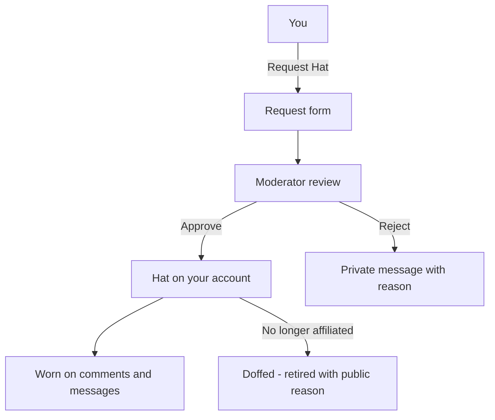

# Hats

> **Status**: ✅ Active
> **Generated**: 2026-10-24T00:00:00Z
> **Last Updated**: 2026-10-24T00:00:00Z
---

## Overview

### What It Does
A hat is a verified badge on your account — like "OpenBSD Developer" — that you can wear on a comment or private message to show you are speaking officially for a project, organization, or company. You request a hat, a moderator verifies and approves it, and from then on you can choose to wear it when posting.

### Why It Exists
Readers need to know when a comment represents a project or company rather than a personal opinion. Hats make that affiliation visible and trustworthy, because every hat has been checked by a moderator and every grant or retirement is publicly logged.

### Key Capabilities
- Browse every active hat and its wearer on the public Hats page
- Request a hat with a short label, a public verification link, and a private note to moderators
- Receive a private message when your request is approved or rejected, with the moderator's reason
- Wear one of your hats on a comment or private message (you may hold several, but wear one at a time)
- Give up ("doff") a hat with a short public reason when you no longer speak for the organization

---

## Architecture

### High-Level Design

### Components

#### Backend Components
| Component | File Path | Purpose |
|-----------|-----------|---------|
| Hats pages | `app/controllers/hats_controller.rb` | The public hats list, doffing, and moderator edits |
| Request pages | `app/controllers/hat_requests_controller.rb` | Your request form and the moderator review queue |
| Hat record | `app/models/hat.rb` | Your badge: label, link, who granted it, when it was retired |
| Hat request | `app/models/hat_request.rb` | Your pending application until a moderator decides |

#### Frontend Components
| Component | File Path | Purpose |
|-----------|-----------|---------|
| Hats list | `app/views/hats/index.html.erb` | Public table of all active hats |
| Request form | `app/views/hat_requests/new.html.erb` | Where you apply for a hat |
| Doff form | `app/views/hats/doff.html.erb` | Where a hat is retired with a reason |

### Technology Stack
- **Backend**: The Lobsters web application
- **Frontend**: Standard web forms — no special software needed
- **Database**: Your hats and pending requests are stored with your account
- **External Services**: None

---

## Model Details

### Hat (your badge)

#### Associations
A hat belongs to you, and it remembers which moderator granted it.

#### Key Methods
| What | Meaning |
|------|---------|
| Label ("hat") | The short text shown on your posts, up to 255 characters |
| Link | Public proof of affiliation (your project email or an employment page), up to 255 characters |
| Granted date | Shown when readers hover over your hat |
| Doffed date | Set when the hat is retired; retired hats stop appearing in the public list |

A hat appears in the public list only while it is not doffed **and** your account is active.

### HatRequest (your application)

| What | Meaning |
|------|---------|
| Hat | The label you want (required) |
| Link | Your verification link (required) |
| Comment | Private notes that only moderators see during review (required) |

When a moderator decides, the application itself is removed — the outcome arrives as a private message.

---

## Database Schema

Your hat stores: the label, the public link, who wears it, who granted it, when it was granted, and (if retired) when it was doffed. Your pending request stores: the requested label, the link, your private comment, and when you asked. No other personal data is collected by this feature.

---

## API Endpoints

The pages you will use:

| Page | Where | Who can use it |
|------|-------|----------------|
| Hats list | `/hats` | Everyone, even logged out |
| Request a hat | "Request Hat" link on the hats page | Any signed-in user |
| Doff a hat | Doffing page for your hat | You (for your own hats) or a moderator |
| Approve/reject requests | Moderator queue | Moderators only |

---

## Authorization

| Action | Who |
|--------|-----|
| See all active hats | Everyone |
| Request a hat | Signed-in users |
| Doff a hat | The hat's owner, or a moderator |
| Rename a hat or change its link | Moderators only |
| Approve or reject requests | Moderators only |

---

## Configuration

Nothing to configure. One helpful option: connect your GitHub account in your settings before requesting — if the organization publicly lists that account, moderators can verify you instantly without a verification email.

---

## Usage Examples

### Requesting a hat
1. Sign in and open the **Hats** page, then click **Request Hat**.
2. **Hat** — enter the label, e.g. "XYZ Project Member".
3. **Link** — your email at the project/company, or a URL showing your employment. This is public once granted.
4. **Comment** — private context for moderators; linking to discussions where the hat would be useful helps.
5. Click **Request Hat**. You'll see "Successfully submitted hat request."

### Giving up a hat
When you can no longer speak for the organization, doff the hat with a short public reason like "Left project". Your old posts keep showing the hat; you just can't wear it on new ones.

---

## Testing

Not applicable for customers — moderators verify every request by hand before a hat appears on your account.

---

## Known Issues & Caveats

| Caveat | Description |
|--------|-------------|
| One at a time | You may hold several hats but wear only one on any single comment or message |
| Hats are for speaking officially | Not for commemorating past contributions or former jobs; usually reserved for notable projects and organizations |
| The link is public | Hover text and the hats table show your link; if it's an email address, logged-out visitors see only the domain |
| Doffing is permanent | A doffed hat cannot be worn again — you'd request a new one |
| History is preserved | Old comments and messages keep showing the hat they were posted with |
| No request archive | Decided requests disappear; the decision reaches you by private message |

---

## Performance

The hats list and request review are instant, everyday web pages; approval itself depends on how quickly a moderator can verify you — a GitHub-verifiable link is the fastest path.

---

## Troubleshooting

### Issue: My request form won't submit
**Symptoms:** The form returns with errors.
**Cause:** Hat, Link, and Comment are all required (label and link up to 255 characters).
**Solution:** Fill in all three fields and resubmit.

### Issue: I can't doff a hat without typing anything
**Symptoms:** "You must give a reason for the doffing."
**Cause:** A public reason is required.
**Solution:** Enter a short explanation such as "Left project".

### Issue: My hat vanished from the hats page
**Cause:** It was doffed (by you or a moderator), or your account is inactive. Your profile page still records it.
**Solution:** Check your private messages and the public moderation log for the reason.

---

## Related Features

- **[Comments](../features/comments.md)** — where you wear a hat to speak officially
- **[Messages](../features/messages.md)** — approval/rejection notices arrive here; hats can be worn on messages too
- **[Settings](../features/settings.md)** — connect GitHub to speed up verification
- **[Moderation](../features/moderation.md)** — grants, edits, and doffings appear in the public moderation log

---

**Generated:** 2026-10-24T00:00:00Z
**Last Updated:** 2026-10-24T00:00:00Z
**Status:** ✅ Active
