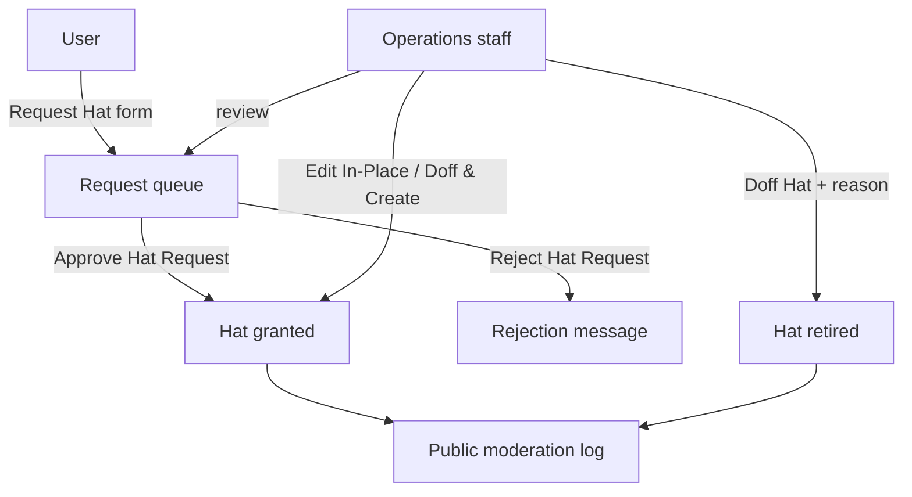

# Hats

> **Status**: ✅ Active
> **Generated**: 2026-10-24T00:00:00Z
> **Last Updated**: 2026-10-24T00:00:00Z
---

## Overview

### What It Does
Hats are verified affiliation badges users wear on comments and private messages to speak officially for a project, organization, or company. As operations staff (moderators), you review hat requests, approve or reject them with a reason, edit existing hats, and doff (retire) hats when an affiliation ends.

### Why It Exists
Verified affiliations only stay trustworthy if someone checks them. This feature gives operations staff a review queue, editable approvals, a mandatory reason trail, and automatic public moderation logging for every grant, edit, and retirement.

### Key Capabilities
- Review the pending hat request queue (requester, requested label, verification link, private comment)
- Edit a request's hat text or link before approving
- Approve or reject with a required reason, automatically messaged to the requester
- Edit live hats in place, or replace them history-preservingly with **Doff & Create**
- Doff any user's hat with a required public reason

---

## Architecture

### High-Level Design

### Components

#### Backend Components
| Component | File Path | Purpose |
|-----------|-----------|---------|
| `HatsController` | `app/controllers/hats_controller.rb` | Hats list, doffing, moderator edit flows |
| `HatRequestsController` | `app/controllers/hat_requests_controller.rb` | Queue listing, approve, reject |
| `Hat` | `app/models/hat.rb` | Badge record; writes grant/doff entries to the moderation log |
| `HatRequest` | `app/models/hat_request.rb` | Pending request; sends decision messages, then is deleted |
| `HatsHelper` | `app/helpers/hats_helper.rb` | Renders hat badges with granted-date tooltips |

#### Frontend Components
| Component | File Path | Purpose |
|-----------|-----------|---------|
| Request queue | `app/views/hat_requests/index.html.erb` | Approve/Reject forms per pending request |
| Hats table | `app/views/hats/index.html.erb` | Public list; **Edit** link appears for staff |
| Edit form | `app/views/hats/edit.html.erb` | **Edit In-Place** / **Doff & Create** buttons |
| Doff form | `app/views/hats/doff.html.erb` | Required **Reason** field, **Doff Hat** button |

### Technology Stack
- **Backend**: Lobsters Rails application
- **Frontend**: Server-rendered forms in the moderator UI
- **Database**: Hats and pending requests stored alongside user accounts
- **External Services**: None — notifications use the site's private messages

---

## Model Details

### Hat

Each hat records: the wearer, the staff member who granted it (`granted_by_user`), the label (max 255 chars), the public link (max 255 chars), a short URL id, a modlog-use flag, and the doffing timestamp once retired.

#### Callbacks (automatic staff-relevant behavior)
| When | What happens |
|------|-------------|
| On grant | Public moderation log entry `Granted hat "<name>" (<link>)`, attributed to the granter |
| On doff | Public moderation log entry `Doffed hat "<name>"` with your reason; self-doffs carry no moderator attribution |

#### Key Methods
| Method | Operational meaning |
|--------|---------------------|
| `doff_by_user_with_reason` | Retires the hat now and logs the reason publicly |
| `sanitized_link` | Email links are shown to logged-out visitors as the domain only |

Active list rule: a hat appears on `/hats` only while undoffed **and** its wearer's account is active.

### HatRequest

Fields: requester, hat (required), link (required), comment (required, staff-only visibility, rendered as Markdown in the queue).

| Method | Operational meaning |
|--------|---------------------|
| `approve_by_user_for_reason!` | Creates the hat (you as granter), messages the requester "Your hat \"<name>\" has been approved" with your reason, deletes the request — all or nothing |
| `reject_by_user_for_reason!` | Messages "Your request for hat \"<name>\" has been rejected" with your reason, deletes the request |

---

## Database Schema

Records kept per hat: wearer, granter, label, link, short id, modlog flag, grant and doff timestamps. Records kept per pending request: requester, label, link, private comment, request time. **Decided requests are deleted** — the moderation log and the decision message are the only durable traces.

---

## API Endpoints

| Method | Path | Action | Staff task |
|--------|------|--------|-----------|
| `GET` | `/hats` | `index` | Public hats table (your **Edit** links live here) |
| `GET` | `/hat_requests` | `index` | Open the review queue |
| `POST` | `/hat_requests/:id/approve` | `approve` | **Approve Hat Request** button |
| `POST` | `/hat_requests/:id/reject` | `reject` | **Reject Hat Request** button |
| `GET` | `/hats/:id/edit` | `edit` | Open the edit form |
| `POST` | `/hats/:id/update_in_place` | `update_in_place` | **Edit In-Place** button |
| `POST` | `/hats/:id/update_by_recreating` | `update_by_recreating` | **Doff & Create** button |
| `GET` | `/hats/:id/doff` | `doff` | Open the doffing form |
| `POST` | `/hats/:id/doff_by_user` | `doff_by_user` | **Doff Hat** button |

---

## Authorization

| Action | Required role |
|--------|---------------|
| View hats list | Anyone |
| View request queue | Any signed-in user (note: not staff-only) |
| Approve / reject requests | Moderator |
| Edit hats (both modes) | Moderator |
| Doff a hat | Hat owner or moderator |

---

## Configuration

No settings, environment variables, or config files. Site policy to apply during review: hats are for users who will **speak officially**, not for commemorating past roles, and are usually reserved for notable projects and organizations.

---

## Usage Examples

### Approving a request (step by step)
1. Open the request queue. Each entry shows **User** (with request age), **Hat**, **Link**, and the private **Comment** (Markdown).
2. Correct the **Hat** or **Link** fields if needed — your edits are saved as part of the approval.
3. Type a **Reason** (required). The requester receives it verbatim in a private message.
4. Click **Approve Hat Request**. Confirmation: "Successfully approved hat request."

### Rejecting a request
1. Type a **Reason** (required) — written to the requester, so keep it courteous and specific.
2. Click **Reject Hat Request** (styled as a destructive action). Confirmation: "Successfully rejected hat request."

### Doffing a user's hat
1. Open the doffing form from the hat. Enter a **Reason** — a short public explanation, like "Left project".
2. Click **Doff Hat**. A blank reason fails with "You must give a reason for the doffing."

---

## Testing

Before approving, verify the affiliation: prefer requests where the user has authenticated GitHub and the organization publicly lists that account (instant verification); otherwise check the provided email domain or employment URL.

---

## Known Issues & Caveats

| Caveat | Operational impact |
|--------|--------------------|
| Queue visible to all signed-in users | Treat request comments as semi-private, not secret |
| Requests are deleted on decision | Copy anything you need before clicking Approve/Reject |
| Rejections are not modlogged | Only the private message records a rejection |
| **Edit In-Place** vs **Doff & Create** | In-place rewrites the live hat (logged as rename/link change); Doff & Create retires the old hat with reason `To replace with "<new>"` and preserves history — prefer it when the affiliation actually changed |
| Approval message padding | The approval message body carries trailing spaces (length-validation workaround); harmless |
| Self-doffs lack moderator attribution | Modlog shows the doff without a staff name when users doff their own hats |

---

## Performance

Queue and hats pages preload user records; no staff-facing performance concerns at normal volumes.

---

## Troubleshooting

### Approve/Reject button does nothing useful
**Symptoms:** Form returns without a decision.
**Cause:** The **Reason** field is required on both actions; on approval the **Hat** and **Link** fields are also required.
**Solution:** Fill the required fields and resubmit.

### Edit fails and bounces back to the form
**Cause:** Validation failure — e.g., hat or link over 255 characters, or blank hat name.
**Solution:** Shorten/correct the values; the flash lists the exact errors.

### A doffed hat still shows on old comments
**Cause:** By design — history is preserved; doffing only prevents future wear.
**Solution:** None needed. The hats table hides doffed hats; profiles still record them.

---

## Related Features

- **[Moderation](../features/moderation.md)** — grants, edits, and doffings all land in the public moderation log
- **[Messages](../features/messages.md)** — your approval/rejection reasons are delivered as private messages
- **[Users](../features/users.md)** — hats hang off user accounts; inactive users drop off the public list
- **[Settings](../features/settings.md)** — users' GitHub auth (used for fast verification) lives here

---

**Generated:** 2026-10-24T00:00:00Z
**Last Updated:** 2026-10-24T00:00:00Z
**Status:** ✅ Active
