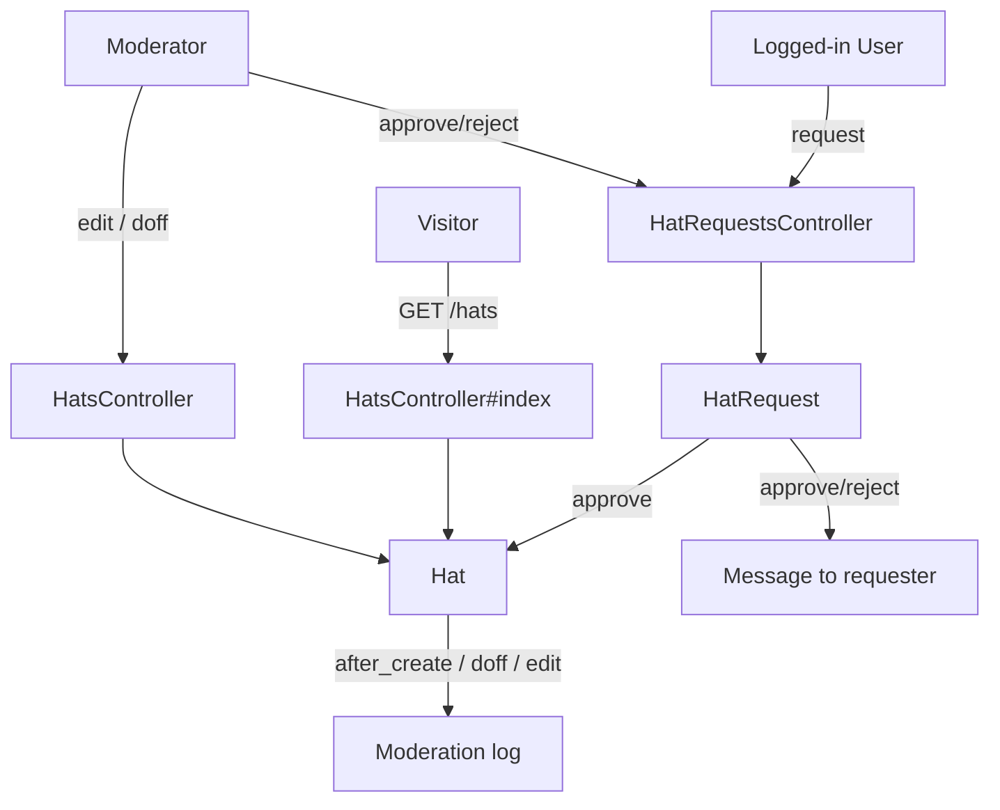
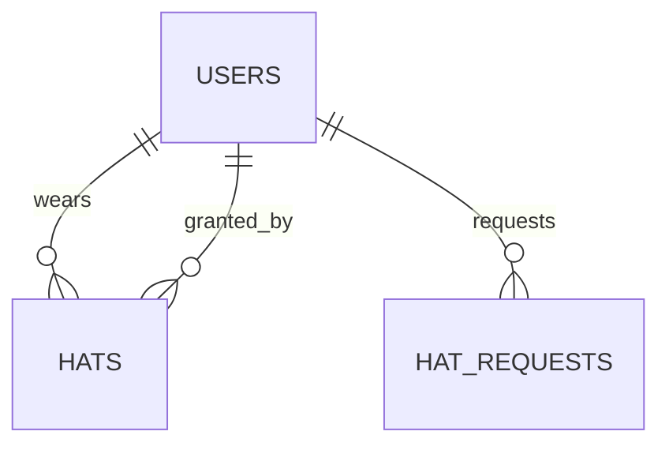

# Hats

> **Status**: ✅ Active
> **Generated**: 2026-10-24T00:00:00Z
> **Last Updated**: 2026-10-24T00:00:00Z
---

## Overview

### What It Does
Hats are verified affiliation badges. A hat is a short label (e.g., "OpenBSD Developer") attached to a user, granted by a moderator, that the user may wear on a comment or private message to indicate they are speaking officially for a project, organization, or company. Users request hats through a moderated workflow (`HatRequest`); moderators approve, reject, edit, and doff (retire) hats.

### Why It Exists
Community members sometimes need to make statements on behalf of their project or employer. Hats give those statements a verified, visually distinct marker, while the request/approval workflow and moderation logging keep the verification trustworthy and auditable.

### Key Capabilities
- Public listing of all active hats grouped by hat text (`/hats`)
- Logged-in users can request a hat with a verification link and private justification
- Moderators approve/reject requests (with editable hat/link and a required reason messaged to the requester)
- Hat owner or a moderator can doff (retire) a hat with a required public reason
- Moderators can edit a hat in place or replace it via "Doff & Create" (history-preserving)
- All grants, edits, and doffings are written to the moderation log

---

## Architecture

### High-Level Design


### Components

#### Backend Components
| Component | File Path | Purpose |
|-----------|-----------|---------|
| `HatsController` | `app/controllers/hats_controller.rb` | Public index; doffing; moderator edit (in-place or doff-and-recreate) |
| `HatRequestsController` | `app/controllers/hat_requests_controller.rb` | Request form, request queue, moderator approve/reject |
| `Hat` | `app/models/hat.rb` | Hat record; doffing; moderation logging; link sanitization |
| `HatRequest` | `app/models/hat_request.rb` | Pending request; transactional approve/reject with user notification |
| `HatsHelper` | `app/helpers/hats_helper.rb` | Renders the hat badge (`styled_hat`, `hat_text`) |

#### Frontend Components
| Component | File Path | Purpose |
|-----------|-----------|---------|
| Hats index | `app/views/hats/index.html.erb` | Public table of active hats (User / Hat / Link; Edit column for mods) |
| Doff form | `app/views/hats/doff.html.erb` | Reason-required doffing form |
| Edit form | `app/views/hats/edit.html.erb` | Moderator edit with "Edit In-Place" and "Doff & Create" submits |
| Request form | `app/views/hat_requests/new.html.erb` | Hat / Link / Comment request form with policy guidance |
| Request queue | `app/views/hat_requests/index.html.erb` | Per-request editable approve/reject forms |

### Technology Stack
- **Backend**: Ruby on Rails (ActiveRecord models, ERB views)
- **Frontend**: Server-rendered ERB; `form_with` forms
- **Database**: Relational (ActiveRecord); hats and hat_requests tables
- **External Services**: None (uses in-app `Message` and `Moderation` records)

---

## Model Details

### Hat

#### Associations
```ruby
belongs_to :user
belongs_to :granted_by_user, class_name: "User", inverse_of: false
```

#### Concerns
| Concern | Purpose |
|---------|---------|
| `Token` | Shared token generation concern |

#### Callbacks
| Callback | Method | Purpose |
|----------|--------|---------|
| `before_validation` (on: create) | `:assign_short_id` | Generates `short_id` via `ShortId.new(self.class).generate` |
| `after_create` | `:log_moderation` | Writes `Granted hat "<hat>"` (plus link) to the moderation log |

#### Key Methods
| Method | Returns | Purpose | Notes |
|--------|---------|---------|-------|
| `doff_by_user_with_reason(user, reason)` | — | Logs `Doffed hat "<hat>"` with reason, sets `doffed_at = Time.current` | `moderator_user_id` is `nil` for self-doffs |
| `sanitized_link` | `String` | Email links reduced to domain via `Mail::Address`; URLs returned as-is | Protects email addresses from logged-out visitors |
| `to_txt` | `String` | `"(<hat>) "` plain-text form | |
| `to_param` | `String` | `short_id` | Hats are addressed by short id in URLs |

Validations: `hat` presence, max 255; `link` max 255; `modlog_use` inclusion in `[true, false]`; `short_id` presence, max 10.

Scope: `active` → `joins(:user).where(doffed_at: nil).merge(User.active)`.

### HatRequest

#### Associations
```ruby
belongs_to :user
```

#### Concerns
| Concern | Purpose |
|---------|---------|
| `Token` | Shared token generation concern |

#### Key Methods
| Method | Returns | Purpose | Notes |
|--------|---------|---------|-------|
| `approve_by_user_for_reason!(user, reason)` | — | Transaction: create `Hat` (granter = approving mod), message requester `Your hat "<hat>" has been approved`, destroy request | Body is `reason + (" " * 20)` — padding kludge for a 20-char minimum |
| `reject_by_user_for_reason!(user, reason)` | — | Transaction: message requester `Your request for hat "<hat>" has been rejected`, destroy request | No moderation log entry |

Validations: `hat` presence, max 255; `link` presence, max 255; `comment` presence, max 65,535. Also declares `attr_accessor :rejection_comment` (unused in these files).

---

## Database Schema

> Columns inferred from model and controller usage (schema file outside this feature's file set).

### hats
| Column | Type | Default | Notes |
|--------|------|---------|-------|
| `id` | integer | — | Primary key |
| `user_id` | integer | — | Wearer |
| `granted_by_user_id` | integer | — | Granting moderator |
| `hat` | string | — | Label, max 255 |
| `link` | string | — | Verification link, max 255 |
| `short_id` | string | — | URL key, max 10 |
| `modlog_use` | boolean | — | Must be true/false |
| `doffed_at` | datetime | `NULL` | Set when retired |
| `created_at` / `updated_at` | datetime | — | Shown as "Granted" date in tooltip |

### hat_requests
| Column | Type | Default | Notes |
|--------|------|---------|-------|
| `id` | integer | — | Primary key |
| `user_id` | integer | — | Requester |
| `hat` | string | — | Requested label, max 255 |
| `link` | string | — | Verification link, max 255 |
| `comment` | text | — | Private justification, max 65,535 |
| `created_at` / `updated_at` | datetime | — | Request age shown in queue |

### Relationships


---

## API Endpoints

| Method | Path | Action | Description | Notes |
|--------|------|--------|-------------|-------|
| `GET` | `/hats` | `hats#index` | Public listing of active hats | No login required |
| `GET` | `/hats/:id/doff` | `hats#doff` | Doffing form | Owner or moderator |
| `POST` | `/hats/:id/doff_by_user` | `hats#doff_by_user` | Doff with required reason | Owner or moderator |
| `GET` | `/hats/:id/edit` | `hats#edit` | Edit form | Moderator |
| `POST` | `/hats/:id/update_in_place` | `hats#update_in_place` | Rename / change link on existing row | Moderator; logged |
| `POST` | `/hats/:id/update_by_recreating` | `hats#update_by_recreating` | New hat + doff old (`To replace with "<new>"`) | Moderator |
| `GET` | `/hat_requests/new` | `hat_requests#new` | Request form | Logged-in |
| `POST` | `/hat_requests` | `hat_requests#create` | Submit request | Logged-in |
| `GET` | `/hat_requests` | `hat_requests#index` | Pending queue | Logged-in (not mod-gated) |
| `POST` | `/hat_requests/:id/approve` | `hat_requests#approve` | Approve (hat/link editable; reason messaged) | Moderator |
| `POST` | `/hat_requests/:id/reject` | `hat_requests#reject` | Reject (reason messaged) | Moderator |

> Paths shown via their helpers (`doff_by_user_hat_path`, etc.); each listed action exists in its controller.

---

## Authorization

This feature uses controller `before_action` gates, not Pundit policies.

| Gate | Applies to | Conditions |
|------|------------|------------|
| `require_logged_in_user` | all `hats` actions except `index`; all `hat_requests` actions | Must be signed in |
| `require_logged_in_moderator` | `edit`, `update_in_place`, `update_by_recreating`, `approve`, `reject` | Must be a moderator |
| `only_hat_user_or_moderator` | `doff`, `doff_by_user` | Hat owner or moderator; others redirected to own profile |
| `find_hat!` scoping | hat member actions | Mods find any hat by `short_id`; others only within `@user.wearable_hats` |

---

## Configuration

### Environment Variables
None.

### Config Files
None specific to hats.

---

## Usage Examples

### Doffing a hat with a reason
```ruby
# Source: app/models/hat.rb
def doff_by_user_with_reason(user, reason)
  m = Moderation.new
  m.user_id = user_id
  m.moderator_user_id = user.is_moderator? ? user : nil
  m.action = "Doffed hat \"#{hat}\""
  m.reason = reason
  m.save!

  self.doffed_at = Time.current
  save!
end
```

### Approving a hat request
```ruby
# Source: app/models/hat_request.rb
def approve_by_user_for_reason!(user, reason)
  transaction do
    h = Hat.new
    h.user_id = user_id
    h.granted_by_user_id = user.id
    h.hat = hat
    h.link = link
    h.save!

    m = Message.new
    m.author_user_id = user.id
    m.recipient_user_id = user_id
    m.subject = "Your hat \"#{hat}\" has been approved"
    m.body = reason + (" " * 20) # kludge to ensure there are 20 characters
    m.save!

    destroy!
  end
end
```

---

## Testing

### Test Files
No test files are included in this feature's mapped file set.

---

## Known Issues & Caveats

| Issue | Location | Description |
|-------|----------|-------------|
| Queue not mod-gated | `hat_requests_controller.rb` | `index` only requires login; any user can view pending requests (approve/reject stay mod-only) |
| Nil hat crash | `hats_controller.rb` (`find_hat!`) | `find_by` can return `nil`; `only_hat_user_or_moderator` then calls `@hat.user` → `NoMethodError` instead of 404 |
| Padding kludge | `hat_request.rb` | Approval message body appends 20 spaces to satisfy a minimum-length validation |
| Permit-then-except | `hat_requests_controller.rb#approve` | `permit(:hat, :link, :reason).except(:reason)` — reason permitted, then dropped from mass assignment |
| No request history | `hat_request.rb` | Approve and reject both `destroy!` the request; no archived state |
| `modlog_use` not editable | `hats/edit.html.erb` | Preserved by recreation but absent from the edit form; approval never sets it |
| Unused accessor | `hat_request.rb` | `attr_accessor :rejection_comment` is never referenced in these files |

---

## Performance

### Optimization Strategies
- `Hat.active.includes(:user)` and `HatRequest.all.includes(:user)` avoid N+1 user lookups on index pages.

### Caching
- None in this feature.

### Database Optimization
- Lookup by `short_id` (`to_param`) — indexing of that column is defined in the schema, outside this file set.

---

## Troubleshooting

### Issue: Doffing fails with "You must give a reason for the doffing."
**Symptoms:** Redirected back to the doff form with an error flash.
**Cause:** The `reason` field was blank; `doff_by_user` rejects blank reasons.
**Solution:** Enter a short public explanation (e.g., "Left project") and resubmit.

### Issue: User cannot edit or doff a hat
**Symptoms:** Redirect to own profile, or hat not found.
**Cause:** Edit actions are moderator-only; doffing is restricted to the hat's owner or a moderator, and non-mods can only resolve hats in their own `wearable_hats`.
**Solution:** Have a moderator perform the action.

### Issue: Hat edit silently becomes two hats
**Symptoms:** Old hat shows as doffed with reason `To replace with "<new>"`, new hat exists.
**Cause:** The moderator used **Doff & Create** (`update_by_recreating`) rather than **Edit In-Place**.
**Solution:** Expected behavior — recreation preserves history; use Edit In-Place for typo fixes.

---

## Related Features

- **Moderation** — hat grants, edits, and doffings write `Moderation` log entries.
- **Messages** — approval/rejection outcomes are delivered as private messages.
- **Users** — hats belong to users; `User.active` gates the public listing; `wearable_hats` scopes owner access.
- **Comments / private messages** — a worn hat is displayed via `styled_hat` on posts.

---

**Generated:** 2026-10-24T00:00:00Z
**Last Updated:** 2026-10-24T00:00:00Z
**Status:** ✅ Active
