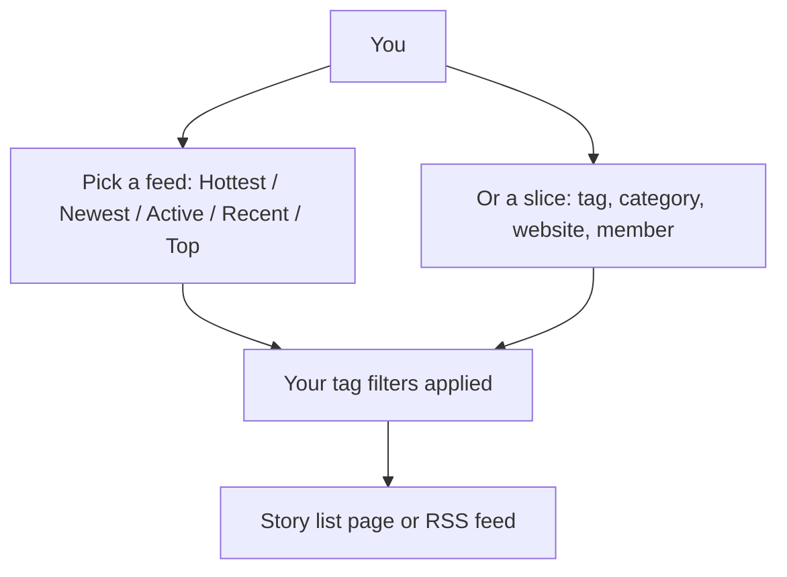

# Home Feed

> **Status**: ✅ Active
> **Generated**: 2026-10-24T00:00:00Z
> **Last Updated**: 2026-10-24T00:00:00Z
---

*Audience: customers — this knowledge base article follows the standard feature document structure.*

## Overview

### What It Does
The home feed is the collection of story lists you browse on the site: the front page of "hottest" stories, plus Newest, Recent, Active, Top, tag pages, category pages, pages for a particular website (domain) or source, one member's newest submissions, and your personal Saved, Upvoted, and Hidden lists. Each list can also be followed from a feed reader via RSS.

### Why It Exists
Different readers want different views of the same stories: what's hot right now, what just arrived, what's being discussed, or what was best over the past week. The home feed provides all of these orderings plus the ability to hide topics you don't care about.

### Key Capabilities
- Browse stories as Hottest (front page), Newest, Recent, Active, or Top over a time period
- Narrow listings to a tag, several tags, a category, a website, or one member
- Hide entire topics site-wide with tag filters — even without an account
- Follow any list in your feed reader; signed-in members get private feeds that respect their filters
- A "Last Read" marker on Newest that shows where you left off

---

## Architecture

### High-Level Design

### Components
From your point of view the feature has three parts:

| Component | What it is |
|-----------|-----------|
| Story lists | One consistent list layout used by every feed, with paging links at the bottom |
| Filtered Tags page | A table of every tag where you tick **Hide** and click **Save Filters** |
| RSS feeds | A feed-reader version of nearly every list, including private tokenized feeds for members |

### Technology Stack
Not relevant for customers — the feeds work in any browser and any standard RSS reader (the feeds use RSS 2.0).

---

## Model Details
This section is technical in the standard template; for customers the important "model" is simple:

- A **story** appears in many lists at once (Hottest, Newest, its tags' pages, its website's page).
- A **tag filter** you set hides stories with that tag from every list you view.
- Your **Saved**, **Upvoted**, and **Hidden** lists are personal and require signing in.

---

## Database Schema
Internal storage details are not part of the customer documentation. What persists for you:

- Your tag filters — on your account if signed in, otherwise in a long-lasting browser cookie
- Your last-read position on the Newest page (signed-in members)
- Your saved / upvoted / hidden story lists

---

## API Endpoints
In customer terms, these are the pages you can visit:

| Page | What it shows | Notes |
|--------|------|-------|
| Front page | Hottest stories | RSS available |
| Newest | All stories, newest first | shows your **Last Read** line |
| Recent | New stories not yet on the front page | its feed link points to Newest on purpose |
| Active | Stories ordered by latest comment | |
| Top | Best of a time period | default is one week; edit the address like `/top/5d` or `/top/2y` |
| Tag page(s) | Stories with one tag, or comma-separated tags | all names must exist |
| Category page(s) | Stories in one or more categories | comma-separated, all must exist |
| Website / source pages | Stories from one site | shows story and submitter counts |
| Member's newest | One member's submissions | |
| Saved / Upvoted / Hidden | Your personal lists | sign-in required |
| Filtered Tags | Manage which tags to hide | works signed out too |

---

## Authorization
In plain language:

- Anyone can browse every public feed and set tag filters (stored in a browser cookie when signed out).
- You must be signed in to use Saved, Upvoted, and Hidden lists.
- Private RSS feeds use a personal token in the URL — treat that link like a password.
- A few special tags can only be filtered or used by moderators; those simply don't show a Hide checkbox for you.

---

## Configuration
There is nothing you need to configure. Optional personal touches:

- **Tag filters** — Filtered Tags page → tick **Hide** → **Save Filters** ("Your filters have been updated.")
- **Story previews** — members can enable inline story preview text in the list
- **Feed reader** — subscribe using the RSS links on each page; members can use their private token links so filters apply

---

## Usage Examples

### Hide a topic everywhere
1. Open the **Filtered Tags** page.
2. Tick **Hide** next to the tags you want gone. The table shows each tag's description, story count, and how many people filter it.
3. Click **Save Filters**. Stories with those tags disappear from your feeds site-wide.

### See the best of the month
Open the Top page and change the period in the address, e.g. `/top/1m`. Unrecognized periods take you back to the one-week default.

### Catch up on Newest
Sign in and open Newest — a **Last Read** line marks the first story you've already seen; it follows onto later pages if needed.

---

## Testing
Not applicable for customers; the feature is covered by the site's automated tests.

---

## Known Issues & Caveats

| Caveat | Description |
|-------|-------------|
| Brief staleness when signed out | Public lists can be up to ~45 seconds old and the front-page feed up to 2 minutes old |
| Recent's feed is Newest | Intentional, because Recent constantly changes as stories get promoted |
| `~` instead of a score | Some stories hide their score from some viewers by design |
| One typo breaks multi-tag URLs | Comma-separated tag or category lists return "not found" if any name is wrong |
| Cookie filters are per-browser | Signed-out filters don't follow you across devices — sign in to keep them |

---

## Performance
Feeds for signed-out visitors are cached briefly so pages load fast; signed-in members always see live, personalized lists.

---

## Troubleshooting

### A story I expect is missing
**Cause:** one of its tags is in your filters, or you hid the story.
**Solution:** check Filtered Tags and your Hidden list.

### My filters vanished
**Cause:** you were signed out and cleared cookies or changed browsers.
**Solution:** sign in so filters are saved to your account.

### My feed reader shows unfiltered stories
**Cause:** you subscribed to the public feed URL.
**Solution:** use the private token links (for example from the Filtered Tags page) so your filters apply; the feed title will read "Private feed for *your-username*".

---

## Related Features

- **Stories** — submitting, voting, saving, and hiding the stories that appear in feeds
- **Tags & Categories** — the tags you browse and filter by
- **Comments** — the comment counts and the Active ordering come from discussions
- **Search** — find specific stories instead of browsing feeds

---

**Generated:** 2026-10-24T00:00:00Z
**Last Updated:** 2026-10-24T00:00:00Z
**Status:** ✅ Active
