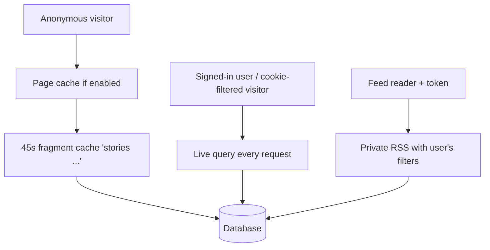

# Home Feed

> **Status**: ✅ Active
> **Generated**: 2026-10-24T00:00:00Z
> **Last Updated**: 2026-10-24T00:00:00Z
---

*Audience: operations staff — this user manual follows the standard feature document structure.*

## Overview

### What It Does
Serves every public story listing (front page/hottest, Newest, Recent, Active, Top, tag, multi-tag, category, domain, origin, newest-by-user), members' personal Saved / Upvoted / Hidden lists, the Filtered Tags preference page, and RSS/JSON renditions of the feeds. It is the highest-traffic surface of the site.

### Why It Exists
Operations needs one reference for how feed traffic is cached, which endpoints require login, which support reports are expected behavior, and what to check during incidents.

### Key Capabilities
- Anonymous traffic served from a two-layer cache (page cache + 45-second fragment cache)
- Signed-in traffic always live (cache bypassed for users and for cookie-filtered visitors)
- Tokenized private RSS feeds for front page, Newest, Saved, Upvoted
- Tag filters stored on the account or in a permanent browser cookie
- Strict page-number bounds that reject crawler abuse as routing errors

---

## Architecture

### High-Level Design

### Components
| Component | Operational role |
|-----------|-----------------|
| Feed controller | Fourteen listing actions; pagination; cache orchestration |
| Filters controller | Filter table + save; writes account record or permanent cookie |
| Shared list view + RSS builder | One template for all HTML lists; RSS 2.0 output with 120-minute TTL hint |
| Key/value store | Supporting counters and read-through cache on the per-request traffic path; keys capped at 50 characters |

### Technology Stack
- **Backend**: Rails; standard cache store (`Rails.cache`) plus optional static page caching gated by the `CACHE_PAGE` deployment setting
- **Database**: primary relational database; feed queries exclude each viewer's filtered tags

---

## Model Details
Operationally relevant data:

- **Tag filters** — per-user records, or a comma-joined tag list in a permanent cookie for anonymous visitors
- **Last-read timestamp** — the Newest page writes to the signed-in user's record on every visit (so Newest is never read-only)
- **Key/value store** — hot-path read-through cache; deliberately unlocked reads; writes via upsert

---

## Database Schema
Not duplicated here; note only that the key/value store uses the key as primary key (max 50 characters, case-insensitively unique) and that feed listings are plain queries over the stories tables — no feature-specific denormalization to maintain.

---

## API Endpoints

| Method | Endpoint | Auth | Formats | Cacheable (anon) |
|--------|------|--------|-------------|-------|
| GET | `/` and `/page/N` | public | HTML, RSS, JSON | yes (RSS 2 min) |
| GET | newest | public | HTML, RSS, JSON | yes |
| GET | newest by user | public | HTML, RSS, JSON | yes |
| GET | recent | public | HTML only | yes |
| GET | active | public | HTML, JSON | yes |
| GET | `/top/<interval>` (e.g. `1w`, `5d`, `2y`) | public | HTML, RSS | yes; bad interval redirects to `/top/1w` |
| GET | tag / multi-tag / category pages | public | HTML, RSS, JSON | yes; 404 if any listed name is unknown |
| GET | domain / origin pages | public | HTML, RSS, JSON | yes |
| GET | hidden | login required | HTML only | no |
| GET | saved / upvoted | login required (or RSS token) | HTML, RSS, JSON | no |
| GET | `/filters` | public | HTML | no (session kept alive for CSRF) |
| POST | `/filters` | public | redirect | no |

---

## Authorization

| Rule | Effect |
|--------|------------|
| Login required | Hidden, Saved, Upvoted lists |
| RSS token (`token` param) | Front page, Newest, Saved, Upvoted feeds act as the user's private feed; title says "Private feed for <username>". Treat token URLs as credentials; rotate on leak |
| Per-tag filterability | Tags a viewer may not filter show no Hide checkbox and are silently dropped from form submissions |
| Moderator extras | "mod edit" links on stories; Edit links and ban details on domain/origin pages |
| Admin extras | Story lookup by numeric ID as well as short ID |

---

## Configuration

### Environment / deployment settings
- `CACHE_PAGE` — enables static page caching for the eleven public listing actions; when on, stale pages persist until the page cache is expired by the deployment's mechanism
- `TAG_FILTER_COOKIE` — cookie name storing anonymous visitors' filters (permanent lifetime)

### Cache TTLs
| Cache | TTL |
|---------|-------------|
| Story-list fragments (`stories ...` keys) | 45 seconds |
| Anonymous front-page RSS (`rss` key) | 2 minutes |
| Related tags per tag page (`related_<tag>`) | 1 day |

---

## Usage Examples

### Support: user reports missing stories
1. Ask whether the story's tag is in their **Filtered Tags** (have them untick and **Save Filters** — confirmation flash is "Your filters have been updated.").
2. Ask whether they hid the story (check their **Hidden** list).
3. If signed out: remind them cookie filters are per-browser.

### Support: private feed not filtered
Confirm the subscribed URL contains their personal token; the feed title must read "Private feed for <username>". Public URLs are never filtered.

### Ops: staleness complaint from signed-out visitor
Within 45 seconds (page) / 2 minutes (front-page RSS) is by design. Beyond that, check the page cache expiry if `CACHE_PAGE` is on.

---

## Testing
Automated coverage: controller spec, request spec for feeds, and a model spec for the key/value store. Smoke-test after deploys: front page HTML + RSS, `/top/1w` redirect behavior, a tag page, `/filters` save round-trip.

---

## Known Issues & Caveats

| Issue | Operational impact |
|-------|-------------|
| Cache-store read errors are swallowed | Missing cache files fall back to live queries silently; shows up as DB load, not errors |
| Saved/Hidden share a cache key label | None in practice (logged-in requests bypass cache), but don't rely on those keys |
| Recent feed link points to Newest | Expected; the Recent list is unstable as stories get promoted |
| Page param > 2^32 or negative | Raises a routing error ("page out of bounds") — crawler noise, not an incident |
| Counter increments on the key/value store | On-conflict SQL always adds exactly 1 regardless of requested amount |

---

## Performance

- Highest-volume endpoints: front page and Newest. Anonymous hit rate on `stories ...` cache keys is the first metric to check when DB load rises.
- Filters page intentionally runs three grouped queries instead of a join for speed.
- Tag pages compute "related tags" once per day per tag; cache flushes briefly raise query cost on popular tags.
- Newest performs a small write per signed-in visit (last-read timestamp).

---

## Troubleshooting

### Front page erroring for everyone
**Cause:** cache store or database outage — anonymous traffic exercises both layers.
**Solution:** check cache backend health first; the fragment layer falls back to live queries, so a cache outage converts to DB load.

### Feeds stale beyond TTLs for signed-out users
**Cause:** static page cache (`CACHE_PAGE`) serving old files.
**Solution:** verify/trigger page-cache expiry for the deployment.

### Feed reader errors on private feeds
**Cause:** token stripped from the URL, or account removed.
**Solution:** re-copy the token URL from the site; confirm the account exists.

---

## Related Features

- **stories** — story lifecycle, hiding/saving, pagination internals
- **tags-categories** — tag activation and filterability rules surfaced on `/filters`
- **domains-origins** — ban status shown on domain/origin feed headers
- **moderation** — mod edit entry points visible in feed rows

---

**Generated:** 2026-10-24T00:00:00Z
**Last Updated:** 2026-10-24T00:00:00Z
**Status:** ✅ Active
