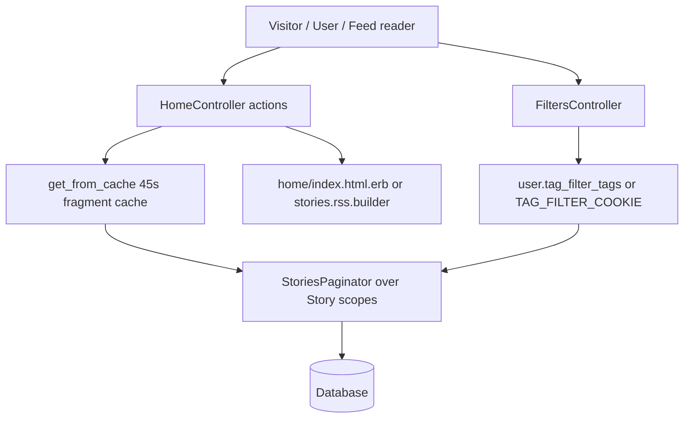
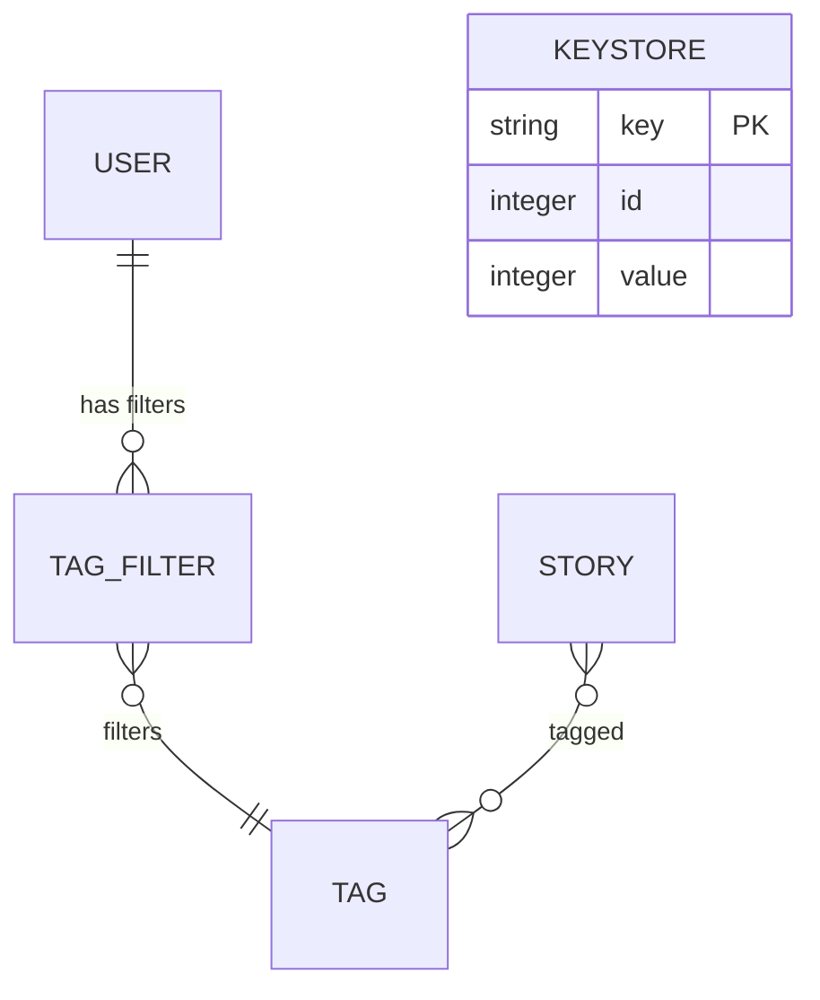

# Home Feed

> **Status**: ✅ Active
> **Generated**: 2026-10-24T00:00:00Z
> **Last Updated**: 2026-10-24T00:00:00Z
---

## Overview

### What It Does
The home-feed feature renders every story listing on the site: the hottest front page, Newest (with a per-user "last read" marker), Recent, Active, Top-by-interval, tag/multi-tag/category listings, domain and origin listings, newest-by-user, and the logged-in Saved / Upvoted / Hidden lists. All HTML listings render one shared view (`home/index`) parameterized by instance variables, and most listings also serve RSS 2.0 and JSON. The feature additionally includes per-user tag filtering (`FiltersController`), the shared `StoryFinder` concern, and the `Keystore` key/value model.

### Why It Exists
Story discovery is the core loop of a link-aggregation community: readers need multiple orderings (hot, new, active, top) and slices (tag, category, domain, origin, author) of the same story corpus, personalized by tag filters and hidden stories, and consumable from feed readers via tokenized private RSS.

### Key Capabilities
- Fourteen feed actions sharing one list view and one RSS builder
- Per-viewer tag filtering (account-backed or permanent cookie for anonymous visitors)
- Tokenized private RSS feeds that apply the user's filters
- Two-layer caching (page caching + 45-second fragment cache) for anonymous traffic
- "Last read" marker on Newest with cross-page carry-over
- Strict pagination bounds and all-or-nothing multi-tag/category lookup

---

## Architecture

### High-Level Design


### Components

#### Backend Components
| Component | File Path | Purpose |
|-----------|-----------|---------|
| HomeController | `app/controllers/home_controller.rb` | All feed actions, pagination, caching, RSS-token handling |
| FiltersController | `app/controllers/filters_controller.rb` | Tag-filter listing and update (user record or cookie) |
| StoryFinder (concern) | `app/controllers/concerns/story_finder.rb` | Shared story lookup by short_id (PK for admins), vote hydration |
| Keystore | `app/models/keystore.rb` | Generic key/value store; read-through cache used by TrafficHelper |

#### Frontend Components
| Component | File Path | Purpose |
|-----------|-----------|---------|
| Shared list view | `app/views/home/index.html.erb` | Story list (inlined copy of `stories/_listdetail`), Last Read divider, pagination nav |
| RSS builder | `app/views/home/stories.rss.builder` | RSS 2.0 rendition of any feed |
| Feed header partials | `app/views/home/_active.html.erb`, `_recent.html.erb`, `_top.html.erb`, `_single_tag.html.erb`, `_multi_tag.html.erb`, `_category.html.erb`, `_for_domain.html.erb`, `_for_origin.html.erb`, `_newest_by_user.html.erb` | Per-feed explanatory headers rendered as `@above`/`@below` |
| Filters page | `app/views/filters/index.html.erb` | Tag-filter table and Save Filters form |

### Technology Stack
- **Backend**: Rails controllers + ActiveRecord scopes (`Story.hottest/newest/active/recent/top/tagged/categories`, `StoriesPaginator`)
- **Frontend**: ERB views, RSS via `xml` builder
- **Database**: relational store behind ActiveRecord; `keystore` table with string primary key
- **External Services**: none (links out to Archive.org / Ghostarchive caches in the story row UI)

---

## Model Details

### Keystore

#### Associations
None — standalone table with `self.primary_key = "key"`.

#### Concerns
None included.

#### Callbacks
None; validations only:
```ruby
validates :key,
  presence: true,
  uniqueness: {case_sensitive: false},
  length: {maximum: MAX_KEY_LENGTH}
validates :id, presence: true
```

#### Key Methods
| Method | Returns | Purpose | Notes |
|--------|---------|---------|-------|
| `self.get(key)` | `Keystore` or nil | find_by key | |
| `self.value_for(key)` | value | `where(key:).pick(:value)` | |
| `self.put(key, value)` | `true` | validated upsert | raises `ActiveRecord::ValueTooLong` on keys > 50 chars |
| `self.incremented_value_for(key, amount = 1)` | new value | transactional upsert | `on_duplicate: Arel.sql("value = value + 1")` ignores `amount` on conflict |
| `self.decremented_value_for(key, amount = -1)` | new value | delegates to increment | same caveat |
| `self.find_or_create_key_for_update(key, init)` | `Keystore` | `lock(true)` loop, retries on `RecordNotUnique` | |
| `self.readthrough_cache(key, &blk)` | value | get-or-compute-and-put | deliberately no lock/transaction — hot path of every request (TrafficHelper) |

### StoryFinder (controller concern)
| Method | Returns | Purpose | Notes |
|--------|---------|---------|-------|
| `find_story` | `Story` or nil | lookup by `short_id` from `params[:story_id] \|\| params[:id]`; admins may also look up by PK | hydrates `story.current_vote` for logged-in users |
| `find_story!` | sets `@story` | raises `ActiveRecord::RecordNotFound` when absent | |

---

## Database Schema

### keystore

> Columns inferred from `app/models/keystore.rb` (schema file not part of this feature's mapped sources).

| Column | Type | Default | Notes |
|--------|------|---------|-------|
| `key` | string (≤ 50 chars) | — | primary key, case-insensitively unique |
| `id` | integer | — | NOT NULL (explicitly validated because it is not the PK) |
| `value` | integer/value | — | incremented via upsert |

### Relationships


---

## API Endpoints

> Paths shown per the URL helpers used in controller/views; all actions verified to exist in `HomeController` / `FiltersController`.

| Method | Path (helper) | Action | Description | Notes |
|--------|------|--------|-------------|-------|
| `GET` | `/` (+ `/page/:page`, `rss_url`) | `index` | Hottest stories | HTML/RSS/JSON; OG meta tags; anonymous RSS cached 2 min |
| `GET` | `newest_url` | `newest` | Newest stories | HTML/RSS/JSON; last-read marker; token private feed |
| `GET` | newest by user (`params[:user]`) | `newest_by_user` | A user's newest stories | 404 on unknown username |
| `GET` | recent | `recent` | Newest not yet on front page | HTML only; RSS link points at newest.rss |
| `GET` | active | `active` | Sorted by last comment | HTML/JSON |
| `GET` | `top_path(length:)` (`/top/1w`, RSS `/top/:param/rss`) | `top` | Top of a time interval | placeholder length redirects to `1w`; no JSON |
| `GET` | `tag_url(@tag)` | `single_tag` | Stories with one tag | related tags cached 1 day |
| `GET` | `multi_tag_url("a,b")` | `multi_tag` | Stories with several tags | 404 unless all tags exist |
| `GET` | `category_url("a,b")` | `category` | Stories by categories | 404 unless all categories exist |
| `GET` | `domain_url(@domain)` | `for_domain` | Stories from a domain | ordered `id: :desc` |
| `GET` | `origin_url(@origin)` | `for_origin` | Stories from an origin | ordered `id: :desc` |
| `GET` | hidden | `hidden` | Viewer's hidden stories | login required; HTML only |
| `GET` | `saved_url` | `saved` | Viewer's saved stories | login required; token private RSS |
| `GET` | `upvoted_stories_path` | `upvoted` | Viewer's upvoted stories | login required; `votes.id DESC` |
| `GET` | `filters_path` | `FiltersController#index` | Tag-filter table | session kept alive for CSRF |
| `POST` | `/filters` | `FiltersController#update` | Save filters | user record or permanent cookie |

---

## Authorization (Pundit)

No Pundit policies in this feature. Access control is via controller filters:

| Mechanism | Scope | Conditions | Notes |
|--------|------------|------------|-------|
| `require_logged_in_user` | `hidden`, `saved`, `upvoted` | logged-in session | |
| `find_user_from_rss_token` | `index`, `newest`, `saved`, `upvoted` | valid `token` param | RSS private feeds; title "Private feed for <username>" |
| `tag.user_can_filter?(@user)` | filter update + checkbox display | per-tag rule | non-filterable tags silently dropped |
| `@user&.is_admin?` | `StoryFinder#find_story` | admin only | PK lookup convenience without permitting enumeration |
| `@user&.is_moderator?` | views | mod edit links; domain/origin Edit links | |

---

## Configuration

### Environment Variables
```bash
# No feature-specific ENV vars found in the mapped sources.
```

### Config Files / Constants
- `CACHE_PAGE` — condition for `caches_page` on the eleven public listing actions
- `TAG_FILTER_COOKIE` — permanent cookie name holding comma-joined filtered tag names for anonymous visitors
- `Keystore::MAX_KEY_LENGTH = 50`

---

## Usage Examples

### Fragment caching of anonymous listings
```ruby
# Source: app/controllers/home_controller.rb:373
def get_from_cache(opts = {}, &)
  # don't cache if there's a user because they can have hidden stories; visitors can filter tags by cookie
  if Rails.env.development? || @user || filtered_tags.any?
    yield
  else
    key = opts.merge(page: page).sort.map { |k, v| "#{k}=#{v.to_param}" }.join(" ")
    begin
      Rails.cache.fetch("stories #{key}", expires_in: 45, &)
    rescue Errno::ENOENT => e
      # Rails.logger.error "error fetching stories #{key}: #{e}"
      yield
    end
  end
end
```

### Page bounds
```ruby
# Source: app/controllers/home_controller.rb:359
def page
  p = params[:page].to_i
  if p == 0
    p = 1
  elsif p < 0 || p > (2**32)
    raise ActionController::RoutingError.new("page out of bounds")
  end
  p
end
```

### Filter update (user vs cookie)
```ruby
# Source: app/controllers/filters_controller.rb:24
def update
  new_tags = Tag.active.where(tag: (params[:tags] || {}).keys).to_a
  new_tags.keep_if { |t| t.user_can_filter? @user }

  if @user
    @user.tag_filter_tags = new_tags
  else
    cookies.permanent[TAG_FILTER_COOKIE] = new_tags.map(&:tag).join(",")
  end

  flash[:success] = "Your filters have been updated."

  redirect_to filters_path
end
```

---

## Testing

### Test Files
- `spec/controllers/home_controller_spec.rb`
- `spec/requests/home_spec.rb`
- `spec/models/keystore_spec.rb`

---

## Known Issues & Caveats

| Issue | Location | Description |
|-------|----------|-------------|
| Cache-key collision | `home_controller.rb:29,153` | `hidden` and `saved` both use `get_from_cache(hidden: true)`; harmless only because logged-in requests bypass the cache |
| Ignored amount on conflict | `keystore.rb:38` | `incremented_value_for`'s `on_duplicate` SQL is hardcoded to `value = value + 1`, ignoring `amount` for existing keys |
| Hand-built RSS URL | `home_controller.rb:322` | top RSS href is the string `"/top/#{length[:param]}/rss"`, not a route helper |
| Inlined partial | `home/index.html.erb:14` | `stories/_listdetail` is copied inline (`heinous_inline_partial`); edits must go to the named partial |
| Swallowed cache errors | `home_controller.rb:381` | `Errno::ENOENT` from the cache store is rescued silently (logger line commented out) |
| Commented-out code | `home_controller.rb:382` | `Rails.logger.error` for cache fetch failures is commented out |
| Unstable list | `home_controller.rb:146-147` | recent's RSS link intentionally points at `/newest.rss` because upvoted stories leave the recent list |

---

## Performance

### Optimization Strategies
- Single shared view + per-action partials; avoids N view templates
- Filters page computes tag/story counts with three separate grouped queries instead of a join ("perf: three queries is much faster", `filters_controller.rb:17`)
- `upvoted` uses `includes(:tags)` to avoid N+1
- Anonymous requests short-circuit to caches at two layers

### Caching
- **Cache Layer**: `caches_page` (eleven actions, `if: CACHE_PAGE`) + `Rails.cache`
- **TTL**: 45 s story fragments; 120 s anonymous front-page RSS; 1 day related tags (`related_<tag>`)

### Database Optimization
- `keystore.key` unique (case-insensitive) primary key, max 50 chars
- Domain/origin listings ordered by `id: :desc` (PK index walk)

---

## Troubleshooting

### Common Issues

#### Issue: Stories missing from feeds for one viewer
**Symptoms:**
- A story visible to others does not appear for a specific visitor/user

**Cause:**
Viewer has the story's tag filtered (account `tag_filter_tags` or `TAG_FILTER_COOKIE`), or hid the story.

**Solution:**
Review `/filters`, untick the tag, **Save Filters**; or unhide via the Hidden list.

#### Issue: 404 on multi-tag or category URLs
**Symptoms:**
- `ActiveRecord::RecordNotFound` on comma-separated tag/category paths

**Cause:**
Every comma-separated name must resolve; counts are compared (`raise ... unless @tags.length == tag_params.length`).

**Solution:**
Fix the tag/category spelling; only active, existing names work.

#### Issue: "page out of bounds" routing error
**Cause:** `params[:page]` negative or > 2**32.
**Solution:** Expected guard, typically crawler noise; no fix needed.

---

## Related Features

- **stories** — provides `Story` scopes (`hottest`, `newest`, `active`, `recent`, `top`, `tagged`, `categories`), `StoriesPaginator`, hiding/saving used by the personal lists
- **tags-categories** — `Tag`, `TagFilter`, `Category` power tag/category feeds and filtering
- **domains-origins** — `Domain`/`Origin` records behind `for_domain`/`for_origin`
- **comments** — the comments RSS feed advertised on the front page; active feed sorts by last comment
- **users** — `newest_by_user`, RSS tokens, `last_read_newest_story`

---

**Generated:** 2026-10-24T00:00:00Z
**Last Updated:** 2026-10-24T00:00:00Z
**Status:** ✅ Active
