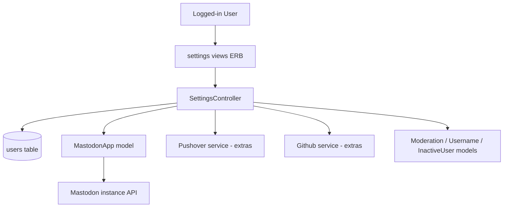
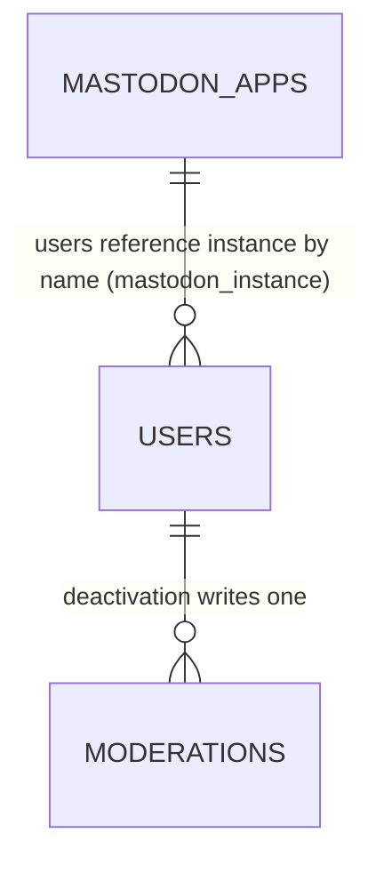

# Settings

> **Status**: ✅ Active
> **Generated**: 2026-10-24T00:00:00Z
> **Last Updated**: 2026-10-24T00:00:00Z
---

## Overview

### What It Does
The settings feature gives every logged-in Lobsters user a single page (`/settings`) to manage their account: public profile fields (username, email, homepage, about), password, notification preferences for replies/mentions/private messages, mailing-list delivery mode, appearance preferences (color scheme, contrast, previews, avatars), two-factor authentication via TOTP, external-account integrations (Gravatar cache, Pushover, Mastodon, GitHub), invitation sending, and self-service account deactivation.

### Why It Exists
A community site needs a self-service surface where members control their identity, security, and notification volume without moderator involvement. The deactivation flow additionally lets users leave on their own terms (optionally disowning content) while preserving site integrity (usernames stay reserved, stories are kept).

### Key Capabilities
- Edit profile, password (with current-password check and session rotation), and notification preferences
- Enroll in / disable TOTP two-factor authentication with QR-code provisioning
- Subscribe to Pushover and link/unlink Mastodon and GitHub accounts via OAuth
- Receive site content by e-mail (mailing-list mode) through a private per-user list address
- Deactivate the account with optional disowning of stories and comments

---

## Architecture

### High-Level Design


### Components

#### Backend Components
| Component | File Path | Purpose |
|-----------|-----------|---------|
| SettingsController | `app/controllers/settings_controller.rb` | All 17 actions: index/update/deactivate, 5 TOTP actions, Pushover, Mastodon, GitHub flows |
| MastodonApp | `app/models/mastodon_app.rb` | Per-instance OAuth client registration, token exchange, revocation |

Collaborators referenced from the controller (owned by other features): `User` (authenticate, roll_session_token, has_2fa?, disable_2fa!, authenticate_totp, delete!), `Username.rename!`, `InactiveUser.disown_all_by_author!`, `Moderation.create!`, and the `extras/` service wrappers `Pushover`, `Github`, `Sponge`.

#### Frontend Components
| Component | File Path | Purpose |
|-----------|-----------|---------|
| Settings form | `app/views/settings/index.html.erb` | Main multi-section settings form, external accounts, invite, deactivate |
| 2FA start | `app/views/settings/twofa.html.erb` | Password confirmation to enroll or disable |
| 2FA enroll | `app/views/settings/twofa_enroll.html.erb` | QR code (SVG) + manual secret reveal |
| 2FA verify | `app/views/settings/twofa_verify.html.erb` | Six-digit TOTP code entry |
| Mastodon start | `app/views/settings/mastodon_authentication.html.erb` | Instance name/URL entry form |

### Technology Stack
- **Backend**: Ruby on Rails controller/model, `ROTP` (TOTP secrets and verification), `RQRCode` (SVG QR codes), `SecureRandom` (OAuth state nonces), `Sponge` HTTP client
- **Frontend**: Server-rendered ERB forms (`form_with`), no JavaScript component
- **Database**: MySQL (`users`, `mastodon_apps`)
- **External Services**: Pushover subscription API, Mastodon OAuth + apps API per instance, GitHub OAuth

---

## Model Details

### MastodonApp

#### Associations
None — standalone table keyed by instance `name`.

#### Concerns
None included.

#### Callbacks
None; `register_app!` is an explicit imperative method, not a callback.

#### Validations
```ruby
validates :name, :client_id, :client_secret,
  presence: true,
  length: {maximum: 255}
validates :name, uniqueness: {case_sensitive: false}
```

#### Key Methods
| Method | Returns | Purpose | Notes |
|--------|---------|---------|-------|
| `oauth_auth_url(state)` | `String` | Authorize URL on the instance with `scope=read:accounts` and CSRF `state` | |
| `redirect_uri` | `String` | `https://<domain>/settings/mastodon_callback?instance=<name>` | |
| `register_app!` | `true`/nil | POST `https://<name>/api/v1/apps` to obtain client_id/secret | Raises if already registered; adds model errors for DNS/SSL/JSON/URI failures |
| `token_and_user_from_code(code)` | `[token, username]` or `[nil, nil]` | Code→token at `/oauth/token`, then username via `/api/v1/accounts/verify_credentials` | |
| `revoke_token(token)` | `true`/`false` | POST `/oauth/revoke`; true when response is `{}` | Returns true on server timeout (Sponge nil) |
| `self.find_or_register(instance_name)` | `MastodonApp`/nil | Sanitizes name, finds existing row or registers a new app | |
| `self.sanitized_instance_name(name)` | `String` | Accepts hostname, URL, or `@user@host` and extracts the hostname | strip → delete `https://` prefix → before first `/` → after last `@` |

### User (settings-relevant surface)
The controller persists these user attributes: credentials (`password`, with `roll_session_token` on change), `totp_secret` (via the 2FA flow), `pushover_user_key`, `mastodon_oauth_token` / `mastodon_username` / `mastodon_instance`, `github_oauth_token` / `github_username`, and the preference fields in `user_params`. Most preference fields live in the serialized `users.settings` text column rather than dedicated columns.

---

## Database Schema

### mastodon_apps

| Column | Type | Default | Notes |
|--------|------|---------|-------|
| `id` | `bigint` | auto | Primary key |
| `name` | `string` | — | `null: false`; unique index (`index_mastodon_apps_on_name`) |
| `client_id` | `string` | — | `null: false` |
| `client_secret` | `string` | — | `null: false` |
| `created_at` | `datetime` | — | `null: false` |
| `updated_at` | `datetime` | — | `null: false` |

### users (columns this feature reads/writes)

| Column | Type | Default | Notes |
|--------|------|---------|-------|
| `username` | `string(50)` | — | unique index `username`; renames logged via `Username.rename!` |
| `email` | `string(100)` | — | unique index |
| `password_digest` | `string(75)` | — | checked by `authenticate` |
| `session_token` | `string(75)` | `""` | rotated on password change and 2FA enable |
| `about` | `mediumtext` | — | profile field |
| `pushover_mentions` | `boolean` | `false` | `null: false` |
| `mailing_list_token` | `string(75)` | — | unique index; forms the private list address |
| `mailing_list_mode` | `integer` | `0` | indexed (`mailing_list_enabled`); 0=no e-mails, 1=stories+comments, 2=stories only |
| `show_email` | `boolean` | `false` | `null: false` |
| `settings` | `mediumtext` | — | serialized store for remaining preferences (color scheme, contrast, totp_secret, integration fields, etc.) |
| `deleted_at` | `datetime` | — | set by `delete!` on deactivation |
| `disabled_invite_at/_by_user_id/_reason` | — | — | drive the "cannot send invitations" message |

### Relationships


---

## API Endpoints

| Method | Path | Action | Description | Notes |
|--------|------|--------|-------------|-------|
| `GET` | `/settings` | `index` | Render settings form (`@edit_user = @user.dup`) | |
| `POST` | `/settings` | `update` | Save settings; always re-renders `index` | Password change requires `current_password` |
| `POST` | `/settings/deactivate` | `deactivate` | Delete account (requires password + "I am sure") | `as: deactivate` |
| `GET` | `/settings/2fa` | `twofa` | Password prompt to enroll/disable | `as: twofa` |
| `POST` | `/settings/2fa_auth` | `twofa_auth` | Verify password; disable 2FA or continue to enroll | |
| `GET` | `/settings/2fa_enroll` | `twofa_enroll` | Generate secret + QR code | 15-minute window |
| `GET` | `/settings/2fa_verify` | `twofa_verify` | TOTP code entry form | 15-minute window |
| `POST` | `/settings/2fa_update` | `twofa_update` | Verify code, enable 2FA, re-roll session | |
| `POST` | `/settings/pushover_auth` | `pushover_auth` | Redirect to Pushover subscription | guarded by `Pushover.enabled?` |
| `GET` | `/settings/pushover_callback` | `pushover_callback` | Store `pushover_user_key` | raises on `rand` mismatch |
| `GET` | `/settings/mastodon_authentication` | `mastodon_authentication` | Instance entry form | |
| `GET` | `/settings/mastodon_auth` | `mastodon_auth` | Register/find app, redirect to instance OAuth | state nonce in session |
| `GET` | `/settings/mastodon_callback` | `mastodon_callback` | Exchange code, link account | validates `state` |
| `POST` | `/settings/mastodon_disconnect` | `mastodon_disconnect` | Revoke token (best-effort), clear fields | |
| `GET` | `/settings/github_auth` | `github_auth` | Redirect to GitHub OAuth | state nonce in session |
| `GET` | `/settings/github_callback` | `github_callback` | Exchange code, link account | validates `state` |
| `POST` | `/settings/github_disconnect` | `github_disconnect` | Revoke GitHub token, clear fields | manual-cleanup notice on API error |

---

## Authorization

Lobsters does not use Pundit; authorization here is session-based.

| Guard | Scope | Conditions | Notes |
|-------|-------|------------|-------|
| `require_logged_in_user` | all actions | logged-in session required | `before_action` |
| current password | `update` (password change), `deactivate`, `twofa_auth` | `@user.authenticate(...)` must pass | |
| `i_am_sure == "1"` | `deactivate` | checkbox must be ticked | |
| 15-minute window | `twofa_enroll`, `twofa_verify`, `twofa_update` | `session[:last_authed]` within `TOTP_SESSION_TIMEOUT` (900 s) | |
| OAuth `state` nonce | Pushover/Mastodon/GitHub callbacks | session nonce must match param | Pushover mismatch raises |
| `@user.can_invite?` | invite form visibility | otherwise shows `disabled_invite_reason` | |

---

## Configuration

### Environment Variables
None read directly by this controller; integrations are configured via the service wrappers and application config:

- `Pushover.enabled?` — gates the Pushover row and `pushover_auth`
- `Github.enabled?`, `Mastodon.enabled?` — gate the External Accounts rows
- `Rails.application.name` — TOTP issuer in the provisioning URI
- `Rails.application.domain` / `root_url` / `shortname` — OAuth redirect URIs and the mailing-list address

### Config Files
- Service credentials for Pushover/GitHub live with the `extras/` wrappers (outside this feature's files)

---

## Usage Examples

### Guarding a password change and rotating sessions
```ruby
# Source: app/controllers/settings_controller.rb (update)
if params[:user][:password].empty? ||
    @user.authenticate(params[:current_password].to_s)
  @edit_user.roll_session_token if params[:user][:password]
  if @edit_user.update(user_params)
    if @edit_user.username_changed?
      Username.rename!(
        user: @edit_user,
        from: @edit_user.changed_atributes[:username],
        to: @edit_user.username,
        by: @user
      )
    end
    session[:u] = @user.session_token if params[:user][:password]
    flash.now[:success] = "Successfully updated settings."
    @user = @edit_user
  end
else
  flash[:error] = "Your current password was not entered correctly."
end
```

### Enabling 2FA after TOTP verification
```ruby
# Source: app/controllers/settings_controller.rb (twofa_update)
@user.totp_secret = session[:totp_secret]
if @user.authenticate_totp(params[:totp_code])
  # re-roll, just in case
  @user.session_token = nil
  @user.save!

  session[:u] = @user.session_token

  flash[:success] = "Two-Factor Authentication has been enabled on your account."
  session.delete(:totp_secret)
  redirect_to "/settings"
else
  flash[:error] = "Your TOTP code was invalid, please verify the " \
    "current code in your TOTP application."
  redirect_to twofa_verify_url
end
```

### Normalizing a user-supplied Mastodon instance
```ruby
# Source: app/models/mastodon_app.rb
# user may input hostname (foo.social), url (https://foo.social/@user), or user (@user@foo.social)
# extract hostname from possible URL
def self.sanitized_instance_name(instance_name)
  instance_name
    .to_s
    .strip
    .delete_prefix("https://")
    .split("/").first
    .split("@").last
end
```

---

## Testing

### Test Files
- `spec/requests/settings_spec.rb`
- `spec/features/settings_spec.rb`
- `spec/models/mastodon_app_spec.rb`

---

## Known Issues & Caveats

| Issue | Location | Description |
|-------|----------|-------------|
| Misspelled method dependency | `settings_controller.rb:46` | `@edit_user.changed_atributes[:username]` (sic) — the rename source value relies on this misspelled method name |
| Raise instead of error page | `settings_controller.rb:174` | `pushover_callback` raises on `rand` mismatch → 500 for a tampered/stale callback |
| Cosmetic checkbox | `index.html.erb` | "Receive E-mail for ModMail" renders `email_messages` with `disabled: true, checked: true`; there is no `modmail_messages` param — moderator mail is always e-mailed |
| State-changing GETs | `routes.rb:189–193` | `mastodon_auth`, `mastodon_callback`, `github_auth`, `github_callback`, `pushover_callback` mutate state on GET; the `state`/`rand` nonce is the only CSRF guard |
| Swallowed revocation errors | `settings_controller.rb:230` | Mastodon disconnect ignores networking exceptions by design ("indie instances often disappear") |
| Conditional flash | `mastodon_disconnect` | success flash only set `if flash.empty?` because the action doubles as failed-auth teardown |

---

## Performance

### Optimization Strategies
- `@user.dup` / `@user.clone` keep form state off the session user until save succeeds
- Mastodon app registration happens once per instance; subsequent links reuse the `mastodon_apps` row

### Caching
- **Cache Layer**: Avatar images are cached from Gravatar; users expire via `/avatars/expire`
- **TTL**: n/a for settings itself

### Database Optimization
- Indexes: unique `mastodon_apps.name`; unique `users.username`, `users.email`, `users.session_token`, `users.mailing_list_token`; `users.mailing_list_mode` indexed for mailing-list fan-out

---

## Troubleshooting

### Issue: "Your enrollment period timed out."
**Symptoms:**
- User bounced from enroll/verify back to `/settings/2fa`

**Cause:**
More than 15 minutes (`TOTP_SESSION_TIMEOUT`) since password confirmation, or the session lost `totp_secret`.

**Solution:**
Restart at `/settings/2fa`; complete scan + code entry within 15 minutes.

### Issue: "Invalid OAuth state" on Mastodon/GitHub callback
**Symptoms:**
- Redirected back to `/settings` with the error flash

**Cause:**
`params[:state]` does not match the session nonce (stale tab, replay, or cookies cleared mid-flow).

**Solution:**
Restart the connect flow in one browser session.

### Issue: Settings save rejected with "Your current password was not entered correctly."
**Symptoms:**
- Form re-renders, nothing saved

**Cause:**
A new password was supplied but `current_password` failed `authenticate`.

**Solution:**
Enter the correct current password, or clear the new-password fields when only changing preferences.

---

## Related Features

- **authentication** — login/2FA verification at login time consumes the `totp_secret` set here
- **inbox-notifications / messages / comments** — honor the notification checkboxes saved here
- **users** — profile page displays the fields and linked accounts; avatars come from the Gravatar cache
- **signup-invitations** — the invite form embedded on `/settings`
- **moderation** — username renames and deactivations write modlog entries

---

**Generated:** 2026-10-24T00:00:00Z
**Last Updated:** 2026-10-24T00:00:00Z
**Status:** ✅ Active
