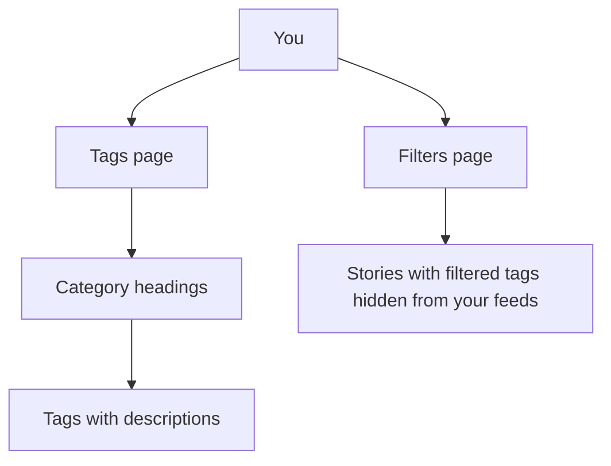

# Tags & Categories

> **Status**: ✅ Active
> **Generated**: 2026-10-24T00:00:00Z
> **Last Updated**: 2026-10-24T00:00:00Z
---

## Overview

### What It Does
Tags are short topic labels attached to every story on the site; categories group related tags together. The Tags page lists every tag under its category so you can browse topics, follow the ones you like, and filter out the ones you don't — filtering works even without an account.

### Why It Exists
Readers want to find stories about their interests and avoid topics they don't care about. A small, curated set of tags keeps story labelling consistent and browsable.

### Key Capabilities
- Browse the full tag directory, grouped by category, each tag with a short description
- Read stories for one tag, or several at once via `/t/tag1,tag2`
- Read stories for whole categories, or several via `/categories/foo,bar`
- Filter out stories by tag — no account required
- See at a glance which tags are inactive (retired) or filtered by you

---

## Architecture

### High-Level Design

### Components

#### What you see
| Component | Where | Purpose |
|-----------|-------|---------|
| Tags page | `/tags` | All tags grouped under category headings, alphabetical |
| Tag links | each tag name | Open all stories carrying that tag |
| Category links | each heading | Open stories across the category |
| "filtered" marker | next to a tag | Shows you currently filter it; links to your filter settings |
| *inactive* marker | next to a tag | Tag is retired and can't be used on new stories |

#### Frontend Components
| Component | Where | Purpose |
|-----------|-------|---------|
| Filters link | top of Tags page | "You can filter out stories by tag, even if you don't have an account." |

### Technology Stack
Not applicable for readers — everything works in your browser with no setup.

---

## Model Details

### Tag (what a tag is)
- A short name: up to 25 characters — letters, numbers, underscores, hyphens, or plus signs
- A one-line description (up to 100 characters) shown on the Tags page
- Belongs to exactly one category
- Status flags you may notice:
  | Flag | What it means for you |
  |------|----------------------|
  | inactive | Can't be used on new stories any more; kept for old stories |
  | privileged | Only moderators can apply (or filter) it |
  | new-user restricted | Brand-new accounts can't use it when submitting |
  | media | Marks a media-type tag, styled differently |
  | hotness modifier | Small boost or penalty to how stories with this tag rank |

### Category (what a category is)
- A short unique name (up to 25 characters; capitalisation doesn't create a different category)
- Groups tags; every tag has exactly one category
- Shown as headings on the Tags page with its tags listed alphabetically

### Related tags
For any tag, the site can suggest up to eight other tags that most often appear on the same stories (generic catch-all and media tags are excluded from suggestions).

---

## Database Schema

Not applicable for customers — your filters and the tag list are stored for you automatically; nothing to manage.

---

## API Endpoints

| What | Address | Notes |
|------|---------|-------|
| Tag directory | `/tags` | The page you browse |
| Machine-readable list | `/tags` (JSON) | Name, description, category, and status for every tag |
| Stories for tags | `/t/tag1,tag2` | One or more tags, comma-separated |
| Stories for categories | `/categories/foo,bar` | One or more categories |
| Your filters | `/filters` | Choose tags to hide from your feeds |

---

## Authorization

| Action | Who can do it |
|--------|---------------|
| Browse tags and categories | Everyone |
| Filter stories by tag | Everyone, even logged out |
| Filter a privileged tag | Moderators only |
| Apply a privileged tag to a story | Moderators only |
| Use certain tags as a brand-new account | Restricted for some tags |
| Create or edit tags and categories | Site administrators/moderators |

---

## Configuration

Nothing to configure. Your only personal setting is your tag filter list on the Filters page.

---

## Usage Examples

### Hide a topic you don't want to see
1. Open the Tags page and spot the tag.
2. Follow the filters link (top of the page or the "filtered" marker) to your filter settings.
3. Add the tag to your filters — stories with that tag disappear from your feeds.

### Read two topics at once
Visit `/t/tag1,tag2` (replace with the real tag names) to see stories from both tags in one list. The same works for categories at `/categories/foo,bar`.

---

## Testing

Not applicable for customers.

---

## Known Issues & Caveats

| Note | Description |
|------|-------------|
| Tags aren't deleted | Retired tags are marked *inactive* rather than removed, so old stories keep their labels |
| Privileged tags | You may see tags you cannot apply or filter; these are moderator-managed |
| New accounts | Some tags are unavailable until your account is established; you'll get a clear error if you try |
| Renames change addresses | Tag and category web addresses use their names, so a rename changes the link |

---

## Performance

The Tags page is a single lightweight listing; no action needed on your side.

---

## Troubleshooting

### I can't use a tag on my story
**Cause:** the tag is privileged (moderator-only), inactive (retired), or restricted for new accounts.
**Solution:** pick an alternative tag, or ask a moderator to apply the privileged tag.

### A tag I filtered still shows as a name on the Tags page
**Cause:** filtering hides *stories* from your feeds; the tag itself stays listed (marked "filtered").
**Solution:** this is expected — use the "filtered" link to review your filter list.

### I filtered tags without an account and they reset
**Cause:** logged-out filters are remembered by your browser session.
**Solution:** create an account to keep filters permanently across devices.

---

## Related Features

- **Story submission** — you pick tags when submitting a story
- **Home feeds** — tag and category feeds, plus your filters shaping what you see
- **Moderation log** — every tag/category change made by staff is publicly recorded

---

**Generated:** 2026-10-24T00:00:00Z
**Last Updated:** 2026-10-24T00:00:00Z
**Status:** ✅ Active
