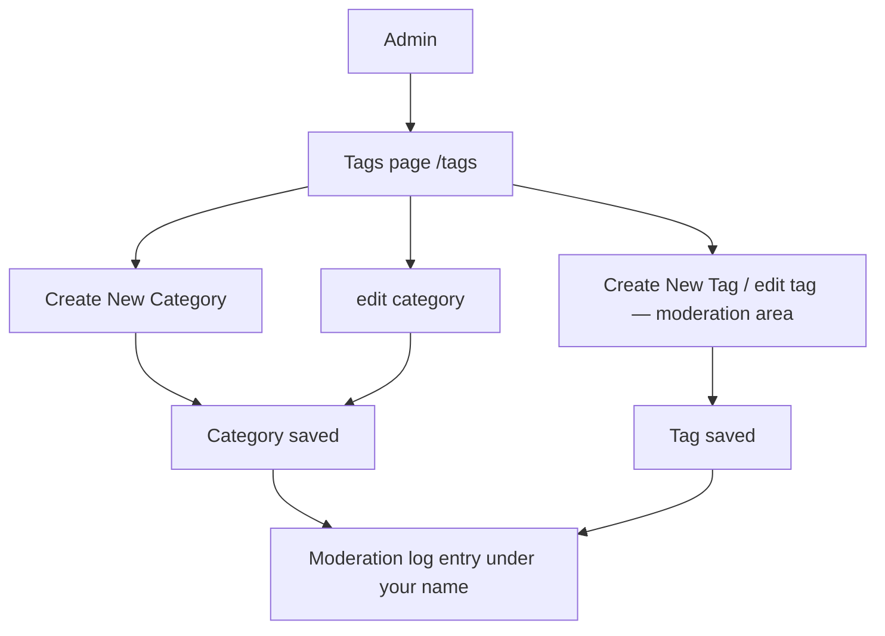

# Tags & Categories

> **Status**: ✅ Active
> **Generated**: 2026-10-24T00:00:00Z
> **Last Updated**: 2026-10-24T00:00:00Z
---

## Overview

### What It Does
This manual is for operations staff (administrators and moderators) who maintain the site's taxonomy: the tags readers apply to stories and the categories that group those tags. It covers reviewing the directory, creating and renaming categories, managing tag flags, and the audit trail behind every change.

### Why It Exists
A consistent, curated taxonomy keeps story labelling useful. Operations staff are the only people who can change it, and every change is publicly logged.

### Key Capabilities
- Review the full taxonomy on the **Tags** page (`/tags`)
- Create categories (**Create New Category**) and rename them (**edit** next to each heading)
- Reach tag creation/editing via **Create New Tag** and per-tag **edit** links (moderation area)
- Control tag availability with flags: active, privileged, new-user permission, media, hotness modifier
- Rely on the moderation log: every save is recorded with your name, field by field

---

## Architecture

### High-Level Design

### Components

#### Screens you use
| Screen | How to reach it | Purpose |
|--------|-----------------|---------|
| Tags page | `/tags` | Directory of all categories and tags; your admin links appear here |
| Create Category | **Create New Category** at page bottom | One **Name** field, **Create Category** button |
| Edit Category | **edit** beside a category heading | Same form, **Update Category** button |
| Tag screens | **Create New Tag** / per-tag **edit** | Tag management (moderation area) |

#### Frontend Components
Admin-only links are hidden from ordinary users; if you don't see them, you are not signed in as an administrator.

### Technology Stack
Browser only; no tooling required.

---

## Model Details

### Category rules
| Rule | Value |
|------|-------|
| Name length | up to 25 characters |
| Allowed characters | letters, digits, underscore, hyphen (no spaces, no `+`) |
| Uniqueness | case-insensitive — `Culture` and `culture` collide |
| Deletion | not possible while the category holds tags; no delete button exists |
| Address | the category's web address is its name — renaming changes the link |

### Tag rules
| Rule | Value |
|------|-------|
| Name length | up to 25 characters |
| Allowed characters | letters, digits, underscore, hyphen, plus |
| Uniqueness | case-sensitive |
| Description | up to 100 characters, shown on the Tags page |
| Category | exactly one, required |

### Tag flags
| Flag | Effect |
|------|--------|
| active | Off = retired: unusable on new stories, still displayed marked *inactive* |
| privileged | Only moderators can apply or filter the tag |
| permit by new users | Off = brand-new accounts can't use the tag |
| is media | Media-type tag; styled differently; excluded from related-tag suggestions |
| hotness mod | Whole number −10 to +10 adjusting story ranking for the tag |

---

## Database Schema

Not needed for day-to-day operations; data entry happens only through the screens above. Remember that filters users set against a tag, the tag's moderation history, and pending tag suggestions all block deletion — retire (deactivate) instead.

---

## API Endpoints

| Task | Address / control |
|------|-------------------|
| Review directory | `/tags` |
| Audit/scripting | `/tags` as JSON — name, description, category, flags per tag |
| New category | **Create New Category** → **Create Category** |
| Rename category | **edit** by heading → **Update Category** |
| Tag management | **Create New Tag** / per-tag **edit** (moderation area) |

---

## Authorization

| Task | Required role |
|------|---------------|
| View `/tags` | none (public) |
| Category create/edit screens | Administrator (enforced; non-admins are rejected) |
| Tag create/edit | Moderation-area access |
| Applying privileged tags | Moderator |

---

## Configuration

No settings or environment preparation needed; sign in with an admin account.

---

## Usage Examples

### Create a category
1. Open `/tags`, click **Create New Category**.
2. Enter **Name** (≤25 chars; letters/digits/underscore/hyphen; unique ignoring case).
3. Click **Create Category**.
4. Expected result: you return to the Tags page with "Category *name* has been created", and the moderation log records the creation.

### Rename a category
1. On `/tags`, click **edit** next to the heading.
2. Change **Name**, click **Update Category**.
3. Expected result: "Category *name* has been updated" on the Tags page. If invalid, you are returned to the edit form with the error message; fix and retry.
4. Warning: the category's address changes with its name; old links break.

### Retire a tag
1. Open the tag's **edit** screen from `/tags`.
2. Turn off *active*, save.
3. Expected result: the tag shows *inactive* on the Tags page and can no longer be used on new stories; existing stories keep it.

---

## Testing

After any change, reload `/tags` and confirm the new name/flag appears as intended, then check the moderation log entry attributed to you.

---

## Known Issues & Caveats

| Issue | Description |
|-------|-------------|
| Invalid category creation errors hard | A rule-breaking name on **Create Category** produces an application error rather than an inline message — validate the name before submitting |
| Everything is public | Each saved change is written to the public moderation log with old → new values under your name |
| No deletes | Neither tags nor categories have a delete workflow; deactivate tags, keep categories |
| Case rules differ | Category names collide ignoring case; tag names are case-sensitive |

---

## Performance

The Tags page loads everything in one view; no operational tuning required.

---

## Troubleshooting

### Category screens refuse access
**Symptoms:** you are redirected or rejected opening new/edit category pages.
**Cause:** your account is not an administrator.
**Solution:** sign in as an admin.

### Error creating a category
**Cause:** name too long, invalid characters (spaces, `+`), or duplicate ignoring case.
**Solution:** correct the name and resubmit.

### "Category not updated: …" after rename
**Cause:** the new name violates the same rules.
**Solution:** fix the listed problem on the edit form and save again.

### Users report a tag can't be applied
**Cause:** tag is privileged, inactive, or blocked for new accounts.
**Solution:** apply it for them (if privileged), re-activate it, or advise an alternative.

---

## Related Features

- **Moderation** — tag create/edit screens and the public log of your changes
- **Stories** — where tags are applied at submission
- **Home feeds / Filters** — user-facing tag and category feeds, user filter lists

---

**Generated:** 2026-10-24T00:00:00Z
**Last Updated:** 2026-10-24T00:00:00Z
**Status:** ✅ Active
