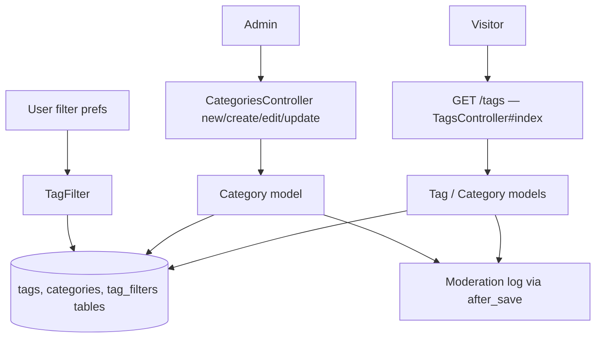
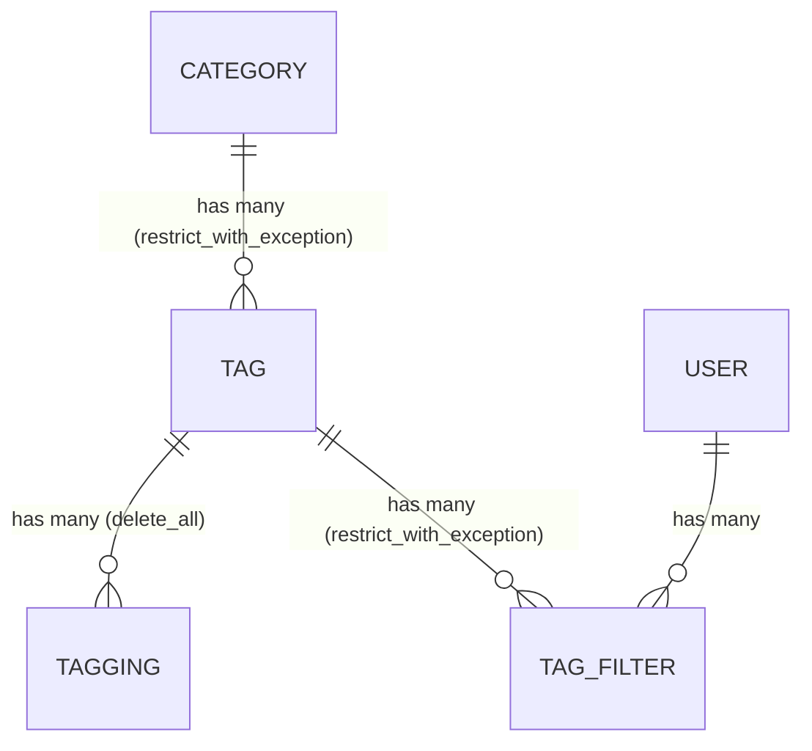

# Tags & Categories

> **Status**: ✅ Active
> **Generated**: 2026-10-24T00:00:00Z
> **Last Updated**: 2026-10-24T00:00:00Z
---

## Overview

### What It Does
Provides the site's story taxonomy: tags (short keywords applied to stories) grouped into categories (one category per tag). Includes the public tags listing page (HTML and JSON), per-user tag filtering support (`TagFilter`), and admin-only category creation and editing. Tag create/edit screens themselves live in the moderation namespace; this feature owns the domain models and the public listing.

### Why It Exists
Readers need to discover stories by topic and hide topics they don't care about; moderators need a controlled, audited vocabulary so story labelling stays consistent across the site.

### Key Capabilities
- Public, categorized tag directory at `/tags` with JSON representation
- Per-user story filtering by tag (works for logged-out visitors; see intro text on the index)
- Admin category creation and renaming with flash feedback
- Full audit trail: every tag/category save writes a `Moderation` log entry
- Tag flags controlling usage: `active`, `privileged`, `permit_by_new_users`, `is_media`, plus `hotness_mod` ranking modifier (−10..10)
- Related-tag discovery (top 8 co-occurring tags)

---

## Architecture

### High-Level Design


### Components

#### Backend Components
| Component | File Path | Purpose |
|-----------|-----------|---------|
| TagsController | `app/controllers/tags_controller.rb` | Public tags index, HTML + JSON |
| CategoriesController | `app/controllers/categories_controller.rb` | Admin category new/create/edit/update |
| Tag | `app/models/tag.rb` | Tag model: validations, flags, scopes, audit callback |
| Category | `app/models/category.rb` | Category model: validations, audit callback |
| TagFilter | `app/models/tag_filter.rb` | Join model user ⇄ tag for filtering |

#### Frontend Components
| Component | File Path | Purpose |
|-----------|-----------|---------|
| Tags index | `app/views/tags/index.html.erb` | Category-grouped tag listing with admin links |
| Multi-tag tip | `app/views/tags/_multi_tag_tip.html.erb` | Hint: `/t/tag1,tag2` |
| Category form | `app/views/categories/_form.html.erb` | Shared new/edit form (single Name field) |
| Multi-category tip | `app/views/categories/_multi_category_tip.html.erb` | Hint: `/categories/foo,bar` |
| New/Edit wrappers | `app/views/categories/new.html.erb`, `edit.html.erb` | Render the shared form |

### Technology Stack
- **Backend**: Ruby on Rails controllers/ActiveRecord models
- **Frontend**: ERB server-rendered views
- **Database**: relational tables `tags`, `categories`, `tag_filters` (via ActiveRecord)
- **External Services**: none

---

## Model Details

### Tag

#### Associations
```ruby
belongs_to :category
has_many :taggings, dependent: :delete_all
has_many :stories, through: :taggings
has_many :tag_filters, dependent: :restrict_with_exception
has_many :filtering_users,
  class_name: "User",
  through: :tag_filters,
  source: :user,
  dependent: :delete_all
has_one :moderation, dependent: :restrict_with_exception
has_many :suggested_taggings, dependent: :restrict_with_exception
```

#### Concerns
| Concern | Purpose |
|---------|---------|
| `Token` | Shared token generation concern |

#### Callbacks
| Callback | Method | Purpose |
|----------|--------|---------|
| `after_save` | `:log_modifications` | Writes a `Moderation` record describing the create or each changed field, attributed to `edit_user_id` |

#### Validations
- `tag`: presence, max 25, uniqueness `case_sensitive: true`, format `/\A[A-Za-z0-9_\-+]+\z/`
- `description`: max 100
- `hotness_mod`: inclusion in `-10..10`
- `permit_by_new_users`, `privileged`, `active`, `is_media`: inclusion in `[true, false]`

#### Scopes
- `active` — `where(active: true)`
- `not_permitted_for_new_users` — `where(permit_by_new_users: false)`
- `related(tag)` — active, non-media tags co-occurring on stories with `tag`, excluding the tag itself and hardcoded id 67 (programming catch-all), ordered by co-occurrence count, limit 8

#### Key Methods
| Method | Returns | Purpose | Notes |
|--------|---------|---------|-------|
| `to_param` | `String` | URL identity = tag name | |
| `Tag.all_with_filtered_counts_for(user)` | `Array<Tag>` | Active tags (ordered by name) the user can apply, each with `filtered_count` populated from one grouped query | |
| `category_name` / `category_name=` | `String` | Virtual attribute mapping to `Category.find_by category:` | |
| `css_class` | `String` | `"tag tag_<name>"` + `" tag_is_media"` when media | |
| `user_can_filter?(user)` | `Boolean` | `active? && (!privileged? || user.try(:is_moderator?))` | |
| `can_be_applied_by?(user)` | `Boolean` | Privileged ⇒ moderator required; else `true` | Comment: unusable tags are included so submit shows an error |
| `filtered_count` | `Integer` | Memoized `TagFilter.where(tag_id: id).count` | |
| `as_json` | `Hash` | Tag fields + `category` name | Lists `:permit_by_new_user` (typo, no trailing `s`) — see Known Issues |

### Category

#### Associations
```ruby
has_many :tags,
  -> { order("tag asc") },
  dependent: :restrict_with_exception,
  inverse_of: :category
has_many :stories, through: :tags
has_one :moderation, dependent: :restrict_with_exception
```

#### Concerns
| Concern | Purpose |
|---------|---------|
| `Token` | Shared token generation concern |

#### Callbacks
| Callback | Method | Purpose |
|----------|--------|---------|
| `after_save` | `:log_modifications` | Moderation log entry (create or per-field change), attributed to `edit_user_id`, sets `category_id` |

#### Validations
- `category`: presence, max 25, uniqueness `case_sensitive: false`, format `/\A[A-Za-z0-9_-]+\z/` (no `+`, unlike tags)

#### Key Methods
| Method | Returns | Purpose | Notes |
|--------|---------|---------|-------|
| `to_param` | `String` | URL identity = category name | Renames change URLs |

### TagFilter

#### Associations
```ruby
belongs_to :tag
belongs_to :user
```
No validations or callbacks; pure join model.

---

## Database Schema

> Columns inferred from model code and serializers; `db/schema.rb` is outside this feature's mapped file set.

### tags
| Column | Type | Notes |
|--------|------|-------|
| `tag` | string | ≤25 chars, unique (case-sensitive) |
| `description` | string | ≤100 chars |
| `category_id` | integer | FK → categories |
| `privileged` | boolean | moderator-only tag |
| `is_media` | boolean | media tag |
| `active` | boolean | usable on new stories |
| `permit_by_new_users` | boolean | new-user availability |
| `hotness_mod` | integer | −10..10 |

### categories
| Column | Type | Notes |
|--------|------|-------|
| `category` | string | ≤25 chars, unique (case-insensitive) |

### tag_filters
| Column | Type | Notes |
|--------|------|-------|
| `tag_id` | integer | FK → tags |
| `user_id` | integer | FK → users |

### Relationships


---

## API Endpoints

| Method | Path | Action | Description | Notes |
|--------|------|--------|-------------|-------|
| `GET` | `/tags` | `TagsController#index` | Category-grouped tag listing | HTML and JSON (`Tag#as_json` array); public |
| `GET` | `/categories/new` | `CategoriesController#new` | New-category form | Admin only |
| `POST` | `/categories` | `CategoriesController#create` | Create category | Admin only; redirects to `/tags` |
| `GET` | `/categories/:category_name/edit` | `CategoriesController#edit` | Edit form, lookup by name (`first!`) | Admin only |
| `POST` | `update_category_path` | `CategoriesController#update` | Rename category | Admin only; form posts with `method: :post` |

No destroy actions exist for tags or categories.

---

## Authorization

No Pundit policies; authorization is controller-level and view-level.

| Check | Where | Effect |
|-------|-------|--------|
| `require_logged_in_admin` | `CategoriesController` `before_action` | All category actions admin-only |
| `@user.try(:is_admin?)` | `tags/index.html.erb` | Shows edit/create links only to admins |
| `Tag#can_be_applied_by?(user)` | model | Privileged tags applicable only by moderators |
| `Tag#user_can_filter?(user)` | model | Filtering privileged tags requires moderator; inactive tags not filterable |

---

## Configuration

### Environment Variables
None.

### Config Files
None specific to this feature.

---

## Usage Examples

### Rendering the tags index
```ruby
# Source: app/controllers/tags_controller.rb
def index
  @title = "Tags"

  @categories = Category.order(category: :asc).includes(:tags)
  @tags = Tag.all.preload(:category)

  @filtered_tags = filtered_tags.index_by(&:id)

  respond_to do |format|
    format.html { render action: "index" }
    format.json { render json: @tags }
  end
end
```

### Audited category update
```ruby
# Source: app/controllers/categories_controller.rb
def update
  category = Category.where(category: params[:category_name]).first!
  if category.update(category_params)
    flash[:success] = "Category #{category.category} has been updated"
    redirect_to tags_path
  else
    flash[:error] = "Category not updated: #{category.errors.full_messages.join(", ")}"
    redirect_to edit_category_path
  end
end
```

---

## Testing

### Test Files
No test files are included in this feature's mapped file set.

---

## Known Issues & Caveats

| Issue | Location | Description |
|-------|----------|-------------|
| JSON typo | `app/models/tag.rb` (`as_json`) | `only:` lists `:permit_by_new_user` (missing `s`); the flag never appears in JSON output |
| Dead error branch | `app/controllers/categories_controller.rb` (`create`) | `Category.create!` raises on invalid input, so the `else` flash/redirect is unreachable |
| Hardcoded id | `app/models/tag.rb` (`related` scope) | Excludes tag id `67` with comment "programming, the catch-all" |
| Inert strong param | `categories_controller.rb` | Permits `:category_name` but `Category` has no such writer; only `:category` is used |
| Asymmetric rules | models | Tag uniqueness case-sensitive, category case-insensitive; `+` allowed in tag names only |

---

## Performance

### Optimization Strategies
- `includes(:tags)` / `preload(:category)` on the index to avoid N+1 queries
- `Tag.all_with_filtered_counts_for` uses one grouped `TagFilter` count query for all tags
- `filtered_count` memoized per instance

### Caching
- None in this feature's code.

### Database Optimization
- Lookups by name (`to_param`) imply indexes on `tags.tag` and `categories.category` (unique).

---

## Troubleshooting

### Issue: Admin sees exception when creating a category
**Symptoms:**
- 500 error / `ActiveRecord::RecordInvalid` on submit

**Cause:**
`create!` raises for invalid names (too long, bad characters, duplicate case-insensitive name); the friendly error path is dead code.

**Solution:**
Validate the name client-side or switch `create!` to `create` so the error flash branch is reachable.

### Issue: Tag flag `permit_by_new_users` missing from JSON
**Cause:** typo in `Tag#as_json` (`:permit_by_new_user`).
**Solution:** correct the symbol in the `only:` array.

---

## Related Features

- **stories** — owns `Tagging`/`SuggestedTagging`; stories carry tags
- **home-feed** — `/t/<tags>` and `/categories/<names>` feeds; `/filters` manages `TagFilter` rows
- **moderation** — mod-area tag CRUD; `Moderation` log receives every tag/category change

---

**Generated:** 2026-10-24T00:00:00Z
**Last Updated:** 2026-10-24T00:00:00Z
**Status:** ✅ Active
