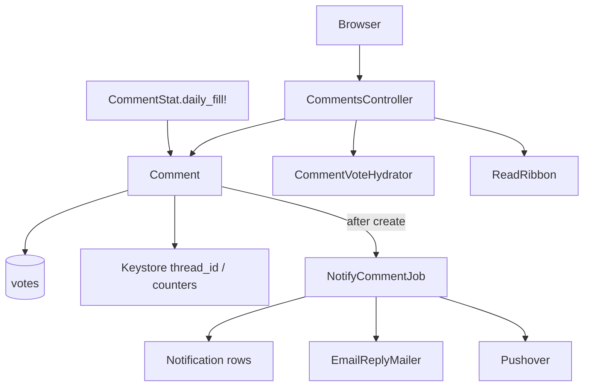
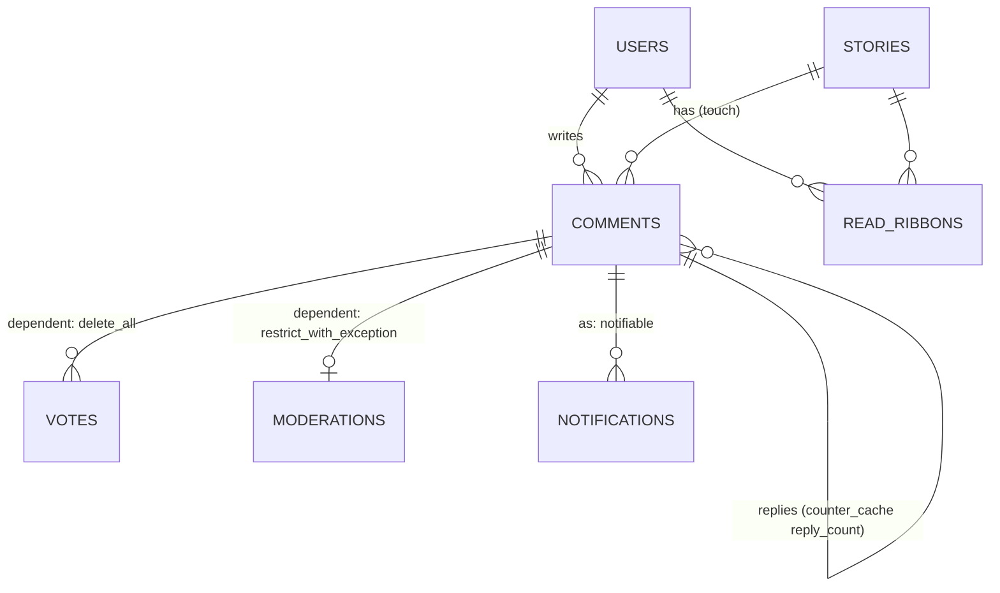

# Comments

> **Status**: ✅ Active
> **Generated**: 2026-10-24T00:00:00Z
> **Last Updated**: 2026-10-24T00:00:00Z
---

## Overview

### What It Does
Implements threaded discussion on stories. Logged-in users create comments (optionally with a hat), reply up to a hard depth cap of 18, preview, edit within 6 hours, delete within 14 days (disown afterwards), upvote, and flag with a reason for 7 days. Siblings are ordered by a Wilson-score confidence value packed into a 3-byte binary key so whole trees sort with a single ORDER BY. A background job fans out reply and @mention notifications (in-app rows, threaded email, Pushover). Site-wide listings and RSS feeds expose the newest and upvoted comments and per-user thread history; `ReadRibbon` tracks read state per user per story.

### Why It Exists
The commenting rules enforce discussion quality mechanically: low-effort comments are rejected at validation, flag-heavy threads are rate-limited, scores on young comments are hidden to curb bandwagons, deeply nested flamewars are cut off at depth 18, and badly scored comments collapse.

### Key Capabilities
- Full comment lifecycle: create (with duplicate-resubmit tolerance), preview, edit, delete, undelete, disown
- Confidence-ordered threaded rendering via recursive CTEs (`story_threads`, `recent_threads`)
- Voting: upvote/unvote; flagging gated by reason list, ownership, age, and score floor
- Reply + mention notification fan-out with user-setting and story-hiding gates
- Newest/upvoted listings (20/page), "Last Read" marker, public (cached) and private (token) RSS
- Daily average comment score precomputation (`CommentStat`) backing the `above_average` scope

---

## Architecture

### High-Level Design


### Components

#### Backend Components
| Component | File Path | Purpose |
|-----------|-----------|---------|
| CommentsController | `app/controllers/comments_controller.rb` | 16 actions covering lifecycle, voting, listings, permalinks |
| Comment | `app/models/comment.rb` | Validations, threading, confidence math, permission predicates, tree queries |
| CommentStat | `app/models/comment_stat.rb` | Daily average score rows (`daily_fill!`) |
| CommentVoteHydrator | `app/models/comment_vote_hydrator.rb` | Batched viewer-vote decoration of comment collections |
| ReadRibbon | `app/models/read_ribbon.rb` | Read tracking + `is_following` reply toggle |
| EmailReplyMailer | `app/mailers/email_reply_mailer.rb` | `reply` / `mention` mails with List-style threading headers |
| NotifyCommentJob | `app/jobs/notify_comment_job.rb` | Reply notifications first, then mentions minus already-notified |

#### Frontend Components
| Component | File Path | Purpose |
|-----------|-----------|---------|
| `_comment.html.erb` | `app/views/comments/` | Byline, action links, collapse checkbox, score display, gone-text placeholder |
| `_commentbox.html.erb` | `app/views/comments/` | Form: Post/Update, Preview, Cancel, hat select, markdown help, closing-soon hint |
| `_threads.html.erb` | `app/views/comments/` | Flattened-tree walker emitting nested `<ol>`; inlines the comment partial |
| `_preview.html.erb`, `_postedreply.html.erb`, `_too_deep.html.erb` | `app/views/comments/` | Preview container, created-comment response, depth-cap notice |
| `index.html.erb`, `index.rss.builder`, `user_threads.html.erb` | `app/views/comments/` | Listings, RSS 2.0 (ttl 120), user threads |
| `reply.text.erb`, `mention.text.erb` | `app/views/email_reply_mailer/` | Plain-text bodies, 72-column wrap, permalink footer |

### Technology Stack
- **Backend**: Rails; ActiveJob (`queue_as :default`); ActionMailer; raw-SQL recursive CTEs; BigDecimal Wilson scoring
- **Frontend**: ERB, CSS checkbox folding, XHR partial swaps
- **Database**: MySQL (binary string sort keys, `insert low_priority`, `on duplicate key update`)
- **External Services**: Pushover; SMTP

---

## Model Details

### Comment

#### Associations
```ruby
belongs_to :user
belongs_to :story,
  inverse_of: :comments,
  touch: true
has_many :votes,
  dependent: :delete_all
belongs_to :parent_comment,
  class_name: "Comment",
  inverse_of: false,
  optional: true,
  counter_cache: :reply_count,
  touch: true
has_one :moderation,
  class_name: "Moderation",
  inverse_of: :comment,
  dependent: :restrict_with_exception
belongs_to :hat,
  optional: true
has_many :taggings, through: :story
has_many :links, inverse_of: :from_comment, dependent: :restrict_with_exception
has_many :incoming_links,
  class_name: "Link",
  inverse_of: :to_comment,
  dependent: :restrict_with_exception
has_many :notifications, as: :notifiable
```

#### Concerns
| Concern | Purpose |
|---------|---------|
| `Token` | Shared token-generation concern |

#### Callbacks
| Callback | Method | Purpose |
|----------|--------|---------|
| `before_validation` on create | `:assign_initial_attributes` | short_id; score ||= 1; confidence; 3-byte placeholder confidence_order; thread_id/depth (root: new Keystore thread_id, depth 0; reply: inherit thread, depth+1) |
| `after_save` | `:log_hat_use` | Moderation "used <hat> hat" when `hat.modlog_use` and hat new/changed |
| `after_commit` on create | `:mark_submitter` | Keystore `user:<id>:comments_posted` increment |
| `after_commit` on create | `:record_initial_upvote` | `Vote.create!(…, vote: 1)` then `update_score_and_recalculate!(0, 0)` (moved from after_create to cut in-transaction queries, bug #1238) |
| `after_commit` | `:recreate_links` | `Link.recreate_from_comment!` when body changed |
| `after_commit` | `:update_associated_caches` | `story.update_cached_columns`, `user.refresh_counts!` |

#### Validations
- `short_id` presence, uniqueness (case-insensitive), length ≤ 10; `comment` presence ("cannot be empty.") and ≤ 16,777,215 chars; `markeddown_comment` ≤ 16,777,215; presence of `confidence`, `confidence_order`, `flags`, `score`, `last_edited_at`; booleans `is_deleted`, `is_moderated`, `is_from_email`.
- Anti-noise block: "this." → "Nope"; `tl;dr` → "Wow!  A blue car!"; quote-only → "If a tree falls in the woods and no one hears it, does it make a sound?"; `bump` → "Don't bump threads."; spaced capitals → "D O N ' T"; "me too|nice|+1" → "Please just upvote the parent post instead."; graphics-only → "🚫".
- Contextual: parent gone → "Comment was deleted by the author or a mod while you were writing."; depth cap (plus `ModNote.tattle_on_max_depth_limit`) → "You have replied too greedily and too deep."; hat not wearable → error on `:hat`; story must be `accepting_comments?`; on create, `validate_commenter_hasnt_flagged_parent` → "You've flagged that comment for the mods, so you can leave it for the mods."

#### Key Methods
| Method | Returns | Purpose | Notes |
|--------|---------|---------|-------|
| `calculated_confidence` | 0..1 | Wilson lower bound, z = 1.281551565545 (80%); ups = score+flags, downs = flags | BigDecimal; 0 when gone; clamped |
| `update_score_and_recalculate!` | — | SQL recompute: score = Σ votes, flags = count(vote = −1), confidence, confidence_order | confidence_order = 2 B inverted confidence + id low byte (stable tiebreaker) |
| `breaks_speed_limit?` | Boolean | Reply throttle: delay = `(2 + flag_count + commenter_flag_count).minutes` over the ancestor chain; author's flags double-count | Mods exempt; top-level exempt; adds "Thread speed limit reached…" error |
| `depth_permits_reply?` | Boolean | `depth < 18`; false for unsaved | |
| `parents` | Relation | Ancestors oldest-first (recursive CTE on parent_comment_id) | Works on new records |
| `is_editable_by_user?` | Boolean | Author ∧ ¬gone ∧ within `MAX_EDIT_MINS` (360) of last_edited_at | |
| `is_deletable_by_user?` / `is_disownable_by_user?` | Boolean | Author within / after `DELETEABLE_DAYS` (14) | |
| `is_undeletable_by_user?` | Boolean | Mod always; author unless moderated | |
| `is_flaggable?` | Boolean | ¬gone ∧ ¬own ∧ score > −10 ∧ age ≤ 7 d | |
| `delete_by_moderator` | — | is_moderated, Moderation row, `User.update_counters user_id, karma: (votes.count * -2)` | |
| `undelete_for_user` | — | Restores score; mod-undelete of others logged | timestamps suppressed |
| `gone_text` | String | moderator-removed w/ name+reason / banned user / removed by author | |
| `has_been_edited?` | Boolean | last_edited_at − created_at > 1 min | |
| `show_score_to_user?` | Boolean | Mods always; hidden when (<36 h ∧ score ∈ −2..4) or viewer flagged | |
| `as_json` | Hash | short_id, timestamps, flags, parent short_id, body (gone_text substituted), depth, username, URLs | |
| `mailing_list_message_id` | String | `comment.<short_id>[.email].<created_at>@<domain>` | |
| `Comment.story_threads(story)` | Relation | Tree incl. merged stories, ordered by confidence_order_path (CHAR(93) binary) | predicate pushed into CTE on purpose |
| `Comment.recent_threads(user)` | Relation | Trees for user's last 20 thread_ids | |
| `Comment.regenerate_markdown` | nil | Re-render all `markeddown_comment` without timestamps | maintenance |

#### Scopes
`deleted`, `not_deleted`, `not_moderated`, `active`, `accessible_to_user(user)` (mods: all; else active — flat listings only), `recent` (6 months), `above_average` (score > daily average, default 3), `on_stories_not_authored_by`, `for_presentation` (preloads), `filter_tags`, `filter_tags_for`, `not_on_story_hidden_by`.

### CommentStat
Date-unique rows holding the day's average comment score; `daily_fill!` upserts the trailing 30 days (timestamps shifted −5 h to approximate site-local days; deleted comments excluded).

### ReadRibbon
`is_unread?(comment)`: comment newer than ribbon `updated_at` and not by the ribbon's user. `bump` avoids callbacks. `expire_old_ribbons!` deletes ribbons idle > 1 year. `hide_replies_for`/`unhide_replies_for` flip `is_following`. No callbacks by design.

### CommentVoteHydrator
Enumerable decorator; for a signed-in viewer, three batch queries fill `current_vote`, `vote_summary`, `current_reply` on each yielded comment.

---

## Database Schema

### comments
> Derived from model/SQL usage; the feature file set does not include `db/schema.rb` — verify against it before relying on types.

| Column | Type | Notes |
|--------|------|-------|
| `id` | int PK | Low byte is the confidence tiebreaker |
| `short_id` | varchar(10) unique | ShortId-generated |
| `user_id`, `story_id` | int FK | required |
| `parent_comment_id`, `hat_id` | int FK | optional |
| `thread_id`, `depth`, `reply_count` | int | threading |
| `comment`, `markeddown_comment` | mediumtext | raw / rendered |
| `score`, `flags` | int | denormalized from votes |
| `confidence` | decimal | Wilson bound |
| `confidence_order` | binary(3) | sibling sort key |
| `is_deleted`, `is_moderated`, `is_from_email` | bool | |
| `last_edited_at`, `last_reply_at`, `created_at`, `updated_at` | datetime | |

### comment_stats
| Column | Type | Notes |
|---|---|---|
| `date` | date unique | |
| `average` | decimal | day's average score |

### read_ribbons
| Column | Type | Notes |
|---|---|---|
| `user_id`, `story_id` | int | pair-unique in practice |
| `is_following` | bool | reply notifications |
| `updated_at` | datetime | read watermark |

### Relationships


---

## API Endpoints

> Every action below exists in `CommentsController`; paths reflect the route helpers referenced in views (`comment_short_id_path`, `edit_comment_path`, `reply_comment_path`, `disown_comment_path`, `comments_url`, `upvoted_comments_url`).

| Method | Path | Action | Description | Notes |
|--------|------|--------|-------------|-------|
| POST | `/comments` | `create` | story_id (short id), comment, hat_id, parent_comment_short_id, preview | 400 story missing/gone; JSON error invalid parent; duplicate silently accepted; speed-limit returns commentbox |
| GET | `/comments/:id` | `show` | Partial for owner-editable comment; else redirect to target | |
| GET | `/comments/:id` (JSON) | `show_short_id` | `as_json` | |
| GET | `/c/:id` | `redirect_from_short_id` | Permalink → story anchor; permanent cache; merged-story aware; admin numeric ids | |
| GET | `/comments/:id/edit` | `edit` | Commentbox (XHR partial or full) | 400 unless editable |
| GET | `/comments/:id/reply` | `reply` | Commentbox with hydrated parents; `too_deep` at cap + ModNote | |
| POST | `/comments/:id/delete` | `delete` | `delete_for_user` | 400 unless deletable |
| POST | `/comments/:id/undelete` | `undelete` | `undelete_for_user` | 400 unless undeletable |
| POST | `/comments/:id/disown` | `disown` | `InactiveUser.disown!` | 400 unless disownable |
| PATCH | `/comments/:id` | `update` | Edit body/hat; preview; `redirect_on_submit` → `head :ok` + `x_location` | |
| POST | `/comments/:id/upvote` / `/unvote` | | Vote 1 / 0 via `Vote.vote_thusly_on_story_or_comment_for_user_because` | 400 if gone |
| POST | `/comments/:id/flag` | `flag` | Vote −1 with reason ∈ `Vote::COMMENT_REASONS`; `@user.can_flag?` | 400 invalid reason / not permitted |
| GET | `/comments(.rss)` | `index` | 20/page; active-only for non-mods; tag filters; hidden stories excluded; Last Read marker; public RSS cached 120 s; token feed personalized | page cache if `CACHE_PAGE`; page bounds raise RoutingError |
| GET | `/comments/upvoted(.rss)` | `upvoted` | Viewer's upvotes, own comments excluded; real has-more count | hidden stories TODO |
| GET | `/threads(/:user)` | `user_threads` | Recent-20-thread trees; anonymous without user → redirect `/active` | |

Create/reply/vote/update require login (400); `upvoted` requires login (redirect); RSS token resolves the user for `index`.

---

## Authorization

> Inline (no policy objects): before_actions + model predicates.

| Method | Permission | Conditions | Notes |
|--------|------------|------------|-------|
| `create`/`reply`/`update`/votes | logged-in | 400 otherwise | |
| `is_editable_by_user?` | author | ¬gone, <6 h since last edit | hat re-resolved on edit |
| `is_deletable_by_user?` | author | ≤14 days | |
| `is_disownable_by_user?` | author | >14 days | |
| `is_undeletable_by_user?` | author/mod | author blocked if moderated | |
| `is_flaggable?` + `can_flag?` | any user | ¬own, ≤7 d, score > −10, ¬gone | reason mandatory |
| Mod privileges | moderator | see gone content & scores, flagger usernames, collapse exemption, speed-limit exemption | |
| Admin | admin | PK lookup in `find_comment`, numeric `/c/:id` | anti-enumeration otherwise |

---

## Configuration

### Environment Variables
None feature-specific.

### Config Files
None dedicated. Behavior toggles: `CACHE_PAGE` constant (page caching); per-user settings `email_replies?`, `email_mentions?`, `pushover_replies?`, `pushover_mentions?`; application name/domain in mail subjects and Message-Ids.

---

## Usage Examples

### Wilson confidence (verbatim core)
```ruby
# Source: app/models/comment.rb#calculated_confidence
z = BigDecimal("1.281551565545") # 80% confidence
p = BigDecimal(ups) / n

left = p + (1 / (2 * n) * z * z)
right = z * Math.sqrt((p * ((1 - p) / n)) + (z * z / (4 * n * n)))
under = 1.0 + ((1.0 / n) * z * z)

confidence = (left - right) / under
```

### Notification fan-out order
```ruby
# Source: app/jobs/notify_comment_job.rb#deliver_comment_notifications
notified = deliver_reply_notifications(comment)
deliver_mention_notifications(comment, notified)
```
Mentions are scanned with `/\B[@~]([\w-]+)/`; the author and already-notified reply recipients are subtracted ("email_replies trumps email_mentions"). Email/Pushover skip users hiding the story; `Notification` rows are created regardless so unhiding reveals them.

---

## Testing

No test files are part of this feature's mapped file set; verify spec existence with a glob before citing coverage.

---

## Known Issues & Caveats

| Issue | Location | Description |
|-------|----------|-------------|
| Vote race (TODO) | `comment.rb#update_score_and_recalculate!` | Concurrent votes may compute confidence from stale score |
| Heinous inline partial | `_threads.html.erb` | Hand-inlined copy of `_comment.html.erb`; edit the source partial and re-inline |
| Hidden stories TODO | `comments_controller.rb#upvoted` | Listing ignores viewer's hidden stories |
| Scope misuse hazard | `comment.rb#accessible_to_user` | Flat views only; threads need gone-placeholders to avoid misattributed replies |
| `save!(validate: false)` | delete/undelete paths | Lifecycle transitions bypass validations; timestamps suppressed |
| Commented-out association | `comment_stat.rb` | `has_many :comments` by date disabled |
| Swallowed mailer errors | `notify_comment_job.rb` | Email failures rescued and ignored (logger line commented out) |
| `@has_more` shortcut | `#index` | Always true — no count query on newest feed |

---

## Performance

### Optimization Strategies
- Batched viewer-vote hydration (3 queries per page) via `CommentVoteHydrator`
- Recursive-CTE `confidence_order_path` (CHAR(93) binary) → single ORDER BY per tree; story predicate pushed inside the CTE
- `CommentStat` daily precomputation replaces a dependent subquery
- Duplicate-create short-circuit; `update_column`/single `touch` up the reply chain; ReadRibbon `bump` without callbacks

### Caching
- Public newest-comments RSS: 120 s (`comments.rss` key)
- Short-id permalink: permanent `Rails.cache` entries (`c_<short_id>`)
- `caches_page :index, :threads, if: CACHE_PAGE`

### Database Optimization
- 3-byte `confidence_order` with id-low-byte tiebreaker → stable sibling order (~200 comments/weekday makes rollover ties rare)

---

## Troubleshooting

### Comment won't post, odd error message
**Cause:** anti-noise validations ("Please just upvote the parent post instead.", "Don't bump threads.", "🚫", …).
**Solution:** expected; the comment must add substance.

### "Thread speed limit reached, next comment allowed in …"
**Cause:** flags across the reply chain set a delay of `(2 + flags + own-flags) minutes` since the user's last comment in that thread.
**Solution:** wait; moderators bypass.

### Reply email missing
**Cause:** `email_replies?` off, story hidden, or swallowed SMTP error.
**Solution:** check settings/hidden stories; the in-app Notification row is still created.

### Edits not possible
**Cause:** >6 h since `last_edited_at`, comment gone, or wrong user.
**Solution:** by design; after 14 days offer disown.

---

## Related Features

- **Stories** — parent resource; `accepting_comments?`, merge handling, `last_comment_at` touch
- **Voting** — shared `Vote` machinery, reason catalogs, summaries
- **Moderation** — mod delete/undelete logging, depth-limit ModNotes, flagged-commenter review
- **Hats** — wearable hats; modlog-use hats write Moderation entries
- **Inbox / Notifications** — notification rows consumed by the inbox feature
- **Tags / Hidden stories** — filter the newest-comments feed

---

**Generated:** 2026-10-24T00:00:00Z
**Last Updated:** 2026-10-24T00:00:00Z
**Status:** ✅ Active
