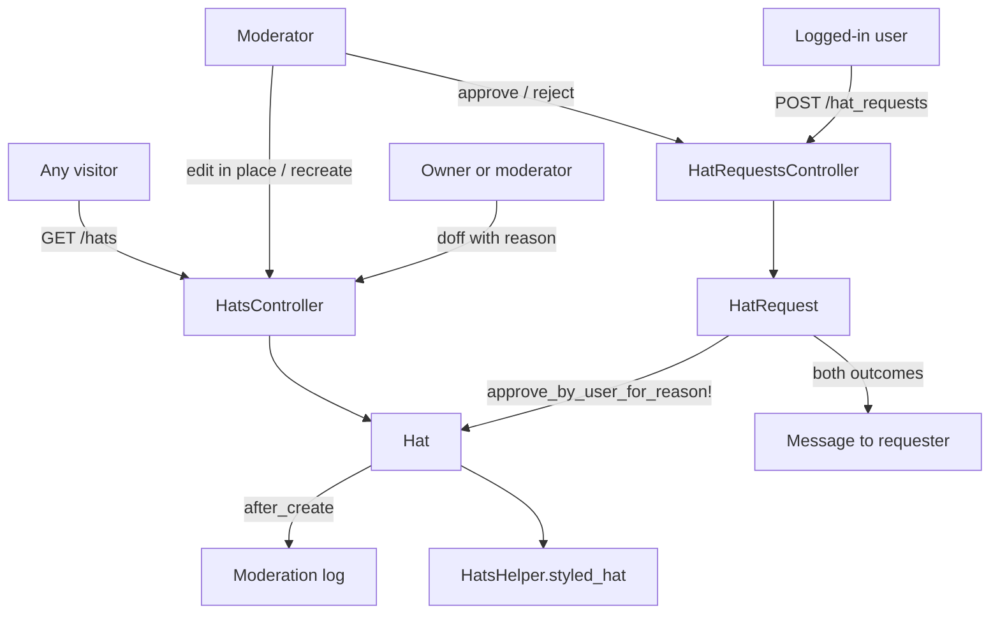
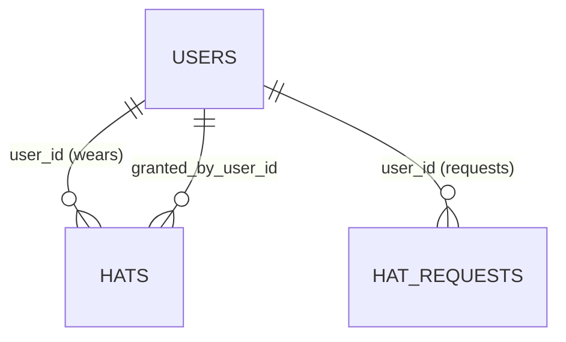

# Hats

> **Status**: ✅ Active
> **Generated**: 2026-10-24T00:00:00Z
> **Last Updated**: 2026-10-24T00:00:00Z
---

## Overview

### What It Does
The hats feature implements verified affiliation flair. A `Hat` is a short label (e.g., "OpenBSD Developer") granted to a user by a moderator; the user may wear one hat on a comment or private message to indicate they are speaking officially for a project, organization, or company. Users apply via `HatRequest`; moderators approve or reject requests, edit live hats, and doff (retire) hats when affiliations end. Every grant, edit, and doff writes to the moderation log.

### Why It Exists
Official statements need a trust signal. The request/approval workflow verifies affiliations before the badge appears, and mandatory reasons plus public moderation logging keep the lifecycle auditable.

### Key Capabilities
- Public `/hats` index of active hats, grouped by hat text and sorted by username
- Logged-in users request hats with a label, public verification link, and private moderator-only comment
- Moderators approve (optionally editing hat/link first) or reject with a required reason; requester is notified by private message
- Hat owners and moderators doff hats with a required public reason
- Moderators edit hats in place (logged) or replace them via doff-and-recreate (history-preserving)
- Hat badges render with granted-date tooltips; email verification links are reduced to their domain for logged-out visitors

---

## Architecture

### High-Level Design


### Components

#### Backend Components
| Component | File Path | Purpose |
|-----------|-----------|---------|
| `HatsController` | `app/controllers/hats_controller.rb` | Public index, doff flow, moderator edit (in-place and recreate) |
| `HatRequestsController` | `app/controllers/hat_requests_controller.rb` | Request creation, queue index, approve/reject |
| `Hat` | `app/models/hat.rb` | Hat record: validations, active scope, doffing, moderation logging, link sanitization |
| `HatRequest` | `app/models/hat_request.rb` | Pending request: validations, transactional approve/reject with notification |
| `HatsHelper` | `app/helpers/hats_helper.rb` | `styled_hat` / `hat_text` badge rendering |

#### Frontend Components
| Component | File Path | Purpose |
|-----------|-----------|---------|
| Hats index | `app/views/hats/index.html.erb` | Public hat table; Request Hat link; moderator Edit column |
| Doff form | `app/views/hats/doff.html.erb` | User/Hat display + required Reason field |
| Edit form | `app/views/hats/edit.html.erb` | Hat/Link fields; "Edit In-Place" and "Doff & Create" submits |
| Request form | `app/views/hat_requests/new.html.erb` | Hat/Link/Comment fields with policy guidance |
| Request queue | `app/views/hat_requests/index.html.erb` | Editable approve/reject forms per request |

### Technology Stack
- **Backend**: Ruby on Rails; plain ActiveRecord (no service layer)
- **Frontend**: Server-rendered ERB, `form_with`, `labelled_grid` form markup
- **Database**: Relational via ActiveRecord (`hats`, `hat_requests`)
- **External Services**: None; notifications use in-app `Message`, audit via `Moderation`

---

## Model Details

### Hat

#### Associations
```ruby
belongs_to :user
belongs_to :granted_by_user, class_name: "User", inverse_of: false
```

#### Concerns
| Concern | Purpose |
|---------|---------|
| `Token` | Shared token-generation concern |

#### Callbacks
| Callback | Method | Purpose |
|----------|--------|---------|
| `before_validation, on: :create` | `:assign_short_id` | `self.short_id = ShortId.new(self.class).generate` |
| `after_create` | `:log_moderation` | Logs `Granted hat "<hat>"`, appending ` (<link>)` when link present; moderator = granter; `created_at` copied from the hat |

#### Validations & Scope
```ruby
validates :hat, presence: true
validates :hat, :link, length: {maximum: 255}
validates :modlog_use, inclusion: {in: [true, false]}
validates :short_id, length: {maximum: 10}, presence: true

scope :active, -> { joins(:user).where(doffed_at: nil).merge(User.active) }
```

#### Key Methods
| Method | Returns | Purpose | Notes |
|--------|---------|---------|-------|
| `doff_by_user_with_reason(user, reason)` | — | Logs `Doffed hat "<hat>"` with reason; sets `doffed_at = Time.current`; saves | `moderator_user_id = user.is_moderator? ? user : nil` — self-doffs are unattributed |
| `sanitized_link` | `String` | Email links (`link.include? "@"`) → `Mail::Address.new(link).domain`; otherwise raw link | Hides emails from logged-out visitors |
| `to_txt` | `String` | `"(#{hat}) "` | Plain-text rendering |
| `to_param` | `String` | `short_id` | URLs keyed by short id |

### HatRequest

#### Associations
```ruby
belongs_to :user
```

#### Concerns
| Concern | Purpose |
|---------|---------|
| `Token` | Shared token-generation concern |

#### Validations
```ruby
validates :hat, presence: true, length: {maximum: 255}
validates :link, presence: true, length: {maximum: 255}
validates :comment, presence: true, length: {maximum: 65_535}
```
Also declares `attr_accessor :rejection_comment` (not referenced elsewhere in the mapped files).

#### Key Methods
| Method | Returns | Purpose | Notes |
|--------|---------|---------|-------|
| `approve_by_user_for_reason!(user, reason)` | — | Transaction: create `Hat` (requester as wearer, approver as granter, copying hat/link); `Message` subject `Your hat "<hat>" has been approved`, body `reason + (" " * 20)`; `destroy!` | 20-space padding is a commented kludge for a minimum body length |
| `reject_by_user_for_reason!(user, reason)` | — | Transaction: `Message` subject `Your request for hat "<hat>" has been rejected`, body `reason`; `destroy!` | No moderation-log entry for rejections |

---

## Database Schema

> Schema file (`db/schema.rb`) is outside this feature's mapped file set; columns below are those exercised by the models/controllers/views.

### hats
| Column | Type | Default | Notes |
|--------|------|---------|-------|
| `id` | integer | — | PK |
| `user_id` | integer | — | Wearer (`belongs_to :user`) |
| `granted_by_user_id` | integer | — | Granting moderator |
| `hat` | string | — | Label; presence, ≤255 |
| `link` | string | — | Verification link; ≤255 |
| `short_id` | string | — | Presence, ≤10; used in URLs |
| `modlog_use` | boolean | — | Must be true/false; preserved on recreation |
| `doffed_at` | datetime | NULL | Non-NULL ⇒ retired |
| `created_at`, `updated_at` | datetime | — | `created_at` shown as "Granted YYYY-MM-DD" tooltip |

### hat_requests
| Column | Type | Default | Notes |
|--------|------|---------|-------|
| `id` | integer | — | PK |
| `user_id` | integer | — | Requester |
| `hat` | string | — | Presence, ≤255 |
| `link` | string | — | Presence, ≤255 |
| `comment` | text | — | Presence, ≤65,535; moderator-only, rendered as Markdown |
| `created_at`, `updated_at` | datetime | — | Age shown in queue |

### Relationships


---

## API Endpoints

> Derived from controller actions and the path helpers used in views; every action listed exists in its controller.

| Method | Path | Action | Description | Notes |
|--------|------|--------|-------------|-------|
| `GET` | `/hats` | `hats#index` | Active hats grouped by hat text | Public |
| `GET` | `/hats/:id/doff` | `hats#doff` | Doff form | Owner or moderator |
| `POST` | `/hats/:id/doff_by_user` | `hats#doff_by_user` | Doff; blank reason → flash error + redirect to form | Owner or moderator |
| `GET` | `/hats/:id/edit` | `hats#edit` | Edit form | Moderator |
| `POST` | `/hats/:id/update_in_place` | `hats#update_in_place` | Update hat/link; modlog entry listing rename and/or link change | Moderator |
| `POST` | `/hats/:id/update_by_recreating` | `hats#update_by_recreating` | New hat (same user/granter/link/modlog_use); old doffed `To replace with "<new>"` | Moderator |
| `GET` | `/hat_requests/new` | `hat_requests#new` | Request form | Logged-in |
| `POST` | `/hat_requests` | `hat_requests#create` | Create request; success flash → redirect `/hats` | Logged-in |
| `GET` | `/hat_requests` | `hat_requests#index` | All pending requests | Logged-in (⚠️ not moderator-gated) |
| `POST` | `/hat_requests/:id/approve` | `hat_requests#approve` | Update hat/link from form, then approve with reason | Moderator |
| `POST` | `/hat_requests/:id/reject` | `hat_requests#reject` | Reject with reason | Moderator |

---

## Authorization

No Pundit policies; gates are controller `before_action`s.

| Gate | Scope | Conditions | Notes |
|------|-------|------------|-------|
| `require_logged_in_user` | `HatsController` except `index`; all of `HatRequestsController` | Signed in | `/hats` index is public |
| `require_logged_in_moderator` | `edit`, `update_in_place`, `update_by_recreating`; `approve`, `reject` | Moderator | |
| `only_hat_user_or_moderator` | `doff`, `doff_by_user` | `@hat.user == @user \|\| @user&.is_moderator?` | Failure redirects to the visitor's profile |
| `find_hat!` | hat member actions | Mods: `Hat.find_by(short_id:)` (any hat); others: `@user.wearable_hats.find_by(short_id:)` | `find_by` ⇒ possible `nil` |

---

## Configuration

### Environment Variables
None.

### Config Files
None specific to this feature.

---

## Usage Examples

### Doffing with a reason
```ruby
# Source: app/models/hat.rb
def doff_by_user_with_reason(user, reason)
  m = Moderation.new
  m.user_id = user_id
  m.moderator_user_id = user.is_moderator? ? user : nil
  m.action = "Doffed hat \"#{hat}\""
  m.reason = reason
  m.save!

  self.doffed_at = Time.current
  save!
end
```

### Moderator in-place edit with change logging
```ruby
# Source: app/controllers/hats_controller.rb
def update_in_place
  if @hat.update(hat: params[:hat][:hat], link: params[:hat][:link])
    m = Moderation.new
    m.user_id = @hat.user_id
    m.moderator_user_id = @user
    m.action = [
      @hat.hat_previously_changed? && "renamed hat \"#{@hat.hat_previously_was}\" to \"#{@hat.hat}\"",
      @hat.link_previously_changed? && "changed link from \"#{@hat.link_previously_was}\" to \"#{@hat.link}\""
    ].select { it }.join(", ")
    m.save!

    redirect_to hats_url
  else
    flash[:error] = @hat.errors.full_messages.join(", ")
    redirect_to edit_hat_path(@hat)
  end
end
```

### Badge rendering
```ruby
# Source: app/helpers/hats_helper.rb
def styled_hat(hat)
  hl = hat.link.present? && hat.link.match(/^https?:\/\//)

  if !hl && hat.link.present?
    sanitized_link = " - #{ERB::Util.html_escape(hat.sanitized_link)}"
  end

  content_tag(:span, class: "hat hat_#{hat.hat.gsub(/[^A-Za-z0-9]/, "_").downcase}", title: "Granted #{hat.created_at.strftime("%Y-%m-%d")}#{sanitized_link if sanitized_link}") do
    concat hat_text(hat, hl)
  end
end
```

---

## Testing

### Test Files
No test files are included in the feature's mapped file set; none verified.

---

## Known Issues & Caveats

| Issue | Location | Description |
|-------|----------|-------------|
| Request queue not mod-gated | `hat_requests_controller.rb:4-5` | `index` requires login only; any user can view pending requests and private comments (approve/reject remain mod-only) |
| Possible nil dereference | `hats_controller.rb` `find_hat!` → `only_hat_user_or_moderator` | `find_by` may return `nil`; `@hat.user` then raises `NoMethodError` instead of rendering 404 |
| Message-length kludge | `hat_request.rb` | Approval body is `reason + (" " * 20)` — comment admits it exists "to ensure there are 20 characters" |
| Permit-then-except | `hat_requests_controller.rb#approve` | `.permit(:hat, :link, :reason).except(:reason)` permits reason then drops it from the update |
| Empty modlog action possible | `hats_controller.rb#update_in_place` | If neither hat nor link changed, the logged action is an empty string |
| No request archive | `hat_request.rb` | Both approve and reject `destroy!` the request; rejections leave no modlog entry |
| `modlog_use` not settable via UI | `hats/edit.html.erb` | Preserved by recreation, but absent from edit form; approvals never set it |
| Unused accessor | `hat_request.rb` | `attr_accessor :rejection_comment` unreferenced in mapped files |

---

## Performance

### Optimization Strategies
- `Hat.active.includes(:user).find_each` on the public index (eager-loads users, batches rows)
- `HatRequest.all.includes(:user)` on the queue

### Caching
- None.

### Database Optimization
- Lookups by `short_id`; index definitions live in the schema outside this file set.

---

## Troubleshooting

### Issue: "You must give a reason for the doffing."
**Symptoms:** Doff form redisplays with an error flash.
**Cause:** `doff_by_user` rejects blank `params[:reason]`.
**Solution:** Provide a short public explanation (the form hints: `Short public explanation, like "Left project"`).

### Issue: Non-moderator cannot reach doff/edit pages for a hat
**Symptoms:** Redirected to own profile or error.
**Cause:** `find_hat!` scopes non-mods to `@user.wearable_hats`; edit actions require moderator.
**Solution:** Only the owner may doff their own hat; edits require a moderator.

### Issue: Hat rename produced a doffed duplicate
**Symptoms:** Old hat doffed with reason `To replace with "<new>"`; new hat active.
**Cause:** Moderator used **Doff & Create** (`update_by_recreating`).
**Solution:** Intended, history-preserving behavior; use **Edit In-Place** for corrections.

---

## Related Features

- **[Moderation](../features/moderation.md)** — grants, in-place edits, and doffs create `Moderation` rows
- **[Messages](../features/messages.md)** — approval/rejection decisions are delivered as `Message`s
- **[Users](../features/users.md)** — `belongs_to :user`, `granted_by_user`; `User.active` gates the index; `wearable_hats` scopes access
- **[Comments](../features/comments.md)** — worn hats render on comments via `styled_hat`
- **[Settings](../features/settings.md)** — request form recommends GitHub auth (settings `#external`) for instant verification

---

**Generated:** 2026-10-24T00:00:00Z
**Last Updated:** 2026-10-24T00:00:00Z
**Status:** ✅ Active
