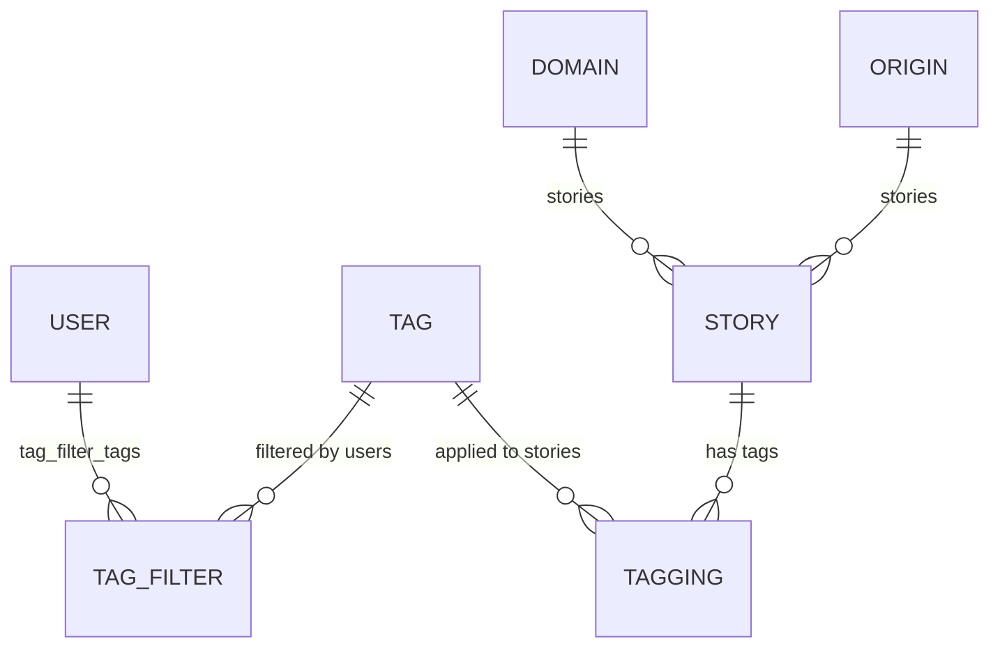

# Home Feed

> **Status**: ✅ Active
> **Generated**: 2026-10-24T00:00:00Z
> **Last Updated**: 2026-10-24T00:00:00Z
---

## Overview

### What It Does
Home-feed implements every story listing on the site through a single controller (`HomeController`) and a single shared view. It serves the hottest front page, Newest (with a per-user last-read marker), Recent, Active, Top over a configurable time interval, tag/multi-tag/category listings, per-domain and per-origin listings, newest-by-user, and the login-gated Saved, Upvoted, and Hidden lists. Each listing is available as HTML and, for most actions, RSS 2.0 and JSON. The feature also owns per-viewer tag filtering (`FiltersController` + `/filters` page), the `StoryFinder` controller concern, and the `Keystore` key/value model.

### Why It Exists
Feed browsing is the primary read path of a link-aggregation community. Readers need multiple orderings and slices of one story corpus, personalized by tag filters (which work even for anonymous visitors via cookie) and consumable from feed readers through tokenized private RSS URLs.

### Key Capabilities
- Fourteen feed actions rendered by one shared list view (`home/index`) and one RSS builder
- Viewer tag filtering applied to every main feed query (`filtered_tags.map(&:id)`)
- Private, filter-aware RSS via `find_user_from_rss_token` on index/newest/saved/upvoted
- Two-layer anonymous caching: `caches_page` plus a 45-second `Rails.cache` fragment
- Last-read marker on Newest with carry-over to later pages via `@next_page_params`
- Bounded pagination and all-or-nothing resolution of comma-separated tag/category lists

---

## Architecture

### High-Level Design
```mermaid
graph TD
    A[Browser / Feed reader] --> B[HomeController action]
    B --> C{anonymous & unfiltered?}
    C -- yes --> D[Rails.cache fetch 'stories key' 45s]
    C -- no --> E[direct query]
    D --> F[StoriesPaginator.new(scope, page, user).get]
    E --> F
    F --> G[(DB: Story scopes)]
    B --> H[home/index.html.erb or stories.rss.builder]
    A --> I[FiltersController]
    I --> J[user.tag_filter_tags / cookies.permanent TAG_FILTER_COOKIE]
    J --> B
```

### Components

#### Backend Components
| Component | File Path | Purpose |
|-----------|-----------|---------|
| HomeController | `app/controllers/home_controller.rb` | All 14 feed actions; pagination, caching, RSS tokens, OG meta tags |
| FiltersController | `app/controllers/filters_controller.rb` | List and persist tag filters (account or cookie) |
| StoryFinder | `app/controllers/concerns/story_finder.rb` | Story lookup by short_id (PK for admins) + current-vote hydration |
| Keystore | `app/models/keystore.rb` | Key/value store; read-through cache for TrafficHelper's hot path |

#### Frontend Components
| Component | File Path | Purpose |
|-----------|-----------|---------|
| Shared list view | `app/views/home/index.html.erb` | Story rows (inlined `stories/_listdetail`), Last Read divider, prev/next nav |
| RSS template | `app/views/home/stories.rss.builder` | RSS 2.0 channel + items for any feed |
| `_active` / `_recent` / `_top` | `app/views/home/_*.html.erb` | Hint headers ("sorted by last comment…", "not yet reached the front page", interval syntax) |
| `_single_tag` / `_multi_tag` / `_category` | `app/views/home/_*.html.erb` | Tag/category boxes: descriptions, hotness mod, privileged/new-user notes, filtered notice, related tags |
| `_for_domain` / `_for_origin` | `app/views/home/_*.html.erb` | Source headers: story/submitter/origin counts, ban info, mod Edit link |
| `_newest_by_user` | `app/views/home/_newest_by_user.html.erb` | "Newest stories submitted by <user>" header |
| Filters page | `app/views/filters/index.html.erb` | Category-grouped tag table with Hide checkboxes and Save Filters |

### Technology Stack
- **Backend**: Rails controllers, ActiveRecord scopes (`Story.hottest/newest/newest_by_user/recent/active/top/tagged/categories/hidden/saved`), `StoriesPaginator`
- **Frontend**: ERB + builder templates; no JS components in this feature's mapped files
- **Database**: relational via ActiveRecord; `keystore` with string PK
- **External Services**: none (story rows link out to Archive.org / Ghostarchive caches)

---

## Model Details

### Keystore

#### Associations
None.

#### Concerns
None.

#### Callbacks
None — validations only (verbatim):
```ruby
validates :key,
  presence: true,
  uniqueness: {case_sensitive: false},
  length: {maximum: MAX_KEY_LENGTH}
validates :id, presence: true
```
`self.primary_key = "key"`; `MAX_KEY_LENGTH = 50`.

#### Key Methods
| Method | Returns | Purpose | Notes |
|--------|---------|---------|-------|
| `get(key)` | record or nil | `find_by(key:)` | |
| `value_for(key)` | value | `where(key:).pick(:value)` | |
| `put(key, value)` | `true` | upsert, `returning: false` | key length validated, raises `ActiveRecord::ValueTooLong` |
| `increment_value_for` / `incremented_value_for(key, amount = 1)` | new value | transactional upsert | `on_duplicate: Arel.sql("value = value + 1")` — conflict path ignores `amount` |
| `decrement_value_for` / `decremented_value_for(key, amount = -1)` | new value | aliases into the increment pair | |
| `find_or_create_key_for_update(key, init = nil)` | locked record | `lock(true)` find-or-create loop | retries on `ActiveRecord::RecordNotUnique` |
| `readthrough_cache(key, &blk)` | value | get-or-compute-then-put | "deliberately no lock/transaction as TrafficHelper is on the hot path of every request" |

### StoryFinder (concern)
| Method | Returns | Purpose | Notes |
|--------|---------|---------|-------|
| `find_story` | Story or nil | `Story.find_by(short_id: params[:story_id] \|\| params[:id])`; falls back to `Story.find(params[:id])` for admins | hydrates `story.current_vote` from the user's story-level `Vote` |
| `find_story!` | sets `@story` | raises `ActiveRecord::RecordNotFound` if nil | |

---

## Database Schema

### keystore

> Derived from the model (db/schema.rb is outside this feature's mapped file set — verify columns there before relying on types).

| Column | Type | Default | Notes |
|--------|------|---------|-------|
| `key` | string(50) | — | Primary key; case-insensitively unique |
| `id` | integer | — | NOT NULL enforced by explicit validation (not the PK here) |
| `value` | numeric/string | — | upserted; incremented via `value = value + 1` |

### Relationships


---

## API Endpoints

> All actions verified present in `HomeController` / `FiltersController`; paths per URL helpers referenced in code and views.

| Method | Path | Action | Description | Notes |
|--------|------|--------|-------------|-------|
| `GET` | `/`, `/page/:page`, `/rss` | `index` | Hottest stories | OG meta tags; anonymous RSS cached 2 min under key `"rss"`; token → "Private feed for <username>" |
| `GET` | `/newest(.rss)` | `newest` | All stories, newest first | last-read marker; `@next_page_params[:last_read_timestamp]` carry-over; token private feed |
| `GET` | newest-by-user (`params[:user]`) | `newest_by_user` | One user's submissions | `User.find_by!` → 404 on unknown username |
| `GET` | `/recent` | `recent` | Newest not yet on front page | HTML only; `Story.recent(..., unmerged: false)`; RSS link intentionally `/newest.rss` |
| `GET` | active | `active` | Sorted by last comment | HTML + JSON |
| `GET` | `/top/:length(/rss)` | `top` | Top of interval via `IntervalHelper#time_interval` | placeholder → redirect `/top/1w`; no JSON |
| `GET` | `tag_url(tag)` (.rss) | `single_tag` | One tag | `Tag.find_by!`; related tags cached 1 day |
| `GET` | multi-tag `"a,b"` (.rss) | `multi_tag` | All listed tags | 404 unless every name resolves |
| `GET` | category `"a,b"` (.rss) | `category` | Listed categories | same all-or-nothing rule |
| `GET` | `domain_url(domain)` (.rss) | `for_domain` | Stories from a domain | `@domain.stories.base(@user).order(id: :desc)` |
| `GET` | `origin_url(origin)` (.rss) | `for_origin` | Stories from an origin | same ordering |
| `GET` | hidden | `hidden` | Viewer's hidden stories | `require_logged_in_user`; HTML only |
| `GET` | `saved_url` (.rss) | `saved` | Viewer's saved stories | login or token; private-feed title |
| `GET` | `upvoted_stories_path` (.rss) | `upvoted` | Viewer's upvotes | `order("votes.id DESC")`, `includes(:tags)` |
| `GET` | `/filters` | `FiltersController#index` | Filter table | `skip_after_action :clear_session_cookie` to keep CSRF valid |
| `POST` | `/filters` | `FiltersController#update` | Save filters | flash "Your filters have been updated."; redirect to `/filters` |

---

## Authorization (Pundit)

No Pundit policies exist in this feature; authorization is controller/view-level:

| Mechanism | Permission | Conditions | Notes |
|--------|------------|------------|-------|
| `require_logged_in_user` | view personal lists | `hidden`, `saved`, `upvoted` only | |
| `find_user_from_rss_token` | private RSS | `token` param on `index`, `newest`, `saved`, `upvoted` | loads the user's tag filters for the feed |
| `Tag#user_can_filter?` | filter a tag | per tag/user | enforced on save (`keep_if`) and in checkbox rendering |
| `User#is_admin?` | PK story lookup | `StoryFinder#find_story` | avoids general enumeration |
| `User#is_moderator?` | mod edit links | story rows, domain/origin headers | view-level only |

---

## Configuration

### Environment Variables
None found in the mapped sources.

### Config Files / Constants
- `CACHE_PAGE` — gate for `caches_page :active, :category, :for_domain, :for_origin, :index, :multi_tag, :newest, :newest_by_user, :recent, :single_tag, :top`
- `TAG_FILTER_COOKIE` — permanent cookie of comma-joined tag names for anonymous filtering
- `Keystore::MAX_KEY_LENGTH` = 50

---

## Usage Examples

### Anonymous fragment caching with silent fallback
```ruby
# Source: app/controllers/home_controller.rb:373
def get_from_cache(opts = {}, &)
  # don't cache if there's a user because they can have hidden stories; visitors can filter tags by cookie
  if Rails.env.development? || @user || filtered_tags.any?
    yield
  else
    key = opts.merge(page: page).sort.map { |k, v| "#{k}=#{v.to_param}" }.join(" ")
    begin
      Rails.cache.fetch("stories #{key}", expires_in: 45, &)
    rescue Errno::ENOENT => e
      # Rails.logger.error "error fetching stories #{key}: #{e}"
      yield
    end
  end
end
```

### Last-read marker on Newest
```ruby
# Source: app/controllers/home_controller.rb:94
@last_read_timestamp = if params[:last_read_timestamp]
  Time.zone.at(params[:last_read_timestamp].to_i)
else
  @user&.last_read_newest_story
end

@user&.touch(:last_read_newest_story)

last_read_marker_shown = @stories.any? { |story| @last_read_timestamp&.after?(story.created_at) }
unless last_read_marker_shown
  @next_page_params = {last_read_timestamp: @last_read_timestamp.to_i}
end
```

### All-or-nothing multi-tag resolution
```ruby
# Source: app/controllers/home_controller.rb:229
tag_params = params[:tag].split(",")
@tags = Tag.where(tag: tag_params)
raise ActiveRecord::RecordNotFound unless @tags.length == tag_params.length
```

---

## Testing

### Test Files
- `spec/controllers/home_controller_spec.rb`
- `spec/requests/home_spec.rb`
- `spec/models/keystore_spec.rb`

---

## Known Issues & Caveats

| Issue | Location | Description |
|-------|----------|-------------|
| Cache-key collision | `home_controller.rb:29` vs `:153` | `hidden` and `saved` both call `get_from_cache(hidden: true)`; masked because logged-in users bypass caching |
| `amount` ignored on conflict | `keystore.rb:38` | upsert `on_duplicate` is hardcoded `value = value + 1` |
| Hardcoded RSS path | `home_controller.rb:322` | `href: "/top/#{length[:param]}/rss"` built by string, not a helper |
| Swallowed cache error + commented logging | `home_controller.rb:380-382` | `Errno::ENOENT` rescued, logger call commented out |
| Inline partial copy | `home/index.html.erb:14-165` | `heinous_inline_partial(stories/_listdetail)` — "Do not edit"; canonical source is the named partial |
| Deliberate race window | `keystore.rb:68-77` | `readthrough_cache` documented as lock/transaction-free on the hot path |
| Unstable list vs RSS | `home_controller.rb:146` | recent advertises newest.rss "because upvoted stories get removed" |

---

## Performance

### Optimization Strategies
- One shared view; per-feed differences are tiny partials
- Filters page: "perf: three queries is much faster than joining, grouping on tags.id for counts" (`Tagging.group(:tag_id).count`, `TagFilter.group(:tag_id).count`)
- `upvoted` eager-loads tags (`includes(:tags)`)
- Related tags per tag page cached 1 day (`related_<tag>`)

### Caching
- **Cache Layer**: page cache (`caches_page`, `if: CACHE_PAGE`) + `Rails.cache`
- **TTL**: 45 s story fragments; 120 s anonymous `/rss`; 1 day related tags; RSS `ttl` element advertises 120 (minutes) to readers

### Database Optimization
- `keystore.key` unique PK; domain/origin feeds walk `id DESC`

---

## Troubleshooting

### Common Issues

#### Issue: Stories invisible to one viewer
**Symptoms:**
- Story on the site but absent from a particular viewer's feeds

**Cause:**
Viewer's tag filters (account or `TAG_FILTER_COOKIE`) exclude the story's tag ids from every feed query, or the viewer hid the story.

**Solution:**
Untick the tag on `/filters` and **Save Filters**, or unhide from the Hidden list.

#### Issue: 404 on comma-separated tag/category URLs
**Cause:** every name must resolve (`length` comparison before querying stories).
**Solution:** correct the names; only existing tags/categories are accepted.

#### Issue: `ActionController::RoutingError: page out of bounds`
**Cause:** `params[:page]` negative or above `2**32`.
**Solution:** expected guard; typically bot traffic.

---

## Related Features

- **[stories](../features/stories.md)** — Story scopes, StoriesPaginator, hide/save mechanics rendered in feed rows
- **[tags-categories](../features/tags-categories.md)** — Tag, TagFilter, Category; filterability and hotness mods surfaced in feed headers
- **[domains-origins](../features/domains-origins.md)** — Domain/Origin records behind `for_domain`/`for_origin`
- **[comments](../features/comments.md)** — comment counts in rows; Active ordering; comments RSS advertised on the front page
- **[users](../features/users.md)** — `newest_by_user`, RSS tokens, `last_read_newest_story`

---

**Generated:** 2026-10-24T00:00:00Z
**Last Updated:** 2026-10-24T00:00:00Z
**Status:** ✅ Active
