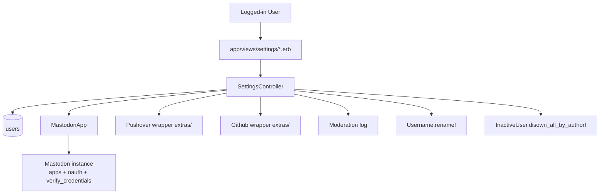
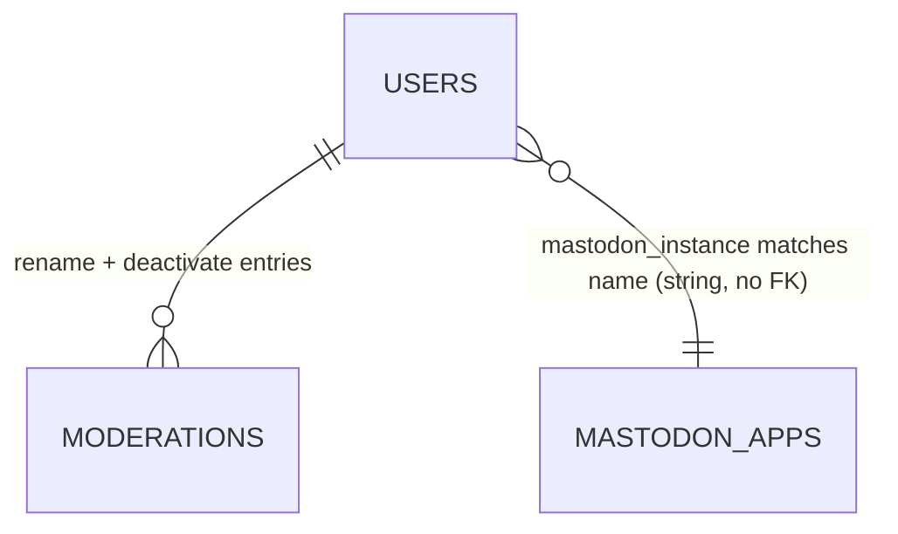

# Settings

> **Status**: ✅ Active
> **Generated**: 2026-10-24T00:00:00Z
> **Last Updated**: 2026-10-24T00:00:00Z
---

## Overview

### What It Does
Settings is the self-service account page of Lobsters. A logged-in user manages, from `/settings`: public profile data (username, email, homepage, about), password, per-event notification preferences (comment replies, mentions, private messages — each via e-mail/inbox/Pushover), mailing-list delivery of site content, appearance (color scheme, contrast, story previews, avatars), TOTP two-factor authentication, external accounts (Gravatar avatar cache, Pushover, Mastodon, GitHub), sending invitations, and account deactivation with optional content disowning.

### Why It Exists
It concentrates every user-controlled knob in one place so identity, security, and notification volume are self-service, and it provides an orderly account exit that preserves site integrity (reserved usernames, retained stories, modlog audit trail).

### Key Capabilities
- Save profile and preference changes in a single form (`POST /settings`)
- Change password with a current-password check; sessions elsewhere are invalidated
- Enroll/disable TOTP 2FA through a QR-code flow with a 15-minute enrollment window
- OAuth-link Mastodon (any instance, auto-registering an app per instance) and GitHub; subscribe to Pushover
- Deactivate the account after password + explicit confirmation, optionally disowning stories/comments to `inactive-user`

---

## Architecture

### High-Level Design


### Components

#### Backend Components
| Component | File Path | Purpose |
|-----------|-----------|---------|
| `SettingsController` | `app/controllers/settings_controller.rb` | index/update/deactivate + twofa, twofa_auth, twofa_enroll, twofa_verify, twofa_update + pushover_auth/callback + mastodon_authentication/auth/callback/disconnect + github_auth/callback/disconnect |
| `MastodonApp` | `app/models/mastodon_app.rb` | One OAuth client per Mastodon instance: registration, authorize URL, code→token exchange, revocation, instance-name sanitizing |

Cross-feature collaborators invoked here: `User#authenticate`, `#roll_session_token`, `#has_2fa?`, `#disable_2fa!`, `#authenticate_totp`, `#delete!`, `#can_invite?`; `Username.rename!`; `InactiveUser.disown_all_by_author!`; `Moderation.create!`; `EmailBlocklistValidation.email_on_blocklist?`; `Pushover`, `Github`, `Mastodon`, `Sponge` from `extras/`.

#### Frontend Components
| Component | File Path | Purpose |
|-----------|-----------|---------|
| Main form | `app/views/settings/index.html.erb` | 11 sections incl. external accounts, invite, deactivate |
| 2FA password gate | `app/views/settings/twofa.html.erb` | Enroll or disable entry point |
| 2FA enrollment | `app/views/settings/twofa_enroll.html.erb` | SVG QR code + "Reveal Secret" manual fallback |
| 2FA verification | `app/views/settings/twofa_verify.html.erb` | Six-digit code form (`inputmode: numeric`, `autocomplete: one-time-code`) |
| Mastodon instance form | `app/views/settings/mastodon_authentication.html.erb` | Asks for instance name/URL; explains `read:accounts` scope |

### Technology Stack
- **Backend**: Rails; `ROTP` (secret generation `ROTP::Base32.random`, provisioning URI, code verification), `RQRCode` (QR SVG), `SecureRandom.hex` state nonces, `Sponge` HTTP client
- **Frontend**: ERB `form_with` forms; no JS
- **Database**: MySQL — `users`, `mastodon_apps`
- **External Services**: Pushover subscription API; per-instance Mastodon `api/v1/apps`, `oauth/token`, `oauth/revoke`, `api/v1/accounts/verify_credentials`; GitHub OAuth

---

## Model Details

### MastodonApp

#### Associations
None (looked up by `name`; users store `mastodon_instance` as a string).

#### Concerns
None.

#### Callbacks
None.

#### Validations
```ruby
validates :name, :client_id, :client_secret,
  presence: true,
  length: {maximum: 255}
validates :name, uniqueness: {case_sensitive: false}
```

#### Key Methods
| Method | Returns | Purpose | Notes |
|--------|---------|---------|-------|
| `oauth_auth_url(mastodon_state)` | `String` | Instance authorize URL, `scope=read:accounts`, carries `state` | |
| `redirect_uri` | `String` | `https://<app domain>/settings/mastodon_callback?instance=<name>` | |
| `register_app!` | `true`/`nil` | Registers this site at `https://<name>/api/v1/apps`; stores `client_id`/`client_secret` | Raises `"already registered, delete and recreate"` if `client_id` present; rescues DNS/SSL/JSON/URI errors into model errors |
| `token_and_user_from_code(code)` | `[token, username]` / `[nil, nil]` | `/oauth/token` then `verify_credentials` for the username | grant_type `authorization_code` |
| `revoke_token(token)` | `true`/`false`/`nil` | `/oauth/revoke`; `true` when response body parses to `{}` | Returns `true` on timeout (`res.nil?`); blank token returns early |
| `self.find_or_register(instance_name)` | `MastodonApp`/`nil` | Sanitize → find existing → otherwise `new` + `register_app!` | `nil` on blank sanitized name |
| `self.sanitized_instance_name(instance_name)` | `String` | hostname / `https://host/...` / `@user@host` → `host` | `strip` → `delete_prefix("https://")` → `split("/").first` → `split("@").last` |

### User (as used by this feature)
`SettingsController` writes: password (`roll_session_token` when changed), `totp_secret` (2FA), `pushover_user_key`, `mastodon_oauth_token`/`mastodon_username`/`mastodon_instance`, `github_oauth_token`/`github_username`, plus the permitted preference attributes (below). `@edit_user = @user.dup` (index) and `@user.clone` (update) isolate form state until a save succeeds.

Permitted attributes (`user_params`):
```ruby
params.require(:user).permit(
  :username, :email, :password, :password_confirmation, :homepage, :about,
  :email_replies, :email_messages, :email_mentions, :inbox_mentions,
  :pushover_replies, :pushover_messages, :pushover_mentions,
  :mailing_list_mode, :show_email, :show_avatars, :show_story_previews,
  :show_submitted_story_threads, :prefers_color_scheme, :prefers_contrast
)
```

---

## Database Schema

### mastodon_apps

| Column | Type | Default | Notes |
|--------|------|---------|-------|
| `id` | `bigint` | auto-increment | Primary key |
| `name` | `string` | — | `null: false`, unique index `index_mastodon_apps_on_name` |
| `client_id` | `string` | — | `null: false` |
| `client_secret` | `string` | — | `null: false` |
| `created_at` | `datetime` | — | `null: false` |
| `updated_at` | `datetime` | — | `null: false` |

### users (feature-relevant columns)

| Column | Type | Default | Notes |
|--------|------|---------|-------|
| `username` | `string(50)` | — | unique index; renames modlogged |
| `email` | `string(100)` | — | unique index; blocklist hint in form |
| `password_digest` | `string(75)` | — | bcrypt via `authenticate` |
| `session_token` | `string(75)` | `""` | unique index; rotated on password change / 2FA enable |
| `about` | `mediumtext` | — | markdown profile text |
| `pushover_mentions` | `boolean` | `false` | dedicated column (`null: false`) |
| `mailing_list_token` | `string(75)` | — | unique index; private list address component |
| `mailing_list_mode` | `integer` | `0` | 0 none / 1 stories+comments / 2 stories; indexed |
| `show_email` | `boolean` | `false` | `null: false` |
| `settings` | `mediumtext` | — | serialized store backing the remaining preference/integration attributes |
| `deleted_at` | `datetime` | — | set by deactivation (`delete!`) |
| `disabled_invite_at` / `disabled_invite_by_user_id` / `disabled_invite_reason` | — | — | source of the "cannot send invitations" message |

### Relationships


---

## API Endpoints

All verified against `config/routes.rb:175-194` and existing controller actions.

| Method | Path | Action | Description | Notes |
|--------|------|--------|-------------|-------|
| `GET` | `/settings` | `index` | Settings form | |
| `POST` | `/settings` | `update` | Save; always `render action: "index"` | |
| `POST` | `/settings/deactivate` | `deactivate` | Delete account | helper `deactivate_path` |
| `GET` | `/settings/2fa` | `twofa` | Password gate | helper `twofa_url` |
| `POST` | `/settings/2fa_auth` | `twofa_auth` | Verify password → disable or enroll | sets `session[:last_authed]` |
| `GET` | `/settings/2fa_enroll` | `twofa_enroll` | Secret + QR | 15-min window |
| `GET` | `/settings/2fa_verify` | `twofa_verify` | Code form | 15-min window |
| `POST` | `/settings/2fa_update` | `twofa_update` | Enable 2FA | re-rolls session token |
| `POST` | `/settings/pushover_auth` | `pushover_auth` | → Pushover subscription URL | 403-equivalent flash if `!Pushover.enabled?` |
| `GET` | `/settings/pushover_callback` | `pushover_callback` | Store `pushover_user_key` | `rand` nonce; mismatch raises |
| `GET` | `/settings/mastodon_authentication` | `mastodon_authentication` | Instance form | empty action, renders view |
| `GET` | `/settings/mastodon_auth` | `mastodon_auth` | find_or_register → authorize URL | `session[:mastodon_state]` |
| `GET` | `/settings/mastodon_callback` | `mastodon_callback` | Link account | checks `code` + `state` |
| `POST` | `/settings/mastodon_disconnect` | `mastodon_disconnect` | Unlink + best-effort revoke | also used as failure teardown |
| `GET` | `/settings/github_auth` | `github_auth` | → GitHub authorize | `session[:github_state]` |
| `GET` | `/settings/github_callback` | `github_callback` | Link account | checks `code` + `state` |
| `POST` | `/settings/github_disconnect` | `github_disconnect` | Unlink + revoke | manual-delete notice if revoke API errors |

---

## Authorization

No Pundit in this codebase; guards are procedural:

| Guard | Applies to | Conditions | Notes |
|--------|------------|------------|-------|
| `require_logged_in_user` | every action | before_action | plus `show_title_h1` |
| `User#authenticate(current_password)` | `update` | only when a new password is submitted | `params[:user][:password].empty? ||` short-circuits |
| `User#authenticate(password)` | `deactivate`, `twofa_auth` | mandatory | distinct flash messages |
| `i_am_sure == "1"` | `deactivate` | checkbox | `'You did not check the "I am sure" checkbox.'` |
| `TOTP_SESSION_TIMEOUT` (900 s) | `twofa_enroll`, `twofa_verify`, `twofa_update` | `Time.now.to_i - session[:last_authed].to_i` | "Your enrollment period timed out." |
| state nonces | OAuth callbacks | `session[:mastodon_state]` / `session[:github_state]` / `session[:pushover_rand]` | GitHub deletes its nonce after use; Pushover mismatch raises |
| `can_invite?` | invite form | view-level | shows `disabled_invite_reason` otherwise |

---

## Configuration

### Environment Variables
None consumed directly in these files. Behavior toggles come from the service wrappers and app config:

```text
Pushover.enabled?     # gates the Pushover row and pushover_auth
Github.enabled?       # gates the GitHub row
Mastodon.enabled?     # gates the Mastodon row
Rails.application.name       # TOTP issuer
Rails.application.domain     # OAuth redirect URIs, list address domain
Rails.application.shortname  # list address local-part prefix
Rails.application.root_url   # Pushover callback base
```

### Config Files
- Credentials for the wrappers live with `extras/` (outside this feature's file set)

---

## Usage Examples

### Deactivation with optional disown
```ruby
# Source: app/controllers/settings_controller.rb (deactivate)
disown = params[:user][:disown] == "1"
@user.delete!
InactiveUser.disown_all_by_author!(@user) if disown

Moderation.create!(
  moderator: nil,
  user: @user,
  action: "deactivated#{", disowning their stories and comments" if disown}"
)
reset_session
flash[:success] = "You have deleted your account#{" and disowned your stories and comments." if disown}. Bye."
redirect_to "/"
```

### TOTP enrollment QR generation
```ruby
# Source: app/controllers/settings_controller.rb (twofa_enroll)
if !session[:totp_secret]
  session[:totp_secret] = ROTP::Base32.random
end

totp = ROTP::TOTP.new(session[:totp_secret], issuer: Rails.application.name)
totp_url = totp.provisioning_uri(@user.email)

qrcode = RQRCode::QRCode.new(totp_url)
qr = qrcode.as_svg(offset: 0,
  fill: "ffffff",
  color: "000",
  module_size: 5,
  shape_rendering: "crispEdges")
```

### Pushover subscription hand-off
```ruby
# Source: app/controllers/settings_controller.rb (pushover_auth)
session[:pushover_rand] = SecureRandom.hex

redirect_to Pushover.subscription_url(
  success: "#{Rails.application.root_url}settings/pushover_callback?" \
    "rand=#{session[:pushover_rand]}",
  failure: "#{Rails.application.root_url}settings/"
), allow_other_host: true
```

---

## Testing

### Test Files
- `spec/requests/settings_spec.rb`
- `spec/features/settings_spec.rb`
- `spec/models/mastodon_app_spec.rb`

---

## Known Issues & Caveats

| Issue | Location | Description |
|-------|----------|-------------|
| Misspelled method call | `settings_controller.rb:46` | `changed_atributes` (sic) — username-rename modlog source value depends on this spelling |
| Unhandled raise | `settings_controller.rb:173-175` | `pushover_callback` raises on `rand` mismatch instead of flashing — tampered callbacks 500 |
| Cosmetic locked checkbox | `index.html.erb` (Private Message section) | "Receive E-mail for ModMail" renders the `email_messages` field `disabled: true, checked: true`; no backing param — moderator e-mail is unconditionally on |
| State-changing GET routes | `routes.rb:186-193` | `mastodon_auth`/`_callback`, `github_auth`/`_callback`, `pushover_callback` are GETs; the nonce is the only CSRF protection |
| Swallowed exceptions | `mastodon_disconnect` | revocation network errors intentionally ignored ("indie instances often disappear") |
| Flash guard | `mastodon_disconnect` | success flash only `if flash.empty?` because the action tears down failed auths too |
| String-typed instance link | `users.mastodon_instance` | matches `mastodon_apps.name` by string; no foreign key |

---

## Performance

### Optimization Strategies
- One `mastodon_apps` row per instance, registered once and reused for every user on that instance
- `dup`/`clone` of the user avoids dirtying the session user on validation failure

### Caching
- **Cache Layer**: avatars cached from Gravatar (expired manually via `/avatars/expire`)
- **TTL**: n/a

### Database Optimization
- Indexes: `mastodon_apps.name` (unique); `users` unique indexes on `username`, `email`, `session_token`, `mailing_list_token`, plus `mailing_list_mode` index for list delivery queries

---

## Troubleshooting

### Issue: 2FA enrollment loops back with "Your enrollment period timed out."
**Symptoms:**
- Redirect to `/settings/2fa` from enroll/verify/update

**Cause:**
`session[:last_authed]` older than 900 seconds, or `session[:totp_secret]` missing.

**Solution:**
Re-enter the password at `/settings/2fa` and finish within 15 minutes.

### Issue: "Invalid OAuth state" after authorizing Mastodon/GitHub
**Symptoms:**
- Bounce to `/settings` with the error flash; account not linked

**Cause:**
Missing/blank `code` or `state`, or `state` ≠ session nonce (stale tab, replay, cookie loss).

**Solution:**
Restart the connect flow in a single browser session.

### Issue: Preference save silently requires a password
**Symptoms:**
- "Your current password was not entered correctly." when the user only meant to change checkboxes

**Cause:**
Browser autofill populated the New Password field, triggering the password-change path.

**Solution:**
Clear the password fields (autocomplete is set to `off`, but some browsers ignore it) and resubmit.

---

## Related Features

- **authentication** — login-time TOTP checks use the secret enrolled here; password reset reactivates deactivated accounts
- **users** — profile page renders the fields and linked accounts; avatar expiry endpoint
- **messages / comments / inbox-notifications** — consume the notification preferences
- **signup-invitations** — invitation form embedded on `/settings`
- **moderation** — modlog entries for renames and deactivations
- **tags-categories (filters)** — tag filters scope mailing-list delivery

---

**Generated:** 2026-10-24T00:00:00Z
**Last Updated:** 2026-10-24T00:00:00Z
**Status:** ✅ Active
