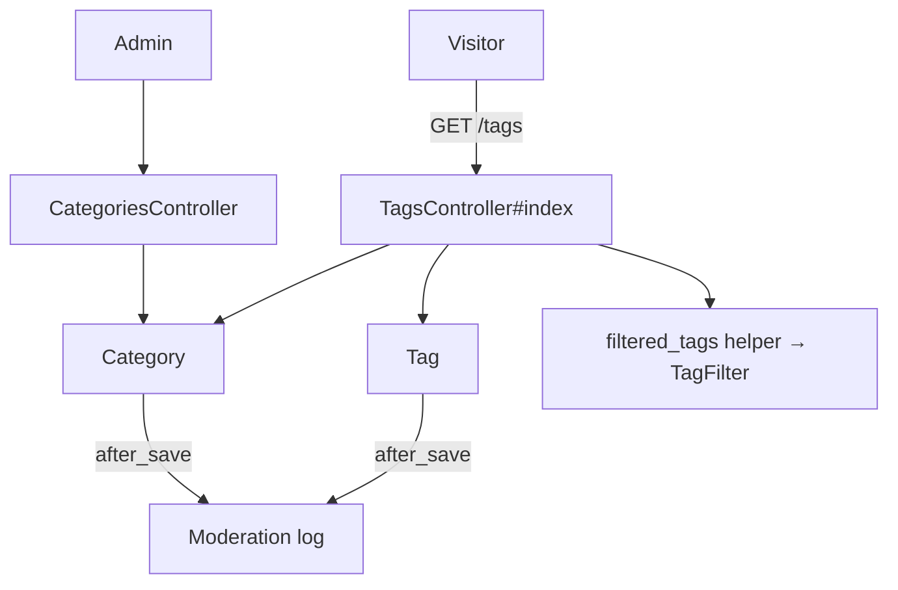
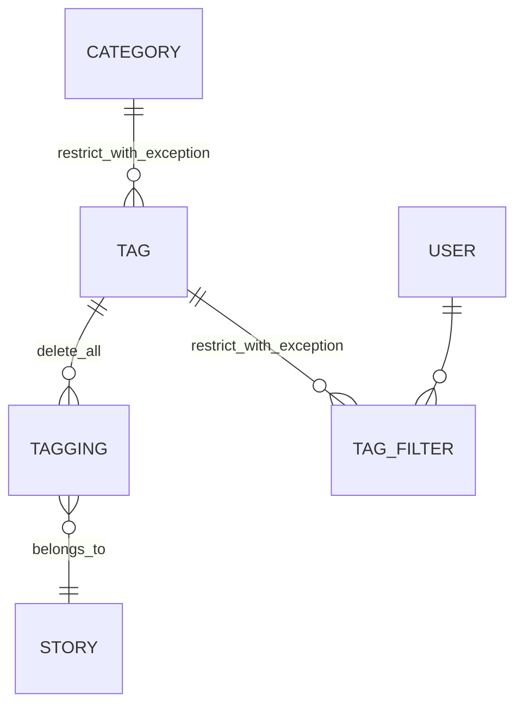

# Tags & Categories

> **Status**: ✅ Active
> **Generated**: 2026-10-24T00:00:00Z
> **Last Updated**: 2026-10-24T00:00:00Z
---

## Overview

### What It Does
Implements the story taxonomy for Lobsters: tags (short labels applied to stories through `Tagging` records) organized into categories, with each tag belonging to exactly one category. Ships the public `/tags` directory (HTML + JSON), the `Tag`/`Category`/`TagFilter` models with full moderation auditing, and admin-only category creation/renaming. Tag create/edit screens live in the moderation namespace and are only linked from here.

### Why It Exists
Readers browse and filter stories by topic; staff need a small, controlled vocabulary whose every change is publicly accountable.

### Key Capabilities
- Public categorized tag directory with per-tag descriptions and status markers
- JSON representation of all tags for machine consumption
- Per-user tag filtering (`TagFilter` join model; works for logged-out visitors per the index copy)
- Admin category CRU (no delete) with flash feedback and audit logging
- Tag usage controls: `active`, `privileged`, `permit_by_new_users`, `is_media`, `hotness_mod` (−10..10)
- `Tag.related` co-occurrence suggestions (top 8)

---

## Architecture

### High-Level Design


### Components

#### Backend Components
| Component | File Path | Purpose |
|-----------|-----------|---------|
| `TagsController` | `app/controllers/tags_controller.rb` | Public index; HTML and JSON |
| `CategoriesController` | `app/controllers/categories_controller.rb` | Admin `new`/`create`/`edit`/`update`; `require_logged_in_admin` |
| `Tag` | `app/models/tag.rb` | Validations, flags, scopes, audit callback, JSON serializer |
| `Category` | `app/models/category.rb` | Validations, audit callback |
| `TagFilter` | `app/models/tag_filter.rb` | `belongs_to :tag` / `belongs_to :user` join |

#### Frontend Components
| Component | File Path | Purpose |
|-----------|-----------|---------|
| Index view | `app/views/tags/index.html.erb` | Category headings + ordered tag lists, admin links |
| Multi-tag tip | `app/views/tags/_multi_tag_tip.html.erb` | `/t/tag1,tag2` hint |
| Category form | `app/views/categories/_form.html.erb` | Single required **Name** field, `autocapitalize: :off` |
| Multi-category tip | `app/views/categories/_multi_category_tip.html.erb` | `/categories/foo,bar` hint |
| `new.html.erb` / `edit.html.erb` | `app/views/categories/` | Render the shared form partial |

### Technology Stack
- **Backend**: Rails controllers + ActiveRecord
- **Frontend**: server-rendered ERB
- **Database**: `tags`, `categories`, `tag_filters` tables
- **External Services**: none

---

## Model Details

### Tag

#### Associations
```ruby
belongs_to :category
has_many :taggings, dependent: :delete_all
has_many :stories, through: :taggings
has_many :tag_filters, dependent: :restrict_with_exception
has_many :filtering_users,
  class_name: "User",
  through: :tag_filters,
  source: :user,
  dependent: :delete_all
has_one :moderation, dependent: :restrict_with_exception
has_many :suggested_taggings, dependent: :restrict_with_exception
```

#### Concerns
| Concern | Purpose |
|---------|---------|
| `Token` | Shared token-generation concern |

#### Callbacks
| Callback | Method | Purpose |
|----------|--------|---------|
| `after_save` | `:log_modifications` | Creates a `Moderation` row: "Created new tag …" with all attributes, or "Updating tag <t>, changed <f> from 'a' to 'b'" per `saved_changes`; `moderator_user_id` = virtual `edit_user_id`; sets `tag_id` |

#### Validations
| Attribute | Rules |
|-----------|-------|
| `tag` | presence; max 25; uniqueness (`case_sensitive: true`); format `/\A[A-Za-z0-9_\-+]+\z/` |
| `description` | max 100 |
| `hotness_mod` | inclusion `-10..10` |
| `permit_by_new_users`, `privileged`, `active`, `is_media` | inclusion `[true, false]` |

#### Scopes
| Scope | Definition |
|-------|------------|
| `active` | `where(active: true)` |
| `not_permitted_for_new_users` | `where(permit_by_new_users: false)` |
| `related(tag)` | active, non-media tags sharing stories with `tag`; excludes `tag` itself and hardcoded id `67` ("programming, the catch-all"); grouped, ordered by `COUNT(*) desc`, `limit(8)` |

#### Key Methods
| Method | Returns | Purpose | Notes |
|--------|---------|---------|-------|
| `to_param` | `String` | URLs address tags by name | |
| `.all_with_filtered_counts_for(user)` | `Array<Tag>` | Active tags ordered by `tag`, filtered by `can_be_applied_by?(user)`, each assigned `filtered_count` from one `TagFilter.group(:tag_id).count` | |
| `category_name` / `category_name=` | `String` | Virtual attr; setter uses `Category.find_by category:` | |
| `css_class` | `String` | `"tag tag_#{tag}"` + `" tag_is_media"` if media | |
| `user_can_filter?(user)` | `Boolean` | `active? && (!privileged? || user.try(:is_moderator?))` | |
| `can_be_applied_by?(user)` | `Boolean` | privileged ⇒ `!!user.try(:is_moderator?)`; else `true` | Comment: include unusable tags "so they submit and get error" |
| `filtered_count` | `Integer` | `@filtered_count ||= TagFilter.where(tag_id: id).count` | |
| `as_json` | `Hash` | selected fields + `category` name | `only:` includes `:permit_by_new_user` — typo, see Known Issues |

### Category

#### Associations
```ruby
has_many :tags,
  -> { order("tag asc") },
  dependent: :restrict_with_exception,
  inverse_of: :category
has_many :stories, through: :tags
has_one :moderation, dependent: :restrict_with_exception
```

#### Concerns
| Concern | Purpose |
|---------|---------|
| `Token` | Shared token-generation concern |

#### Callbacks
| Callback | Method | Purpose |
|----------|--------|---------|
| `after_save` | `:log_modifications` | Same audit pattern as `Tag`; sets `category_id` on the Moderation row |

#### Validations
| Attribute | Rules |
|-----------|-------|
| `category` | presence; max 25; uniqueness (`case_sensitive: false`); format `/\A[A-Za-z0-9_-]+\z/` |

#### Key Methods
| Method | Returns | Purpose | Notes |
|--------|---------|---------|-------|
| `to_param` | `String` | URLs address categories by name | Rename ⇒ URL change |

### TagFilter
```ruby
belongs_to :tag
belongs_to :user
```
Pure join model; no validations, callbacks, or methods.

---

## Database Schema

> Inferred from model/serializer code; `db/schema.rb` is not part of this feature's mapped files.

### tags
| Column | Type | Notes |
|--------|------|-------|
| `tag` | string | ≤25, unique case-sensitive |
| `description` | string | ≤100 |
| `category_id` | integer | FK → categories |
| `privileged`, `is_media`, `active`, `permit_by_new_users` | boolean | usage flags |
| `hotness_mod` | integer | −10..10 ranking modifier |

### categories
| Column | Type | Notes |
|--------|------|-------|
| `category` | string | ≤25, unique case-insensitive |

### tag_filters
| Column | Type | Notes |
|--------|------|-------|
| `tag_id`, `user_id` | integer | FKs; one row = user filters tag |

### Relationships


---

## API Endpoints

| Method | Path | Action | Description | Notes |
|--------|------|--------|-------------|-------|
| `GET` | `/tags` | `TagsController#index` | Categorized tag directory | Public; `format.json` renders `@tags` via `Tag#as_json` |
| `GET` | `/categories/new` | `CategoriesController#new` | New category form | Admin only |
| `POST` | `/categories` | `CategoriesController#create` | Create; success → flash + redirect `/tags` | Admin only; uses `create!` (see caveats) |
| `GET` | `/categories/:category_name/edit` | `CategoriesController#edit` | Edit form; `where(category: …).first!` → 404 on unknown name | Admin only |
| `POST` | `update_category_path` | `CategoriesController#update` | Rename; success → `/tags`, failure → back to edit with error flash | Admin only; form uses `method: :post` |

No destroy actions for either resource.

---

## Authorization

No Pundit policies in this feature; checks are controller- and model-level.

| Method / check | Permission | Conditions | Notes |
|----------------|------------|------------|-------|
| `require_logged_in_admin` | admin | all `CategoriesController` actions | `before_action` |
| `@user.try(:is_admin?)` | admin | view-level | gates edit/create links on index |
| `Tag#can_be_applied_by?` | moderator for privileged tags | `privileged?` | everyone else `true` |
| `Tag#user_can_filter?` | moderator for privileged tags | also requires `active?` | |

---

## Configuration

### Environment Variables
None.

### Config Files
None.

---

## Usage Examples

### Public index action
```ruby
# Source: app/controllers/tags_controller.rb
def index
  @title = "Tags"

  @categories = Category.order(category: :asc).includes(:tags)
  @tags = Tag.all.preload(:category)

  @filtered_tags = filtered_tags.index_by(&:id)

  respond_to do |format|
    format.html { render action: "index" }
    format.json { render json: @tags }
  end
end
```

### Strong params with audit attribution
```ruby
# Source: app/controllers/categories_controller.rb
def category_params
  params.require(:category).permit(
    :category_name,
    :category
  ).merge(edit_user_id: @user.id)
end
```

### Related-tags scope
```ruby
# Source: app/models/tag.rb
scope :related, ->(tag) {
  active
    .joins(:taggings)
    .where(taggings: {story_id: Tagging.where(tag: tag).select(:story_id)})
    .where.not(id: [tag, 67]) # 67 = programming, the catch-all
    .where.not(is_media: true)
    .group(:id)
    .order(Arel.sql("COUNT(*) desc"))
    .limit(8)
}
```

---

## Testing

### Test Files
None mapped to this feature in the catalog; no spec files were read.

---

## Known Issues & Caveats

| Issue | Location | Description |
|-------|----------|-------------|
| JSON serializer typo | `tag.rb` `as_json` | `:permit_by_new_user` (missing `s`) never matches the column; flag absent from JSON |
| Unreachable error branch | `categories_controller.rb:create` | `Category.create!` raises on invalid input; the `else` flash "New category not created: …" is dead code |
| Hardcoded tag id | `tag.rb` `related` scope | id `67` (programming catch-all) excluded by literal |
| Inert permitted param | `categories_controller.rb` | `:category_name` permitted but `Category` defines no `category_name=` |
| Asymmetric naming rules | `tag.rb` vs `category.rb` | tags: case-sensitive unique, `+` allowed; categories: case-insensitive unique, no `+` |
| Deletion unsafe by design | both models | `restrict_with_exception` on filters/moderation/suggestions (tags) and tags (categories) |

---

## Performance

### Optimization Strategies
- `includes(:tags)` / `preload(:category)` avoid N+1 on the index
- Single grouped count in `all_with_filtered_counts_for`; memoized `filtered_count`

### Caching
- None implemented here.

### Database Optimization
- Name-based routing implies unique indexes on `tags.tag` and `categories.category`.

---

## Troubleshooting

### Issue: 500 on category creation
**Symptoms:** exception instead of a validation message.
**Cause:** `create!` raises `ActiveRecord::RecordInvalid`; the friendly branch is unreachable.
**Solution:** use `create` so the error flash/redirect path executes, or validate input first.

### Issue: `permit_by_new_users` missing from `/tags.json`
**Cause:** typo `:permit_by_new_user` in `Tag#as_json`.
**Solution:** fix the symbol.

---

## Related Features

- **stories** — `Tagging`/`SuggestedTagging` live there; tags applied at submission
- **home-feed** — `/t/<tags>`, `/categories/<names>` feeds; `/filters` manages `TagFilter`
- **moderation** — mod-area tag CRUD (`new_mod_tag_path`, `edit_mod_tag_path`); audit log target

---

**Generated:** 2026-10-24T00:00:00Z
**Last Updated:** 2026-10-24T00:00:00Z
**Status:** ✅ Active
