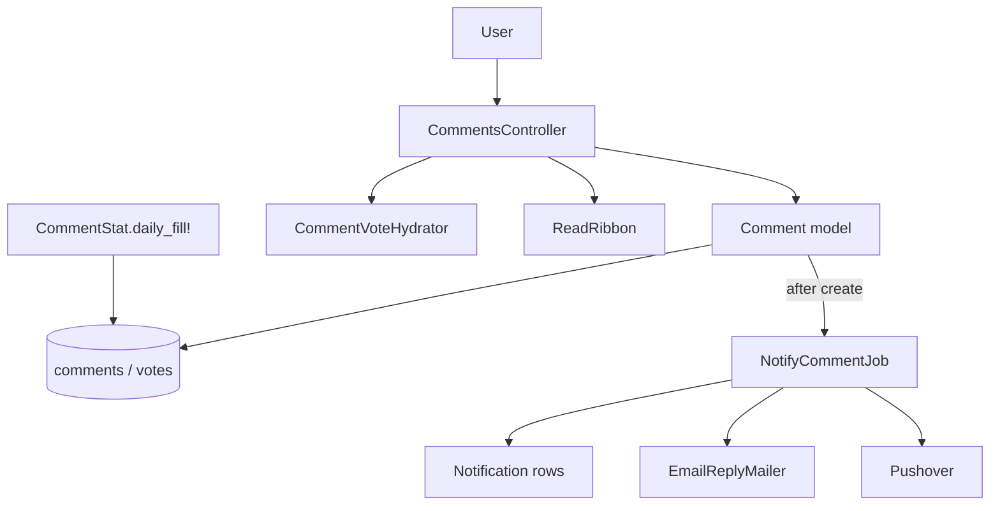
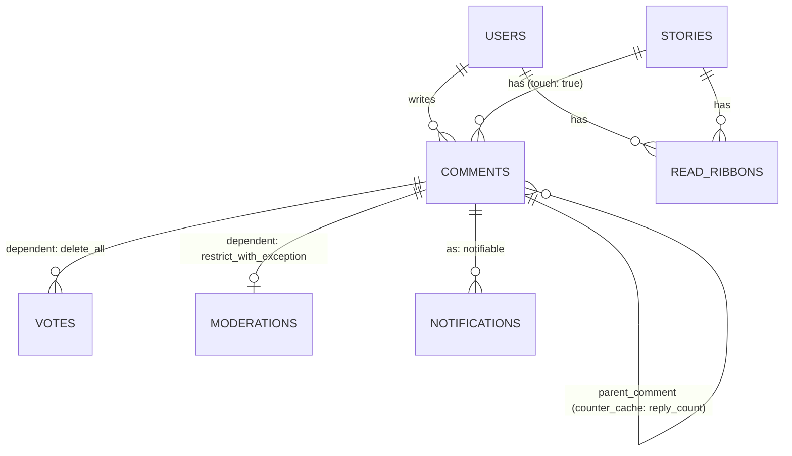

# Comments

> **Status**: ✅ Active
> **Generated**: 2026-10-24T00:00:00Z
> **Last Updated**: 2026-10-24T00:00:00Z
---

## Overview

### What It Does
Threaded commenting on stories. Logged-in users post comments (optionally wearing a hat), preview before posting, reply up to a hard cap of 18 nesting levels, edit within 6 hours, delete within 14 days (and undelete), disown after 14 days, upvote/unvote, and flag with a mandatory reason within 7 days. Sibling comments are ranked by a Wilson-score confidence value packed into a 3-byte sort key so entire comment trees order with one query. After each post, a background job notifies the parent comment's author, the story's author, and @mentioned users — in-app always, email and Pushover according to user settings. Site-wide pages list the newest comments (20 per page, with a "Last Read" marker and RSS), the viewer's upvoted comments, and any user's recent threads. Read state per user per story is tracked by read ribbons.

### Why It Exists
Discussion quality is enforced mechanically: validations reject low-effort comments ("me too", "+1", "this", "tl;dr", bumps, quote-only, emoji-only), flag-heavy threads impose a growing wait between a user's comments, scores on young near-zero comments are hidden to prevent bandwagon voting, comments at score −5 or below collapse, and reply chains stop at depth 18 (historically where threads go off the rails).

### Key Capabilities
- Comment lifecycle: create (duplicate resubmits silently accepted), preview, edit, delete, undelete, disown
- Confidence-ordered threading via recursive SQL CTEs over a fixed-width `confidence_order_path`
- Upvote/unvote/flag with per-audience vote summaries (author sees reason counts; moderators see usernames)
- Reply + mention notifications: in-app rows always; email/Pushover gated by settings and story-hiding
- Newest/upvoted listings and user-thread pages; public RSS cached 2 minutes; private token RSS personalized by tag filters
- Daily average comment score precomputation backing an "above average" query

---

## Architecture

### High-Level Design


### Components

#### Backend Components
| Component | File Path | Purpose |
|-----------|-----------|---------|
| CommentsController | `app/controllers/comments_controller.rb` | create, show, show_short_id, redirect_from_short_id, edit, reply, delete, undelete, disown, update, unvote, upvote, flag, index, upvoted, user_threads |
| Comment | `app/models/comment.rb` | Validations, threading, confidence math, permission predicates, recursive tree queries |
| CommentStat | `app/models/comment_stat.rb` | One row per day: average comment score (`daily_fill!`, trailing 30 days, −5 h day offset, deleted excluded) |
| CommentVoteHydrator | `app/models/comment_vote_hydrator.rb` | Decorates comment collections with viewer's vote, vote summary, replied-to state in 3 batch queries |
| ReadRibbon | `app/models/read_ribbon.rb` | Per user+story read watermark and `is_following` reply toggle |
| EmailReplyMailer | `app/mailers/email_reply_mailer.rb` | `reply` and `mention` mails with Message-Id/References/In-Reply-To threading |
| NotifyCommentJob | `app/jobs/notify_comment_job.rb` | Reply notifications first, then mentions minus already-notified |

#### Frontend Components
| Component | File Path | Purpose |
|-----------|-----------|---------|
| `_comment.html.erb` | `app/views/comments/` | Byline (avatar, user, hat, edited/e-mailed, unread), links (edit/delete/undelete/disown/mod delete/flag/reply/"on:"), collapse checkbox, score, gone-text |
| `_commentbox.html.erb` | `app/views/comments/` | Post/Update, Preview, Cancel buttons; "Put on hat:" select; markdown help; closing-soon hint |
| `_threads.html.erb` | `app/views/comments/` | Depth-walks a flat list into nested `<ol class="comments">`; contains an inlined copy of the comment partial |
| `_preview.html.erb` / `_postedreply.html.erb` / `_too_deep.html.erb` | `app/views/comments/` | Preview container / created-comment wrapper / "Max reply depth reached." notice |
| `index.html.erb` + `index.rss.builder` | `app/views/comments/` | Newest/upvoted listing with "Last Read" line and pagination; RSS 2.0 ttl 120 |
| `user_threads.html.erb` | `app/views/comments/` | Recent threads, with possible-flag warning |
| `reply.text.erb` / `mention.text.erb` | `app/views/email_reply_mailer/` | Plain-text bodies, 72-col wrap, permalink; "reply to this email" supported |

### Technology Stack
- **Backend**: Rails (ActiveRecord, ActiveJob `default` queue, ActionMailer), raw-SQL recursive CTEs, BigDecimal math
- **Frontend**: ERB partials, CSS-checkbox comment folding, XHR form submission
- **Database**: MySQL (binary sort keys via `concat/lpad/char`, `insert low_priority`, `on duplicate key update`)
- **External Services**: Pushover push notifications; SMTP email

---

## Model Details

### Comment

#### Associations
```ruby
belongs_to :user
belongs_to :story,
  inverse_of: :comments,
  touch: true
has_many :votes,
  dependent: :delete_all
belongs_to :parent_comment,
  class_name: "Comment",
  inverse_of: false,
  optional: true,
  counter_cache: :reply_count,
  touch: true
has_one :moderation,
  class_name: "Moderation",
  inverse_of: :comment,
  dependent: :restrict_with_exception
belongs_to :hat,
  optional: true
has_many :taggings, through: :story
has_many :links, inverse_of: :from_comment, dependent: :restrict_with_exception
has_many :incoming_links,
  class_name: "Link",
  inverse_of: :to_comment,
  dependent: :restrict_with_exception
has_many :notifications, as: :notifiable
```

#### Concerns
| Concern | Purpose |
|---------|---------|
| `Token` | Shared token-generation concern (`include Token`) |

#### Callbacks
| Callback | Method | Purpose |
|----------|--------|---------|
| `before_validation` (create) | `:assign_initial_attributes` | Generate short_id; default score 1; compute confidence; 3-byte placeholder confidence_order; root: new Keystore `thread_id` + depth 0, reply: inherit thread_id, depth = parent+1 |
| `after_save` | `:log_hat_use` | Moderation entry "used <hat> hat" for `modlog_use` hats |
| `after_commit` (create) | `:mark_submitter` | Keystore counter `user:<id>:comments_posted` |
| `after_commit` (create) | `:record_initial_upvote` | Author's `Vote` (vote: 1) then `update_score_and_recalculate!` (after_commit to avoid in-transaction queries, bug #1238) |
| `after_commit` | `:recreate_links` | Rebuild outbound `Link` rows when body changed |
| `after_commit` | `:update_associated_caches` | `story.update_cached_columns`; `user.refresh_counts!` |

#### Constants
| Constant | Value | Meaning |
|---|---|---|
| `COMMENTS_PER_PAGE` | 20 | Listing page size (controller) |
| `FLAGGABLE_DAYS` | 7 | Flag window |
| `DELETEABLE_DAYS` | 14 | Author delete window (then disown) |
| `FLAGGABLE_MIN_SCORE` | −10 | Flag floor |
| `COLLAPSE_SCORE` | −5 | Collapse at/below |
| `MAX_EDIT_MINS` | 360 | 6-hour edit window from `last_edited_at` |
| `COP_LENGTH` | 93 | 31 levels × 3-byte confidence_order |
| `MAX_DEPTH` | 18 | Reply depth cap |
| `SCORE_RANGE_TO_HIDE` | (−2..4) | Score hidden in this range for comments <36 h old |

#### Validations
- `comment` presence ("cannot be empty.") and ≤16,777,215 chars; `markeddown_comment` ≤16,777,215; `short_id` unique, ≤10 chars; presence of score/flags/confidence/confidence_order/last_edited_at; boolean `is_deleted`/`is_moderated`/`is_from_email`.
- Anti-noise rejections with fixed messages: "this." → "Nope"; "tl;dr" → "Wow!  A blue car!"; quote-only → "If a tree falls in the woods and no one hears it, does it make a sound?"; "bump…" → "Don't bump threads."; spaced capitals → "D O N ' T"; "me too"/"nice"/"+1" → "Please just upvote the parent post instead."; graphics-only → "🚫".
- Contextual: parent gone → "Comment was deleted by the author or a mod while you were writing."; depth cap (files a ModNote) → "You have replied too greedily and too deep."; hat must be wearable by author; story must be `accepting_comments?` → "Story is no longer accepting comments."; on create, commenter must not have flagged the parent → "You've flagged that comment for the mods, so you can leave it for the mods."

#### Key Methods
| Method | Returns | Purpose | Notes |
|--------|---------|---------|-------|
| `calculated_confidence` | 0..1 | Wilson score lower bound, z = 1.281551565545 (80%); ups = score+flags, downs = flags | BigDecimal; 0 for gone comments; clamped 0..1 |
| `update_score_and_recalculate!(score_delta, flag_delta)` | — | Raw SQL: score = Σvotes, flags = #(−1), confidence, confidence_order = 2-byte inverted confidence + id low byte | Known race under concurrent votes (TODO) |
| `breaks_speed_limit?` | Boolean | Replies only, mods exempt; delay = `(2 + flag_count + commenter_flag_count).minutes` over ancestor chain (author's flags double-count); error "Thread speed limit reached, next comment allowed in …" (+ "Is this thread getting heated?" / "You flagged here, you can leave it for mods.") | Called by controller so previews skip it |
| `depth_permits_reply?` | Boolean | `depth < 18`; false for unsaved records | |
| `parents` | Relation | All ancestors, oldest first (recursive CTE); works on new records | |
| `is_editable_by_user?(u)` | Boolean | Author ∧ not gone ∧ within 6 h of `last_edited_at` | |
| `is_deletable_by_user?(u)` | Boolean | Author ∧ ≤14 days old | |
| `is_disownable_by_user?(u)` | Boolean | Author ∧ >14 days old | controller calls `InactiveUser.disown!` |
| `is_undeletable_by_user?(u)` | Boolean | Mod always; author unless moderated | |
| `is_flaggable?(u)` | Boolean | Not gone ∧ not own ∧ score > −10 ∧ ≤7 days | |
| `delete_for_user` / `delete_by_moderator` | — | Soft delete; mod version also sets `is_moderated`, logs Moderation with reason, karma penalty `votes.count * -2` | `save!(validate: false)` |
| `undelete_for_user(u)` | — | Clears deletion, restores score; mod undelete of others' comments logged | timestamps suppressed |
| `is_gone?` | Boolean | deleted ∨ moderated | |
| `gone_text` | String | "Comment removed by moderator <name>: <reason>" / "Comment from banned user removed" / "Comment removed by author" | mods still see original text in views |
| `has_been_edited?` | Boolean | `last_edited_at − created_at > 1.minute` → "edited" label | |
| `show_score_to_user?(u)` | Boolean | Mods always; else hidden while <36 h old with score in −2..4, or if viewer flagged it | |
| `vote_summary_for_user` / `vote_summary_for_moderator` | String | Reason counts / reason counts with usernames | |
| `as_json` | Hash | short_id, timestamps, deletion flags, score, flags, parent short_id, body (gone_text substituted), depth, username, URLs | |
| `mailing_list_message_id` | String | `comment.<short_id>[.email].<created_at>@<domain>` | |
| `Comment.story_threads(story)` | Relation | Whole tree (incl. merged stories) ordered by binary confidence_order_path | story predicate pushed into the CTE |
| `Comment.recent_threads(user)` | Relation | Trees for the user's 20 most recent thread_ids | |
| `Comment.regenerate_markdown` | nil | Re-render all bodies without touching timestamps | maintenance task |

#### Scopes
`deleted`, `not_deleted`, `not_moderated`, `active`, `accessible_to_user(user)` (mods see all, others `active`; flat listings only — threads need deletion placeholders), `recent` (6 months), `above_average` (score > day's average, default 3), `on_stories_not_authored_by`, `for_presentation` (preloads user/hat/moderation/story/votes), `filter_tags`, `filter_tags_for`, `not_on_story_hidden_by`.

### CommentStat
`date` (unique) + `average`. `daily_fill!` upserts the trailing 30 days so missed runs self-heal.

### ReadRibbon
`belongs_to :user`/`:story`; `is_unread?(comment)` = comment newer than ribbon's `updated_at` and not by the user; `bump` updates the watermark without callbacks; `expire_old_ribbons!` purges ribbons idle >1 year; `hide_replies_for`/`unhide_replies_for` toggle `is_following`. No callbacks by design.

### CommentVoteHydrator
Enumerable wrapper (delegates size/length/empty?/any?); three batched queries fill `current_vote`, `vote_summary`, `current_reply` per comment — the listing-page N+1 killer.

---

## Database Schema

### comments
> Inferred from model and SQL usage; `db/schema.rb` is outside this feature's file set — verify there for exact types.

| Column | Type | Notes |
|--------|------|-------|
| `id` | int PK | Low byte doubles as confidence tiebreaker |
| `short_id` | varchar(10), unique | Public identifier (anti-enumeration) |
| `user_id`, `story_id` | FK | Required |
| `parent_comment_id`, `hat_id` | FK, nullable | Reply link / hat worn |
| `thread_id`, `depth`, `reply_count` | int | Threading (root depth 0) |
| `comment`, `markeddown_comment` | mediumtext | Markdown source / rendered HTML |
| `score`, `flags`, `confidence` | int/int/decimal | Vote denormalizations |
| `confidence_order` | binary(3) | Sibling sort key |
| `is_deleted`, `is_moderated`, `is_from_email` | bool | Soft deletion + email origin |
| `last_edited_at`, `last_reply_at`, `created_at`, `updated_at` | datetime | |

### comment_stats
| Column | Notes |
|---|---|
| `date` | unique |
| `average` | day's average comment score |

### read_ribbons
| Column | Notes |
|---|---|
| `user_id`, `story_id` | one ribbon per pair |
| `is_following` | reply-notification toggle |
| `updated_at` | read watermark |

### Relationships


---

## API Endpoints

> All actions verified in `CommentsController`; paths per the route helpers used in views.

| Method | Path | Action | Description | Notes |
|--------|------|--------|-------------|-------|
| POST | `/comments` | `create` | params: `story_id` (short id), `comment`, `hat_id`, `parent_comment_short_id`, `preview` | 400 story missing/gone; JSON error "invalid parent comment"; identical resubmit silently accepted; speed-limit re-renders commentbox with error |
| GET | `/comments/:id` | `show` | Comment partial if viewer can edit; else redirect to its place in the story | |
| GET | `/comments/:id` (JSON) | `show_short_id` | `as_json` payload | |
| GET | `/c/:id` | `redirect_from_short_id` | Permalink → story anchor `#c_<short_id>`; permanent cache; follows merged stories; admins may pass numeric id | |
| GET | `/comments/:id/edit` | `edit` | Commentbox (XHR partial or full page) | 400 unless editable |
| GET | `/comments/:id/reply` | `reply` | Commentbox with parents rendered above | `too_deep` partial + ModNote at depth 18 |
| POST | `/comments/:id/delete` | `delete` | Author delete (≤14 d) | 400 otherwise |
| POST | `/comments/:id/undelete` | `undelete` | Mod always; author unless moderated | 400 otherwise |
| POST | `/comments/:id/disown` | `disown` | Reattribute to inactive user (>14 d) | 400 otherwise |
| PATCH | `/comments/:id` | `update` | Edit within 6 h; preview; hat change; `redirect_on_submit` → `head :ok` with `x_location` | |
| POST | `/comments/:id/upvote` / `/unvote` | `upvote`/`unvote` | Vote 1 / 0 | 400 if comment gone |
| POST | `/comments/:id/flag` | `flag` | Vote −1; reason must be in `Vote::COMMENT_REASONS`; `@user.can_flag?` checked | 400 "invalid reason" / "not permitted to flag" |
| GET | `/comments(.rss)` | `index` | Newest, 20/page; non-mods see active only; tag filters + hidden stories applied; "Last Read" marker persisted across pages; public RSS cached 120 s; token RSS personalized | `caches_page` when `CACHE_PAGE`; page >2³² → RoutingError |
| GET | `/comments/upvoted(.rss)` | `upvoted` | Comments the viewer upvoted, own excluded; true has-more count | hidden stories not respected (TODO) |
| GET | `/threads(/:user)` | `user_threads` | Trees for the user's 20 recent threads; anonymous without username → redirect `/active` | |

Login required (400) for create/reply/update/upvote/unvote/flag; `upvoted` requires login; RSS token (`find_user_from_rss_token`) identifies the user on `index`.

---

## Authorization

> No policy objects; inline before_actions + model predicates.

| Check | Rule | Notes |
|--------|------|-------|
| Logged-in (400) | create, reply, upvote, flag, unvote, update | |
| `is_editable_by_user?` | author, not gone, <6 h | |
| `is_deletable_by_user?` | author, ≤14 d | |
| `is_disownable_by_user?` | author, >14 d | |
| `is_undeletable_by_user?` | mod always; author unless moderated | |
| `is_flaggable?` + `user.can_flag?` | not own, ≤7 d, score >−10, not gone; reason required | author of flagged comment sees reason counts; mods see flagger usernames |
| Moderator extras | read gone content, see all scores, collapse exemption, speed-limit exemption, mod delete with reason + karma penalty | |
| Admin extras | numeric-PK lookup in `find_comment` and `/c/:id` | regular lookups by short_id only (anti-enumeration) |

---

## Configuration

### Environment Variables
None feature-specific.

### Config Files
None dedicated. Toggles live elsewhere: `CACHE_PAGE` constant (page caching of index/threads); per-user settings `email_replies?`, `email_mentions?`, `pushover_replies?`, `pushover_mentions?`; application name/domain in mail subjects, Message-Ids, and RSS.

---

## Usage Examples

### Confidence sort key maintenance
```ruby
# Source: app/models/comment.rb#update_score_and_recalculate!
Comment.connection.execute <<~SQL
  UPDATE comments SET
    score = (select coalesce(sum(vote), 0) from votes where comment_id = comments.id),
    flags = (select count(*) from votes where comment_id = comments.id and vote = -1),
    confidence = #{new_confidence},
    confidence_order = concat(lpad(char(65535 - floor(#{new_confidence} * 65535) using binary), 2, '\0'), char(id & 0xff using binary))
  WHERE id = #{id.to_i}
SQL
```

### Notification fan-out
```ruby
# Source: app/jobs/notify_comment_job.rb
def deliver_comment_notifications(comment)
  notified = deliver_reply_notifications(comment)
  deliver_mention_notifications(comment, notified)
end
```
Reply recipients: story author (if `story.user_is_following`, not self) and parent comment author (if active, not self). Mentions: `/\B[@~]([\w-]+)/`, minus author and already-notified (email_replies trumps email_mentions). `Notification` rows always created; email/Pushover suppressed for users hiding the story (emails can't be recalled); mailer exceptions swallowed. Emails thread via Message-Id/References/In-Reply-To built from `mailing_list_message_id`; subjects "[<site>] Reply from <user> on <title>" / "[<site>] Mention from …"; bodies word-wrapped at 72 with a permalink, and replying to the email posts a comment (`is_from_email`).

---

## Testing

No test files are included in this feature's mapped file set; verify spec paths with a glob before citing coverage.

---

## Known Issues & Caveats

| Issue | Location | Description |
|-------|----------|-------------|
| Vote race (TODO in code) | `comment.rb#update_score_and_recalculate!` | Simultaneous votes: second computes confidence without first's delta |
| Inlined partial | `_threads.html.erb` | Contains a marked byte-copy of `_comment.html.erb` ("heinous_inline_partial") — keep in sync |
| Hidden stories TODO | `#upvoted` | Upvoted listing ignores viewer's hidden stories |
| `@has_more = true` shortcut | `#index` | Newest feed never counts; always offers next page |
| Scope hazard | `accessible_to_user` | Flat listings only; threads must render deletion placeholders |
| Validation bypass | delete/undelete/mod-delete | `save!(validate: false)`, `record_timestamps = false` |
| Commented-out association | `comment_stat.rb` | `has_many :comments` by date disabled |
| Swallowed mail errors | `notify_comment_job.rb` | Rescue-ignored; logging line commented out |

---

## Performance

### Optimization Strategies
- `CommentVoteHydrator`: 3 batch queries per listing page instead of 3 per comment
- Recursive CTE builds `confidence_order_path` (CHAR(93) binary) → one ORDER BY per tree; story predicate deliberately inside the CTE so the planner doesn't scan the whole table
- `CommentStat` precomputes the expensive average-score subquery
- Duplicate-create short-circuit; single `touch` propagation up the reply chain (`update_column` on parent `last_reply_at`); `ReadRibbon.bump` skips callbacks

### Caching
- Public newest-comments RSS: `Rails.cache` 120 s (`comments.rss`)
- Permalink redirects: permanent entries `c_<short_id>`
- `caches_page :index, :threads, if: CACHE_PAGE`

### Database Optimization
- 3-byte `confidence_order` (inverted 16-bit confidence + id low byte) gives stable, index-friendly sibling ordering; ~200 comments/weekday makes tiebreaker rollover rare

---

## Troubleshooting

### Comment rejected with a cryptic message
**Symptoms:** "Nope", "Don't bump threads.", "Please just upvote the parent post instead.", "🚫".
**Cause:** anti-noise validations matched.
**Solution:** expected; rewrite with substance.

### "Thread speed limit reached, next comment allowed in …"
**Cause:** flags across the reply chain impose `(2 + flags + own-flags-doubled)` minutes between the user's comments in that thread.
**Solution:** wait; moderators are exempt.

### Reply email never arrived
**Cause:** `email_replies?` off, story hidden by recipient, or swallowed delivery error.
**Solution:** check settings/hidden stories; the in-app Notification row always exists.

### Edit/delete link missing
**Cause:** outside 6 h / 14 d windows, comment gone, or wrong user.
**Solution:** by design; offer disown after 14 days.

---

## Related Features

- **Stories** — parent resource: `accepting_comments?`, merge handling, `last_comment_at`
- **Voting** — shared `Vote` machinery and reason catalogs
- **Moderation** — mod delete/undelete logs, depth-limit ModNotes, flagged-commenter tooling
- **Hats** — wearable hats; `modlog_use` hats write Moderation entries
- **Inbox/Notifications** — consumes `Notification` rows created here
- **Tags / Hidden stories** — filter the newest-comments feed

---

**Generated:** 2026-10-24T00:00:00Z
**Last Updated:** 2026-10-24T00:00:00Z
**Status:** ✅ Active
