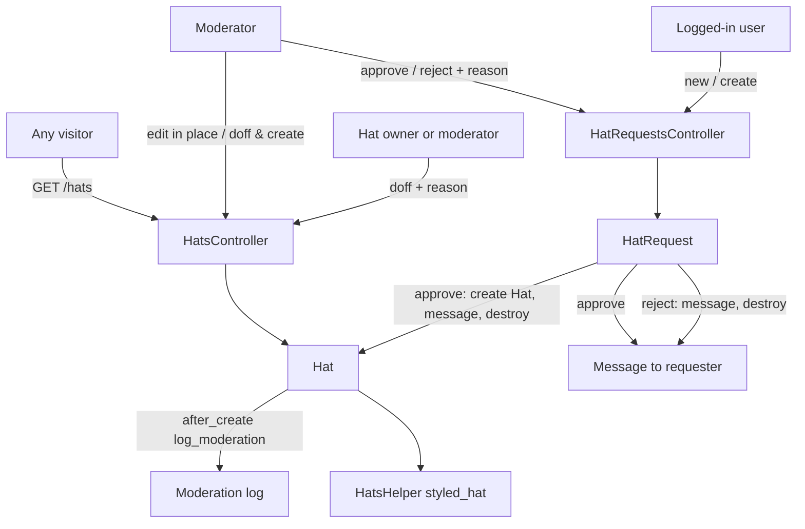
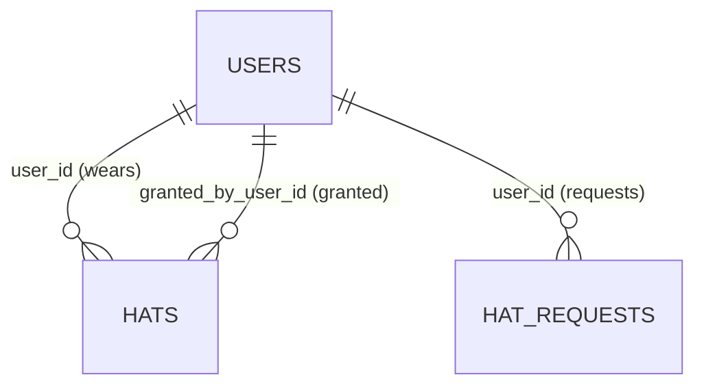

# Hats

> **Status**: ✅ Active
> **Generated**: 2026-10-24T00:00:00Z
> **Last Updated**: 2026-10-24T00:00:00Z
---

## Overview

### What It Does
Hats are verified affiliation badges. A `Hat` is a short label (e.g., "OpenBSD Developer") granted to a user, which that user can wear on a comment or private message to show they are speaking officially for a project, organization, or company. A user may hold multiple hats but wears at most one per comment or message. Users obtain hats through a moderated request workflow (`HatRequest`): any logged-in user applies with a label, a public verification link, and a private comment; moderators approve or reject with a required reason that is privately messaged to the requester. Moderators can later edit a hat (in place, or by retiring it and granting a replacement) and the owner or a moderator can doff (retire) it with a required public reason.

### Why It Exists
Statements made on behalf of a project or company need a trust signal. The approval workflow verifies the affiliation before the badge appears, and mandatory reasons plus automatic moderation-log entries for grants, edits, and doffings keep the whole lifecycle publicly auditable. Site guidance: hats are for speaking officially, not for commemorating past contributions or jobs, and are usually reserved for notable projects and organizations.

### Key Capabilities
- Public `/hats` page listing all active hats, grouped by hat text (case-insensitively) and sorted by username
- Logged-in users request hats via a form with **Hat**, **Link**, and **Comment** (moderator-only) fields
- Moderators review a pending queue, may edit the hat text/link before approving, and must give a reason; the requester is notified by private message on approval ("Your hat \"X\" has been approved") or rejection ("Your request for hat \"X\" has been rejected")
- Doffing requires a reason ("Short public explanation, like \"Left project\""); blank reasons are rejected with "You must give a reason for the doffing."
- Moderator edit offers **Edit In-Place** (mutates and logs rename/link changes) and **Doff & Create** (new hat, old one doffed with reason `To replace with "<new>"`, preserving owner, original granter, link, and modlog flag)
- Hat badges render with a tooltip `Granted YYYY-MM-DD`; `http(s)` links make the badge a new-tab hyperlink; email links are shown to logged-out visitors as the domain only

---

## Architecture

### High-Level Design


### Components

#### Backend Components
| Component | File Path | Purpose |
|-----------|-----------|---------|
| `HatsController` | `app/controllers/hats_controller.rb` | Public index; doff flow; moderator edit (`update_in_place`, `update_by_recreating`) |
| `HatRequestsController` | `app/controllers/hat_requests_controller.rb` | Request form/create; pending queue; moderator approve/reject |
| `Hat` | `app/models/hat.rb` | Badge record: validations, `active` scope, doffing, grant logging, link sanitization |
| `HatRequest` | `app/models/hat_request.rb` | Pending application: validations, transactional approve/reject with notification |
| `HatsHelper` | `app/helpers/hats_helper.rb` | `styled_hat` / `hat_text` badge rendering |

#### Frontend Components
| Component | File Path | Purpose |
|-----------|-----------|---------|
| Hats index | `app/views/hats/index.html.erb` | Public table (User / Hat / Link); **Request Hat** link when signed in; **Edit** column for moderators |
| Doff form | `app/views/hats/doff.html.erb` | Read-only User/Hat + required **Reason**; **Doff Hat** submit |
| Edit form | `app/views/hats/edit.html.erb` | **Hat** and **Link** fields; **Edit In-Place** and **Doff & Create** submits |
| Request form | `app/views/hat_requests/new.html.erb` | **Hat** / **Link** / **Comment** fields with policy guidance and GitHub-auth tip |
| Request queue | `app/views/hat_requests/index.html.erb` | Per-request editable Hat/Link, Markdown comment, required **Reason**, Approve/Reject buttons; "No hat requests." when empty |

### Technology Stack
- **Backend**: Ruby on Rails, plain ActiveRecord (no service objects or jobs)
- **Frontend**: Server-rendered ERB with `form_with`
- **Database**: Relational via ActiveRecord (`hats`, `hat_requests` tables)
- **External Services**: None — notifications are in-app `Message` records; audit trail is `Moderation` records

---

## Model Details

### Hat

#### Associations
```ruby
belongs_to :user
belongs_to :granted_by_user, class_name: "User", inverse_of: false
```

#### Concerns
| Concern | Purpose |
|---------|---------|
| `Token` | Shared token-generation concern |

#### Callbacks
| Callback | Method | Purpose |
|----------|--------|---------|
| `before_validation, on: :create` | `:assign_short_id` | Sets `short_id` via `ShortId.new(self.class).generate` |
| `after_create` | `:log_moderation` | Moderation entry `Granted hat "<hat>"` + ` (<link>)` if link present; moderator = `granted_by_user_id`; `created_at` copied from the hat |

#### Validations and Scope
```ruby
validates :hat, presence: true
validates :hat, :link, length: {maximum: 255}
validates :modlog_use, inclusion: {in: [true, false]}
validates :short_id, length: {maximum: 10}, presence: true

scope :active, -> { joins(:user).where(doffed_at: nil).merge(User.active) }
```
A hat is "active" (publicly listed) only while undoffed **and** its wearer is an active user.

#### Key Methods
| Method | Returns | Purpose | Notes |
|--------|---------|---------|-------|
| `doff_by_user_with_reason(user, reason)` | — | Moderation entry `Doffed hat "<hat>"` with reason; sets `doffed_at = Time.current`; saves | Attribution: `moderator_user_id = user.is_moderator? ? user : nil` — self-doffs are unattributed |
| `sanitized_link` | `String` | If `link` contains `@`, returns `Mail::Address.new(link).domain`; else the raw link | Hides full email addresses from logged-out visitors |
| `to_txt` | `String` | `"(#{hat}) "` | Plain-text rendering |
| `to_param` | `String` | `short_id` | All hat URLs keyed by short id |

### HatRequest

#### Associations
```ruby
belongs_to :user
```

#### Concerns
| Concern | Purpose |
|---------|---------|
| `Token` | Shared token-generation concern |

#### Validations
```ruby
validates :hat, presence: true, length: {maximum: 255}
validates :link, presence: true, length: {maximum: 255}
validates :comment, presence: true, length: {maximum: 65_535}
```
Also declares `attr_accessor :rejection_comment`, which is not referenced anywhere else in the mapped files.

#### Key Methods
| Method | Returns | Purpose | Notes |
|--------|---------|---------|-------|
| `approve_by_user_for_reason!(user, reason)` | — | Transaction: new `Hat` (wearer = requester, granter = approver, hat/link copied); `Message` to requester, subject `Your hat "<hat>" has been approved`, body `reason + (" " * 20)`; then `destroy!` | The 20 trailing spaces are a self-described kludge to meet a 20-character minimum body length |
| `reject_by_user_for_reason!(user, reason)` | — | Transaction: `Message` subject `Your request for hat "<hat>" has been rejected`, body `reason`; then `destroy!` | Rejections create no moderation-log entry |

Both outcomes destroy the request row — the queue is purely pending work; no decision history is kept on the request itself.

---

## Database Schema

> `db/schema.rb` is outside this feature's mapped file set; the columns below are those exercised by the models, controllers, and views.

### hats
| Column | Type | Default | Notes |
|--------|------|---------|-------|
| `id` | integer | — | Primary key |
| `user_id` | integer | — | Wearer |
| `granted_by_user_id` | integer | — | Granting moderator |
| `hat` | string | — | Label; presence, ≤ 255 |
| `link` | string | — | Verification link; ≤ 255 |
| `short_id` | string | — | Presence, ≤ 10; URL key (`to_param`) |
| `modlog_use` | boolean | — | Validated true/false; preserved on recreation |
| `doffed_at` | datetime | NULL | Non-NULL means retired |
| `created_at`, `updated_at` | datetime | — | `created_at` surfaces as the "Granted YYYY-MM-DD" tooltip |

### hat_requests
| Column | Type | Default | Notes |
|--------|------|---------|-------|
| `id` | integer | — | Primary key |
| `user_id` | integer | — | Requester |
| `hat` | string | — | Presence, ≤ 255 |
| `link` | string | — | Presence, ≤ 255 |
| `comment` | text | — | Presence, ≤ 65,535; moderator-facing, rendered as Markdown in the queue |
| `created_at`, `updated_at` | datetime | — | Request age shown in the queue |

### Relationships


---

## API Endpoints

> Derived from controller actions and the path helpers used in the views; every listed action exists in its controller.

| Method | Path | Action | Description | Notes |
|--------|------|--------|-------------|-------|
| `GET` | `/hats` | `hats#index` | Active hats grouped by hat text | Public (no login) |
| `GET` | `/hats/:id/doff` | `hats#doff` | Doffing form ("Doffing a Hat") | Owner or moderator |
| `POST` | `/hats/:id/doff_by_user` | `hats#doff_by_user` | Doff with reason; blank reason → error flash, redirect to form; success → redirect to profile | Owner or moderator |
| `GET` | `/hats/:id/edit` | `hats#edit` | Edit form ("Edit a Hat") | Moderator |
| `POST` | `/hats/:id/update_in_place` | `hats#update_in_place` | Update hat/link; logs rename and/or link change; → hats index | Moderator |
| `POST` | `/hats/:id/update_by_recreating` | `hats#update_by_recreating` | Create replacement hat, doff old with `To replace with "<new>"` | Moderator |
| `GET` | `/hat_requests/new` | `hat_requests#new` | Request form ("Request a Hat") | Logged-in |
| `POST` | `/hat_requests` | `hat_requests#create` | Create; success flash "Successfully submitted hat request." → `/hats` | Logged-in |
| `GET` | `/hat_requests` | `hat_requests#index` | All pending requests | Logged-in (⚠️ not moderator-gated) |
| `POST` | `/hat_requests/:id/approve` | `hat_requests#approve` | Apply form's hat/link edits, approve with reason; flash "Successfully approved hat request." | Moderator |
| `POST` | `/hat_requests/:id/reject` | `hat_requests#reject` | Reject with reason; flash "Successfully rejected hat request." | Moderator |

---

## Authorization

No Pundit policies — access control is entirely controller `before_action` gates.

| Gate | Applies to | Conditions | Notes |
|------|------------|------------|-------|
| `require_logged_in_user` | all `HatsController` actions except `index`; all `HatRequestsController` actions | Signed in | `/hats` itself is public |
| `require_logged_in_moderator` | `edit`, `update_in_place`, `update_by_recreating`; `approve`, `reject` | Moderator account | |
| `only_hat_user_or_moderator` | `doff`, `doff_by_user` | `@hat.user == @user || @user&.is_moderator?` | Failure redirects to the visitor's own profile |
| `find_hat!` scoping | hat member actions | Moderators: `Hat.find_by(short_id: params[:id])` — any hat. Others: `@user.wearable_hats.find_by(short_id: params[:id])` | Non-mods can only act on their own wearable hats |

---

## Configuration

### Environment Variables
None.

### Config Files
None specific to this feature.

---

## Usage Examples

### Doffing with a reason (model)
```ruby
# Source: app/models/hat.rb
def doff_by_user_with_reason(user, reason)
  m = Moderation.new
  m.user_id = user_id
  m.moderator_user_id = user.is_moderator? ? user : nil
  m.action = "Doffed hat \"#{hat}\""
  m.reason = reason
  m.save!

  self.doffed_at = Time.current
  save!
end
```

### Approving a request (model, transactional)
```ruby
# Source: app/models/hat_request.rb
def approve_by_user_for_reason!(user, reason)
  transaction do
    h = Hat.new
    h.user_id = user_id
    h.granted_by_user_id = user.id
    h.hat = hat
    h.link = link
    h.save!

    m = Message.new
    m.author_user_id = user.id
    m.recipient_user_id = user_id
    m.subject = "Your hat \"#{hat}\" has been approved"
    m.body = reason + (" " * 20) # kludge to ensure there are 20 characters
    m.save!

    destroy!
  end
end
```

### Replacing a hat while preserving history (controller)
```ruby
# Source: app/controllers/hats_controller.rb
def update_by_recreating
  new_hat = params[:hat][:hat]

  replaced_hat = Hat.new({
    hat: new_hat,
    doffed_at: nil,
    user_id: @hat.user_id,
    granted_by_user_id: @hat.granted_by_user_id,
    link: @hat.link,
    modlog_use: @hat.modlog_use
  })

  if replaced_hat.save
    @hat.doff_by_user_with_reason(@user, "To replace with \"#{new_hat}\"")

    redirect_to hats_url
  else
    flash[:error] = replaced_hat.errors.full_messages.join(", ")
    redirect_to edit_hat_path(@hat)
  end
end
```

### Badge rendering (helper)
```ruby
# Source: app/helpers/hats_helper.rb
def styled_hat(hat)
  hl = hat.link.present? && hat.link.match(/^https?:\/\//)

  if !hl && hat.link.present?
    sanitized_link = " - #{ERB::Util.html_escape(hat.sanitized_link)}"
  end

  content_tag(:span, class: "hat hat_#{hat.hat.gsub(/[^A-Za-z0-9]/, "_").downcase}", title: "Granted #{hat.created_at.strftime("%Y-%m-%d")}#{sanitized_link if sanitized_link}") do
    concat hat_text(hat, hl)
  end
end
```

---

## Testing

### Test Files
No test files are included in this feature's mapped file set; none verified.

---

## Known Issues & Caveats

| Issue | Location | Description |
|-------|----------|-------------|
| Request queue not mod-gated | `hat_requests_controller.rb` | `index` requires login only — any signed-in user can view pending requests, including the "moderator-only" comments; approve/reject remain mod-only |
| Possible nil dereference | `hats_controller.rb` (`find_hat!` → `only_hat_user_or_moderator`) | `find_by` can return `nil`; `@hat.user` then raises `NoMethodError` instead of rendering a 404 |
| Message-length kludge | `hat_request.rb` | Approval message body is `reason + (" " * 20)`; the comment admits it exists "to ensure there are 20 characters" |
| Permit-then-except | `hat_requests_controller.rb#approve` | `params.require(:hat_request).permit(:hat, :link, :reason).except(:reason)` — reason is permitted, then excluded from the mass update |
| Possible empty modlog action | `hats_controller.rb#update_in_place` | If neither hat nor link actually changed, the Moderation `action` is an empty string |
| No request archive | `hat_request.rb` | Approve and reject both `destroy!` the request; rejections also write no modlog entry, so the private message is the only rejection record |
| `modlog_use` not settable in UI | `hats/edit.html.erb` | Flag is validated and preserved by recreation, but no form exposes it; approvals never set it explicitly |
| Unused accessor | `hat_request.rb` | `attr_accessor :rejection_comment` is never referenced in the mapped files |

---

## Performance

### Optimization Strategies
- `Hat.active.includes(:user).find_each` on the public index — eager-loads wearers and batches rows
- `HatRequest.all.includes(:user)` on the queue — avoids N+1 user lookups

### Caching
- None in this feature.

### Database Optimization
- Hats are looked up by `short_id` (`to_param`); index definitions live in the schema, outside this file set.

---

## Troubleshooting

### Issue: "You must give a reason for the doffing."
**Symptoms:** The doff form redisplays with an error flash.
**Cause:** `doff_by_user` rejects a blank `params[:reason]`.
**Solution:** Enter a short public explanation — the form hints: `Short public explanation, like "Left project"` — and resubmit **Doff Hat**.

### Issue: Non-moderator cannot open a hat's edit or doff page
**Symptoms:** Redirected to their own profile, or the hat isn't found.
**Cause:** Edit actions require a moderator; doffing is limited to the owner or a moderator, and non-mods resolve hats only within their own `wearable_hats`.
**Solution:** Owners can doff their own hats; all edits go through a moderator.

### Issue: A rename produced a doffed duplicate hat
**Symptoms:** Old hat shows doffed with reason `To replace with "<new>"`; a new active hat exists with the same owner and link.
**Cause:** The moderator clicked **Doff & Create** (`update_by_recreating`) rather than **Edit In-Place**.
**Solution:** Working as designed — recreation preserves history. Use **Edit In-Place** for typo-level corrections.

---

## Related Features

- **[Moderation](../features/moderation.md)** — grants, in-place edits, and doffings write `Moderation` entries to the public log
- **[Messages](../features/messages.md)** — approval and rejection decisions are delivered as private `Message`s
- **[Users](../features/users.md)** — hats belong to users; `User.active` gates the public list; `wearable_hats` scopes owner access
- **[Comments](../features/comments.md)** — worn hats render on comments via `styled_hat`
- **[Settings](../features/settings.md)** — the request form recommends GitHub auth (settings, external section) for instant verification

---

**Generated:** 2026-10-24T00:00:00Z
**Last Updated:** 2026-10-24T00:00:00Z
**Status:** ✅ Active
