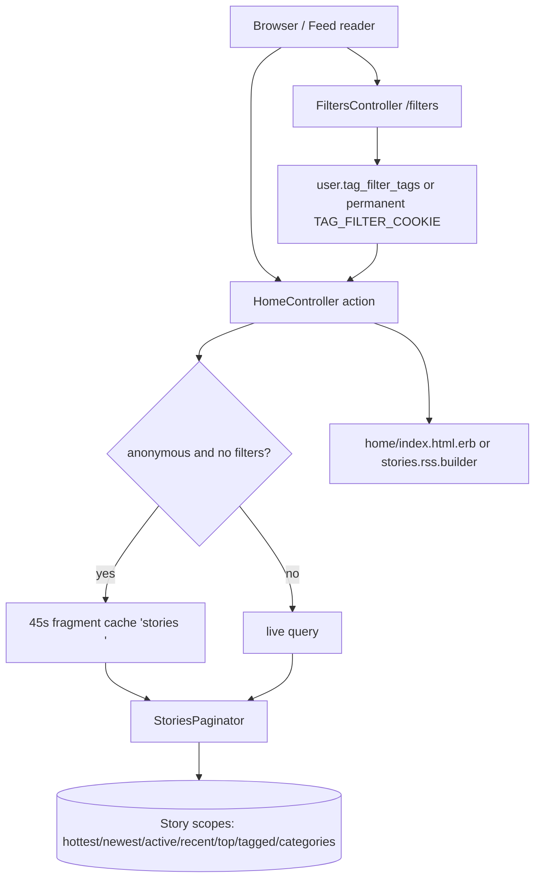
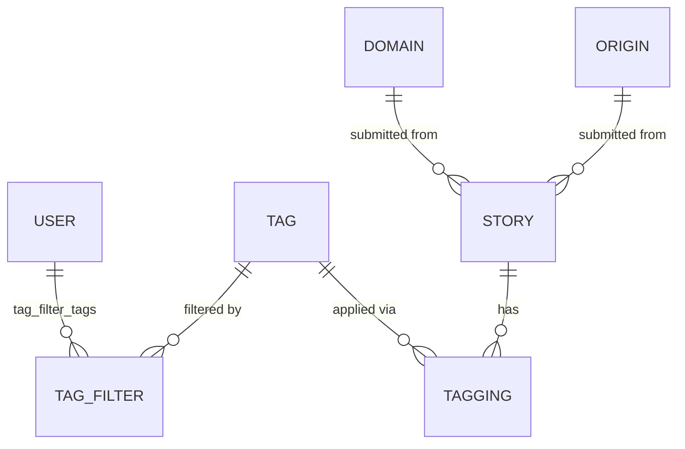

# Home Feed

> **Status**: ✅ Active
> **Generated**: 2026-10-24T00:00:00Z
> **Last Updated**: 2026-10-24T00:00:00Z
---

## Overview

### What It Does
The home-feed feature serves every story listing on the site from one controller and one shared view. Feeds include: the hottest front page, Newest (with a per-user "Last Read" marker), Recent (newest stories that have not yet reached the front page), Active (stories sorted by last comment), Top over a user-editable time interval (default one week), single-tag, multi-tag, category, domain, origin, and newest-by-user listings, plus the login-only Saved, Upvoted, and Hidden personal lists. Most feeds are available in HTML, RSS 2.0, and JSON. The feature also includes per-viewer tag filtering (the Filtered Tags page), the shared StoryFinder lookup concern, and the Keystore key/value model.

### Why It Exists
Browsing stories is the primary activity on a link-aggregation community. Readers need multiple orderings (hot, new, active, top) and slices (by tag, category, website, source, or member) of the same stories, personalized by tag filters — which work even for anonymous visitors via a browser cookie — and consumable from feed readers through private tokenized RSS URLs.

### Key Capabilities
- Fourteen feed actions rendered by one shared list view and one RSS builder
- Viewer tag filters applied to every main feed query; filtered stories vanish site-wide
- Private RSS: a `token` query parameter identifies the user on the front page, Newest, Saved, and Upvoted feeds and applies their filters; feed titled "Private feed for <username>"
- Two-layer caching for anonymous visitors: page caching (gated by `CACHE_PAGE`) plus a 45-second fragment cache; anonymous front-page RSS cached 2 minutes
- "Last Read" marker on Newest that carries over to later pages
- Pagination with strict bounds; comma-separated tag/category lists resolve all-or-nothing (404 on any unknown name)

---

## Architecture

### High-Level Design


### Components

#### Backend Components
| Component | File Path | Purpose |
|-----------|-----------|---------|
| HomeController | `app/controllers/home_controller.rb` | All 14 feed actions; pagination, two-layer caching, RSS tokens, Open Graph meta tags |
| FiltersController | `app/controllers/filters_controller.rb` | Tag-filter table and save; persists to the user record or a permanent cookie |
| StoryFinder concern | `app/controllers/concerns/story_finder.rb` | Story lookup by short_id (admins may use numeric id); hydrates the viewer's current vote |
| Keystore | `app/models/keystore.rb` | Generic key/value store; read-through cache on the per-request traffic path |

#### Frontend Components
| Component | File Path | Purpose |
|-----------|-----------|---------|
| Shared list view | `app/views/home/index.html.erb` | Story rows (inlined copy of `stories/_listdetail`), Last Read divider, prev/next page nav |
| RSS builder | `app/views/home/stories.rss.builder` | RSS 2.0 output: channel title "<site>: <feed title>", ttl 120, items with author "domain by/via username" and one category per tag |
| Feed headers | `app/views/home/_active.html.erb`, `_recent.html.erb`, `_top.html.erb`, `_single_tag.html.erb`, `_multi_tag.html.erb`, `_category.html.erb`, `_for_domain.html.erb`, `_for_origin.html.erb`, `_newest_by_user.html.erb` | Per-feed hint/description boxes rendered above or below the list |
| Filters page | `app/views/filters/index.html.erb` | Category-grouped tag table: Hide checkbox, tag, description, story count, filtering count; Save Filters button |

### Technology Stack
- **Backend**: Rails controllers + ActiveRecord scopes; `StoriesPaginator.new(scope, page, user).get` returns `[stories, show_more]`
- **Frontend**: ERB templates and an XML builder; no JavaScript components in this feature
- **Database**: relational store via ActiveRecord; `keystore` table keyed by a string primary key
- **External Services**: none (story rows link to Archive.org and Ghostarchive cached copies)

---

## Model Details

### Keystore

#### Associations
None — standalone table, `self.primary_key = "key"`.

#### Concerns
None.

#### Callbacks
None; validations only (verbatim):
```ruby
validates :key,
  presence: true,
  uniqueness: {case_sensitive: false},
  length: {maximum: MAX_KEY_LENGTH}
validates :id, presence: true
```
`MAX_KEY_LENGTH = 50`.

#### Key Methods
| Method | Returns | Purpose | Notes |
|--------|---------|---------|-------|
| `self.get(key)` | record/nil | `find_by(key:)` | |
| `self.value_for(key)` | value | `where(key:).pick(:value)` | |
| `self.put(key, value)` | `true` | validated upsert (`returning: false`) | keys > 50 chars raise `ActiveRecord::ValueTooLong` |
| `self.incremented_value_for(key, amount = 1)` | new value | transactional upsert, then read | `on_duplicate: Arel.sql("value = value + 1")` — the conflict branch always adds exactly 1, ignoring `amount` |
| `self.decremented_value_for(key, amount = -1)` | new value | delegates to the increment pair | |
| `self.find_or_create_key_for_update(key, init = nil)` | locked record | `lock(true)` find-or-create loop | retries on `ActiveRecord::RecordNotUnique` |
| `self.readthrough_cache(key, &blk)` | value | get or compute-and-put | "deliberately no lock/transaction as TrafficHelper is on the hot path of every request" |

### StoryFinder (controller concern)
| Method | Returns | Purpose | Notes |
|--------|---------|---------|-------|
| `find_story` | Story/nil | `Story.find_by(short_id: params[:story_id] \|\| params[:id])`; admins fall back to `Story.find(params[:id])` | "convenience to use PK ... without generally permitting enumeration"; sets `story.current_vote` for logged-in users |
| `find_story!` | sets `@story` | raises `ActiveRecord::RecordNotFound` when nil | |

---

## Database Schema

### keystore

> Columns inferred from the model; `db/schema.rb` is outside this feature's mapped file list.

| Column | Type | Default | Notes |
|--------|------|---------|-------|
| `key` | string (max 50) | — | primary key, case-insensitively unique |
| `id` | integer | — | NOT NULL via explicit validation (not the PK) |
| `value` | numeric | — | upserted; conflict path runs `value = value + 1` |

### Relationships


---

## API Endpoints

> Every action listed exists in `HomeController`/`FiltersController`. Paths follow the URL helpers used in code/views.

| Method | Path | Action | Description | Notes |
|--------|------|--------|-------------|-------|
| `GET` | `/`, `/page/:page`, `/rss` | `index` | Hottest stories (front page) | OG meta tags; anonymous RSS cached 2 min; `token` → private filtered feed |
| `GET` | `/newest(.rss)` | `newest` | All stories, newest first | Last Read marker; `last_read_timestamp` carried in next-page params; token private feed |
| `GET` | newest by user | `newest_by_user` | One member's newest submissions | 404 on unknown username |
| `GET` | `/recent` | `recent` | Newest not yet on the front page | HTML only; advertised RSS deliberately points at `/newest.rss` (recent list is unstable) |
| `GET` | active | `active` | "Active Discussions" sorted by last comment | HTML + JSON |
| `GET` | `/top/:length(/rss)` | `top` | Top stories of an interval | bad/placeholder interval redirects to `/top/1w`; units like `/5d`, `/2y`; no JSON |
| `GET` | tag page (.rss) | `single_tag` | Stories for one tag | related tags cached 1 day; header shows hotness modifier, moderator-only or new-user restrictions, filtered notice |
| `GET` | multi-tag `a,b` (.rss) | `multi_tag` | Stories matching the listed tags | 404 unless every tag exists |
| `GET` | category `a,b` (.rss) | `category` | Stories in listed categories | same all-or-nothing rule |
| `GET` | domain page (.rss) | `for_domain` | Stories from one website | ordered newest-first by id; header: story/submitter/origin counts, ban info |
| `GET` | origin page (.rss) | `for_origin` | Stories from one source | same pattern |
| `GET` | hidden | `hidden` | Viewer's hidden stories | login required; HTML only |
| `GET` | saved (.rss) | `saved` | Viewer's saved stories | login required; token → "Private feed of saved stories for <username>" |
| `GET` | upvoted (.rss) | `upvoted` | Viewer's upvoted stories | login required; ordered by most recent vote |
| `GET` | `/filters` | filters#index | Tag-filter table | session kept alive so CSRF passes on save |
| `POST` | `/filters` | filters#update | Save filters | flash "Your filters have been updated."; redirects back to `/filters` |

---

## Authorization (Pundit)

No Pundit policies — controller/view-level rules only:

| Mechanism | Permission | Conditions | Notes |
|--------|------------|------------|-------|
| `require_logged_in_user` | personal lists | `hidden`, `saved`, `upvoted` | |
| `find_user_from_rss_token` | private RSS | `token` param on `index`, `newest`, `saved`, `upvoted` | applies the user's tag filters to the feed |
| `Tag#user_can_filter?` | filter a tag | per tag and viewer | enforced both on save and when rendering Hide checkboxes; non-filterable tags silently dropped |
| `User#is_admin?` | numeric-id story lookup | StoryFinder only | |
| `User#is_moderator?` | mod edit links; Edit on domain/origin headers | view-level | |

---

## Configuration

### Environment Variables
None referenced in the mapped sources.

### Config Files / Constants
- `CACHE_PAGE` — enables `caches_page` on the eleven public listing actions (active, category, for_domain, for_origin, index, multi_tag, newest, newest_by_user, recent, single_tag, top)
- `TAG_FILTER_COOKIE` — permanent cookie holding comma-joined filtered tag names for anonymous visitors
- `Keystore::MAX_KEY_LENGTH = 50`

---

## Usage Examples

### Anonymous fragment caching (45 s) with silent fallback
```ruby
# Source: app/controllers/home_controller.rb:373
def get_from_cache(opts = {}, &)
  # don't cache if there's a user because they can have hidden stories; visitors can filter tags by cookie
  if Rails.env.development? || @user || filtered_tags.any?
    yield
  else
    key = opts.merge(page: page).sort.map { |k, v| "#{k}=#{v.to_param}" }.join(" ")
    begin
      Rails.cache.fetch("stories #{key}", expires_in: 45, &)
    rescue Errno::ENOENT => e
      # Rails.logger.error "error fetching stories #{key}: #{e}"
      yield
    end
  end
end
```

### Page bounds
```ruby
# Source: app/controllers/home_controller.rb:359
def page
  p = params[:page].to_i
  if p == 0
    p = 1
  elsif p < 0 || p > (2**32)
    raise ActionController::RoutingError.new("page out of bounds")
  end
  p
end
```

### Saving filters (account vs cookie)
```ruby
# Source: app/controllers/filters_controller.rb:24
def update
  new_tags = Tag.active.where(tag: (params[:tags] || {}).keys).to_a
  new_tags.keep_if { |t| t.user_can_filter? @user }

  if @user
    @user.tag_filter_tags = new_tags
  else
    cookies.permanent[TAG_FILTER_COOKIE] = new_tags.map(&:tag).join(",")
  end

  flash[:success] = "Your filters have been updated."

  redirect_to filters_path
end
```

---

## Testing

### Test Files
- `spec/controllers/home_controller_spec.rb`
- `spec/requests/home_spec.rb`
- `spec/models/keystore_spec.rb`

---

## Known Issues & Caveats

| Issue | Location | Description |
|-------|----------|-------------|
| Cache-key collision | `home_controller.rb:29` vs `:153` | `hidden` and `saved` both pass `hidden: true` to `get_from_cache`; masked because logged-in requests bypass the cache |
| `amount` ignored on conflict | `keystore.rb:38` | increment upsert hardcodes `value = value + 1` |
| Hardcoded RSS path | `home_controller.rb:322` | top feed href is the literal string `"/top/#{length[:param]}/rss"` |
| Swallowed cache errors | `home_controller.rb:380-382` | `Errno::ENOENT` rescued with the logging line commented out |
| Inlined partial | `home/index.html.erb` | `heinous_inline_partial(stories/_listdetail)` — edit the named partial, not the inline copy |
| Deliberate race | `keystore.rb:68` | `readthrough_cache` documented as lock/transaction-free (hot path) |
| Unstable list vs RSS | `home_controller.rb:146` | recent advertises newest.rss "because upvoted stories get removed" |

---

## Performance

### Optimization Strategies
- One shared list view; feed differences are small header partials
- Filters page computes story counts and filter counts as separate grouped queries — "three queries is much faster than joining"
- Upvoted list eager-loads tags to avoid N+1
- Related-tags computation cached per tag for 1 day

### Caching
- **Cache Layer**: page cache (`caches_page … if: CACHE_PAGE`) + `Rails.cache` fragments
- **TTL**: 45 s story lists (anonymous, unfiltered only); 120 s anonymous front-page RSS; 1 day related tags; RSS advertises `ttl 120` to readers

### Database Optimization
- `keystore.key` unique primary key (≤ 50 chars)
- Domain/origin listings ordered by `id DESC`

---

## Troubleshooting

### Common Issues

#### Issue: A viewer can't see a story others see
**Symptoms:**
- Story absent from feeds for one person only

**Cause:**
Their tag filters (account or cookie) exclude one of its tags from every feed query, or they hid the story.

**Solution:**
Untick the tag on the Filtered Tags page and click **Save Filters**, or unhide the story from the Hidden list.

#### Issue: 404 on multi-tag or category URLs
**Cause:** every comma-separated name must exist; one unknown name fails the whole request.
**Solution:** correct the names.

#### Issue: "page out of bounds" errors in logs
**Cause:** page parameter negative or above 2^32 — a deliberate guard.
**Solution:** none needed; usually crawlers.

---

## Related Features

- **[stories](../features/stories.md)** — Story scopes and StoriesPaginator; hide/save/vote controls shown on feed rows
- **[tags-categories](../features/tags-categories.md)** — tags, tag filters, categories behind tag/category feeds
- **[domains-origins](../features/domains-origins.md)** — domain/origin records behind the source feeds
- **[comments](../features/comments.md)** — comment counts, Active ordering, and the comments RSS advertised on the front page
- **[users](../features/users.md)** — newest-by-user, RSS tokens, the last-read timestamp

---

**Generated:** 2026-10-24T00:00:00Z
**Last Updated:** 2026-10-24T00:00:00Z
**Status:** ✅ Active
