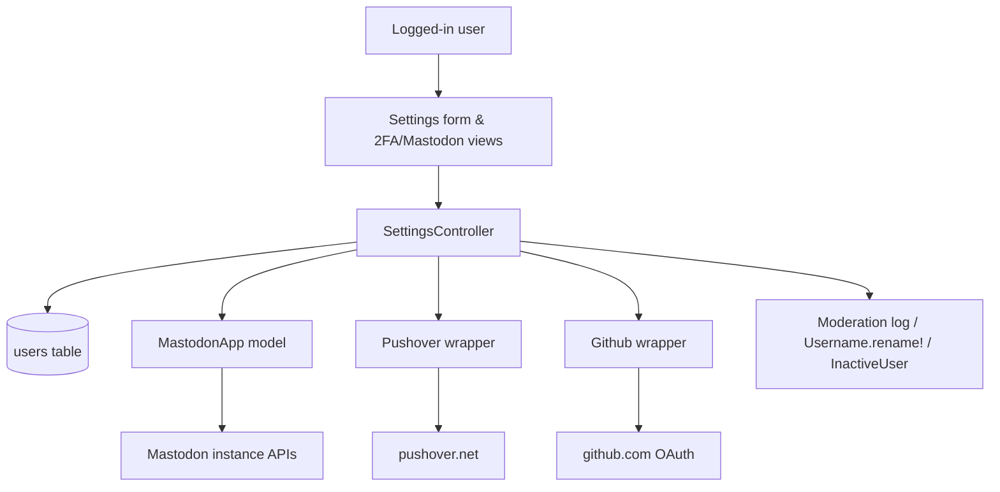
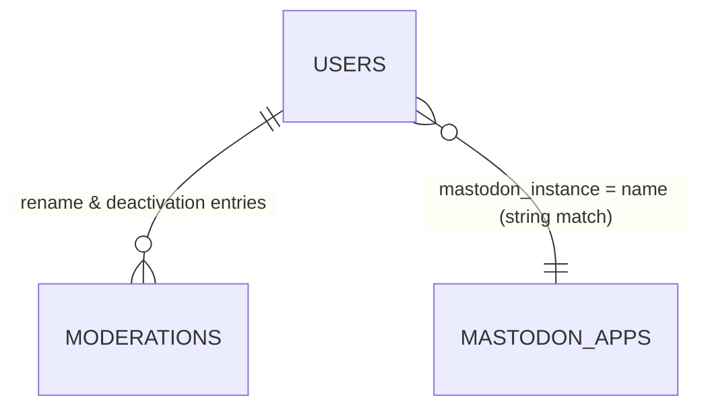

# Settings

> **Status**: ✅ Active
> **Generated**: 2026-10-24T00:00:00Z
> **Last Updated**: 2026-10-24T00:00:00Z
---

## Overview

### What It Does
The settings feature is the account self-service area of Lobsters, rooted at `/settings` and available only to logged-in users. From one page a user edits their public profile (username, email, "Show Email on profile", homepage, about), changes their password, configures notifications for comment replies, comment mentions, and private messages (each independently via e-mail, inbox, or Pushover), opts into mailing-list delivery of site content, sets appearance preferences (color scheme, contrast, story previews, user avatars), enrolls in or disables TOTP two-factor authentication, manages external accounts (Gravatar avatar cache, Pushover subscription, Mastodon link, GitHub link), sends invitations, and can deactivate the account with an optional "disown" of their stories and comments.

### Why It Exists
Identity, security, and notification volume must be user-controlled without staff involvement. The feature also provides a safe, audited exit path: deactivations and username renames are written to the public moderation log, usernames remain reserved, and stories are preserved for the community.

### Key Capabilities
- Single-form save of profile and preference changes (`POST /settings`), with "Successfully updated settings." feedback
- Password change gated on the current password; on success the session token is rotated, signing out all other sessions
- TOTP 2FA enrollment via QR code (or manually revealed secret) with a 15-minute window; disable via password confirmation
- OAuth linking of Mastodon (any instance; the site auto-registers an OAuth app per instance) and GitHub; Pushover subscription for push alerts
- Mailing-list mode: receive all stories and comments, or only stories, by e-mail at a private per-user list address (tag filters respected)
- Account deactivation requiring password + "I am sure" checkbox, with optional disowning of content to the `inactive-user` account

---

## Architecture

### High-Level Design


### Components

#### Backend Components
| Component | File Path | Purpose |
|-----------|-----------|---------|
| `SettingsController` | `app/controllers/settings_controller.rb` | 17 actions: `index`, `update`, `deactivate`; `twofa`, `twofa_auth`, `twofa_enroll`, `twofa_verify`, `twofa_update`; `pushover_auth`, `pushover_callback`; `mastodon_authentication`, `mastodon_auth`, `mastodon_callback`, `mastodon_disconnect`; `github_auth`, `github_callback`, `github_disconnect` |
| `MastodonApp` | `app/models/mastodon_app.rb` | Per-instance OAuth client: registration against `api/v1/apps`, authorize-URL building, code→token exchange, token revocation, instance-name sanitizing |

External collaborators used by the controller: `User` (`authenticate`, `roll_session_token`, `has_2fa?`, `disable_2fa!`, `authenticate_totp`, `delete!`, `can_invite?`, `disabled_invite_reason`), `Username.rename!`, `InactiveUser.disown_all_by_author!`, `Moderation.create!`, `EmailBlocklistValidation.email_on_blocklist?`, and the `extras/` wrappers `Pushover`, `Github`, `Mastodon`, `Sponge`.

#### Frontend Components
| Component | File Path | Purpose |
|-----------|-----------|---------|
| Settings form | `app/views/settings/index.html.erb` | Sections: Public Profile Information; Security Settings; Comment Reply / Comment Mention / Private Message Notification Settings; Submitted Story Comment Settings; Mailing List Settings; Miscellaneous Settings; External Accounts; Invite a New User; Deactivate Account. Submit buttons labeled **Save Account Settings** |
| 2FA gate | `app/views/settings/twofa.html.erb` | Current-password form; button is **Continue** (enroll) or **Disable Two-Factor Authentication** |
| 2FA enroll | `app/views/settings/twofa_enroll.html.erb` | Clickable SVG QR code; **Reveal Secret** details element; **Verify and Enable** button |
| 2FA verify | `app/views/settings/twofa_verify.html.erb` | **TOTP Code** field (numeric, one-time-code autocomplete); **Verify and Enable** |
| Mastodon form | `app/views/settings/mastodon_authentication.html.erb` | **Name or URL** field (e.g. `mastodon.social`); **Continue**; explains the `read:accounts` scope |

### Technology Stack
- **Backend**: Rails controller + ActiveRecord; `ROTP` (secret via `ROTP::Base32.random`, provisioning URI with issuer = app name and account e-mail, `authenticate_totp`); `RQRCode` for the QR SVG; `SecureRandom.hex` state nonces; `Sponge` HTTP client
- **Frontend**: server-rendered ERB (`form_with`); no JavaScript
- **Database**: MySQL (`users`, `mastodon_apps`)
- **External Services**: Pushover subscription API; Mastodon per-instance `api/v1/apps`, `oauth/authorize`, `oauth/token`, `oauth/revoke`, `api/v1/accounts/verify_credentials`; GitHub OAuth

---

## Model Details

### MastodonApp

#### Associations
None — standalone; users reference an instance by name string (`mastodon_instance`).

#### Concerns
None.

#### Callbacks
None.

#### Validations
```ruby
validates :name, :client_id, :client_secret,
  presence: true,
  length: {maximum: 255}
validates :name, uniqueness: {case_sensitive: false}
```

#### Key Methods
| Method | Returns | Purpose | Notes |
|--------|---------|---------|-------|
| `oauth_auth_url(mastodon_state)` | `String` | `https://<name>/oauth/authorize?...&scope=read:accounts&state=...` | |
| `redirect_uri` | `String` | `https://<domain>/settings/mastodon_callback?instance=<name>` | |
| `register_app!` | `true`/`nil` | POST `https://<name>/api/v1/apps` with client_name = site domain, scopes `read:accounts`; saves returned `client_id`/`client_secret` | Raises "already registered, delete and recreate" if `client_id` present; converts `DNSError`/`NoIPsError`, `JSON::ParserError`, `OpenSSL::SSL::SSLError`, `URI::InvalidURIError` and bad responses into model errors |
| `token_and_user_from_code(code)` | `[token, username]` or `[nil, nil]` | `/oauth/token` (grant `authorization_code`) then `GET /api/v1/accounts/verify_credentials` with the bearer token | |
| `revoke_token(token)` | `true`/`false`/`nil` | POST `/oauth/revoke`; `true` when response is `{}` | Returns `true` on timeout (nil response); no-op for blank token |
| `self.find_or_register(instance_name)` | `MastodonApp` or `nil` | Sanitizes name, returns existing row or registers a new app | `nil` when sanitized name is blank |
| `self.sanitized_instance_name(instance_name)` | `String` | Accepts `foo.social`, `https://foo.social/@user`, or `@user@foo.social` → `foo.social` | `strip` → `delete_prefix("https://")` → `split("/").first` → `split("@").last` |

### User (surface touched by this feature)
Attributes written here: password (with `roll_session_token`), `totp_secret`, `pushover_user_key`, `mastodon_oauth_token` / `mastodon_username` / `mastodon_instance`, `github_oauth_token` / `github_username`, and the preference set below. The controller edits a `dup`/`clone` (`@edit_user`) so failed validations never touch the session user; `update` always re-renders `index`.

```ruby
# Source: app/controllers/settings_controller.rb (user_params)
params.require(:user).permit(
  :username, :email, :password, :password_confirmation, :homepage, :about,
  :email_replies, :email_messages, :email_mentions, :inbox_mentions,
  :pushover_replies, :pushover_messages, :pushover_mentions,
  :mailing_list_mode, :show_email, :show_avatars, :show_story_previews,
  :show_submitted_story_threads, :prefers_color_scheme, :prefers_contrast
)
```

Key behaviors in `update`:
- Password change allowed only when `params[:user][:password].empty? || @user.authenticate(params[:current_password])` passes; otherwise flash "Your current password was not entered correctly."
- On password change: `roll_session_token` then `session[:u]` reset — all other sessions invalidated.
- On username change: `Username.rename!(user:, from:, to:, by:)` writes the public modlog entry "changed own username from 'X' to 'Y'" (the from-value is read via the misspelled `changed_atributes`).

---

## Database Schema

### mastodon_apps

| Column | Type | Default | Notes |
|--------|------|---------|-------|
| `id` | `bigint` | auto | PK |
| `name` | `string` | — | `null: false`; unique index `index_mastodon_apps_on_name` |
| `client_id` | `string` | — | `null: false` |
| `client_secret` | `string` | — | `null: false` |
| `created_at` | `datetime` | — | `null: false` |
| `updated_at` | `datetime` | — | `null: false` |

### users (columns relevant here)

| Column | Type | Default | Notes |
|--------|------|---------|-------|
| `username` | `string(50)` | — | unique index |
| `email` | `string(100)` | — | unique index; disposable-domain blocklist hint in the form |
| `password_digest` | `string(75)` | — | `authenticate` |
| `session_token` | `string(75)` | `""` | unique; rotated on password change & 2FA enable |
| `about` | `mediumtext` | — | |
| `pushover_mentions` | `boolean` | `false` | `null: false` |
| `mailing_list_token` | `string(75)` | — | unique; list address = `<shortname>-<token>@<domain>` |
| `mailing_list_mode` | `integer` | `0` | 0 = No e-mails, 1 = All stories and comments, 2 = Only stories; indexed |
| `show_email` | `boolean` | `false` | `null: false`; profile shows e-mail to logged-in users only |
| `settings` | `mediumtext` | — | serialized store backing the remaining preferences/integration fields |
| `deleted_at` | `datetime` | — | set by `delete!` on deactivation |
| `disabled_invite_*` | — | — | reason shown when the invite form is hidden |

### Relationships


---

## API Endpoints

Verified against `config/routes.rb` lines 175–194; every action exists in the controller.

| Method | Path | Action | Description | Notes |
|--------|------|--------|-------------|-------|
| `GET` | `/settings` | `index` | Render form with `@edit_user = @user.dup` | |
| `POST` | `/settings` | `update` | Save settings; re-renders `index` | |
| `POST` | `/settings/deactivate` | `deactivate` | Delete account | needs password + `i_am_sure == "1"` |
| `GET` | `/settings/2fa` | `twofa` | Password gate (enroll or disable) | |
| `POST` | `/settings/2fa_auth` | `twofa_auth` | Check password; disable 2FA or go to enroll | sets `session[:last_authed]` |
| `GET` | `/settings/2fa_enroll` | `twofa_enroll` | Generate secret + QR | 15-min window |
| `GET` | `/settings/2fa_verify` | `twofa_verify` | Code-entry form | 15-min window |
| `POST` | `/settings/2fa_update` | `twofa_update` | Verify code, enable 2FA, re-roll session token | |
| `POST` | `/settings/pushover_auth` | `pushover_auth` | Redirect to Pushover subscription | flash error if `!Pushover.enabled?` |
| `GET` | `/settings/pushover_callback` | `pushover_callback` | Store/clear `pushover_user_key` | `rand` nonce; mismatch raises |
| `GET` | `/settings/mastodon_authentication` | `mastodon_authentication` | Instance entry form | |
| `GET` | `/settings/mastodon_auth` | `mastodon_auth` | Register/find instance app; redirect to authorize | `session[:mastodon_state]` |
| `GET` | `/settings/mastodon_callback` | `mastodon_callback` | Exchange code; link account | "Invalid OAuth state" guard |
| `POST` | `/settings/mastodon_disconnect` | `mastodon_disconnect` | Revoke (best-effort) + clear fields | also teardown for failed auth |
| `GET` | `/settings/github_auth` | `github_auth` | Redirect to GitHub authorize | `session[:github_state]` |
| `GET` | `/settings/github_callback` | `github_callback` | Exchange code; link account | "Invalid OAuth state" guard |
| `POST` | `/settings/github_disconnect` | `github_disconnect` | Revoke + clear fields | manual-cleanup notice if the revoke API errors |

---

## Authorization

No Pundit policies; all guards are inline:

| Guard | Scope | Conditions | Notes |
|--------|------------|------------|-------|
| `require_logged_in_user` | all actions | before_action | feature invisible to anonymous users |
| current password | `update` (only when changing password), `deactivate`, `twofa_auth` | `User#authenticate` | distinct error flashes per action |
| `i_am_sure == "1"` | `deactivate` | required checkbox | `'You did not check the "I am sure" checkbox.'` |
| `TOTP_SESSION_TIMEOUT = (60 * 15)` | `twofa_enroll` / `twofa_verify` / `twofa_update` | `session[:last_authed]` fresher than 900 s and `session[:totp_secret]` present | "Your enrollment period timed out." |
| OAuth state nonces | Pushover (`rand`), Mastodon (`mastodon_state`), GitHub (`github_state`) callbacks | param must equal session value | GitHub deletes the nonce after checking; Pushover mismatch raises |
| `can_invite?` | invite form visibility | else `disabled_invite_reason` shown | |

---

## Configuration

### Environment Variables
None read directly; behavior depends on app config and the `extras/` wrappers:

```text
Pushover.enabled?            # gates Pushover row + pushover_auth ("This site is not configured for Pushover")
Github.enabled?              # gates GitHub row
Mastodon.enabled?            # gates Mastodon row
Rails.application.name       # TOTP issuer in provisioning URI
Rails.application.domain     # OAuth redirect URIs; mailing-list address domain
Rails.application.shortname  # mailing-list address prefix
Rails.application.root_url   # Pushover success/failure callback base
```

### Config Files
- Wrapper credentials live with `extras/` (outside this feature's mapped files)

---

## Usage Examples

### Password change with session rotation and username-rename logging
```ruby
# Source: app/controllers/settings_controller.rb (update)
if params[:user][:password].empty? ||
    @user.authenticate(params[:current_password].to_s)
  @edit_user.roll_session_token if params[:user][:password]
  if @edit_user.update(user_params)
    if @edit_user.username_changed?
      Username.rename!(
        user: @edit_user,
        from: @edit_user.changed_atributes[:username],
        to: @edit_user.username,
        by: @user
      )
    end
    session[:u] = @user.session_token if params[:user][:password]
    flash.now[:success] = "Successfully updated settings."
    @user = @edit_user
  end
else
  flash[:error] = "Your current password was not entered correctly."
end
```

### Deactivation with optional disown
```ruby
# Source: app/controllers/settings_controller.rb (deactivate)
disown = params[:user][:disown] == "1"
@user.delete!
InactiveUser.disown_all_by_author!(@user) if disown

Moderation.create!(
  moderator: nil,
  user: @user,
  action: "deactivated#{", disowning their stories and comments" if disown}"
)
reset_session
```

### Enabling 2FA
```ruby
# Source: app/controllers/settings_controller.rb (twofa_update)
@user.totp_secret = session[:totp_secret]
if @user.authenticate_totp(params[:totp_code])
  # re-roll, just in case
  @user.session_token = nil
  @user.save!

  session[:u] = @user.session_token

  flash[:success] = "Two-Factor Authentication has been enabled on your account."
  session.delete(:totp_secret)
  redirect_to "/settings"
else
  flash[:error] = "Your TOTP code was invalid, please verify the " \
    "current code in your TOTP application."
  redirect_to twofa_verify_url
end
```

---

## Testing

### Test Files
- `spec/requests/settings_spec.rb`
- `spec/features/settings_spec.rb`
- `spec/models/mastodon_app_spec.rb`

---

## Known Issues & Caveats

| Issue | Location | Description |
|-------|----------|-------------|
| Misspelled method call | `settings_controller.rb:46` | `changed_atributes` (sic) feeds the username-rename modlog source value |
| Raise on nonce mismatch | `settings_controller.rb:173-175` | `pushover_callback` raises instead of flashing when `rand` ≠ session value — tampered/stale callback = 500 |
| Locked cosmetic checkbox | `index.html.erb` | "Receive E-mail for ModMail" is the `email_messages` field rendered `disabled: true, checked: true`; moderator e-mail is unconditional, there is no separate param |
| State-changing GETs | `routes.rb:186-193` | OAuth auth/callback routes are GET; the nonce is the only CSRF guard; all external redirects use `allow_other_host: true` |
| Swallowed revoke errors | `mastodon_disconnect` | networking exceptions ignored on purpose ("indie instances often disappear") |
| Flash-empty guard | `mastodon_disconnect` | success flash only `if flash.empty?` (action doubles as failed-auth teardown) |
| Two save buttons | `index.html.erb` | Both **Save Account Settings** buttons submit the same single form |

---

## Performance

### Optimization Strategies
- One `mastodon_apps` registration per instance, shared by all users on that instance
- `@user.dup`/`clone` keeps invalid edits off the session user; no background jobs — everything is synchronous

### Caching
- **Cache Layer**: avatars cached from Gravatar; user-triggered expiry via **Expire cache** (`POST /avatars/expire`)
- **TTL**: n/a

### Database Optimization
- Indexes: unique `mastodon_apps.name`; unique `users.username/email/session_token/mailing_list_token`; index on `users.mailing_list_mode` for delivery queries

---

## Troubleshooting

### Issue: "Your enrollment period timed out."
**Symptoms:**
- Bounced from enroll/verify back to `/settings/2fa`

**Cause:**
More than 15 minutes since the password confirmation (`session[:last_authed]`), or missing `session[:totp_secret]`.

**Solution:**
Restart at `/settings/2fa` and finish within 15 minutes.

### Issue: "Invalid OAuth state" on Mastodon/GitHub callback
**Symptoms:**
- Returned to `/settings` unlinked, with the error flash

**Cause:**
Blank/missing `code` or `state`, or state ≠ session nonce (stale tab, replay, cleared cookies).

**Solution:**
Restart the connect flow in one browser session.

### Issue: Save rejected asking for current password
**Symptoms:**
- "Your current password was not entered correctly." when only preferences were changed

**Cause:**
The New Password field was non-empty (often browser autofill), which activates the password-change path.

**Solution:**
Clear both password fields, or supply the correct current password.

### Issue: Mastodon connect fails before the authorize screen
**Symptoms:**
- Flash such as "X isn't resolving to an IP, check for typos?", "App registration failed, is X a Mastodon instance?", "X isn't a working SSL server", "X responded with non-parseable JSON", "X isn't a valid URL"

**Cause:**
`MastodonApp.register_app!` could not register against the given hostname.

**Solution:**
Re-enter the instance (hostname, URL, or `@user@host` all accepted) and retry.

---

## Related Features

- **authentication** — login-time TOTP verification uses the secret enrolled here; password reset reactivates deactivated accounts
- **users** — profile displays these fields and linked accounts; avatar expiry endpoint
- **messages / comments / inbox-notifications** — events governed by the notification preferences
- **signup-invitations** — the invite form on `/settings` and its `can_invite?` gating
- **moderation** — public modlog entries for renames and deactivations
- **home-feed (filters)** — tag filters limit mailing-list delivery

---

**Generated:** 2026-10-24T00:00:00Z
**Last Updated:** 2026-10-24T00:00:00Z
**Status:** ✅ Active
