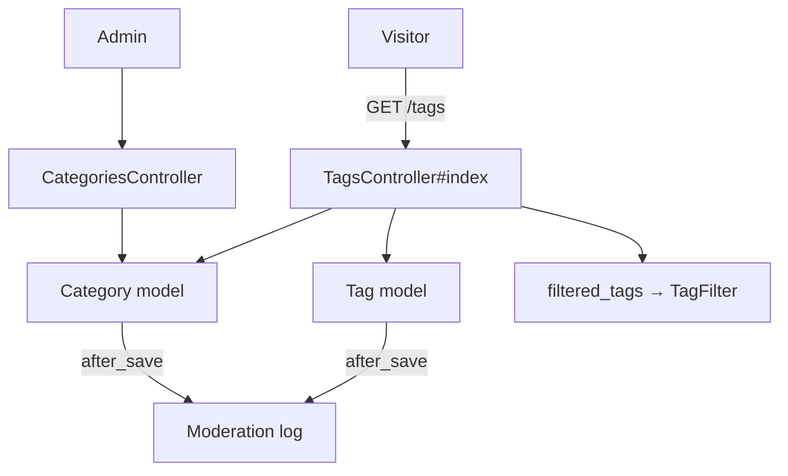
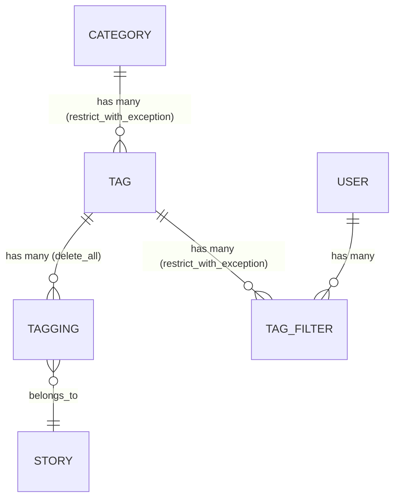

# Tags & Categories

> **Status**: ✅ Active
> **Generated**: 2026-10-24T00:00:00Z
> **Last Updated**: 2026-10-24T00:00:00Z
---

## Overview

### What It Does
Provides Lobsters' story taxonomy. Tags are short labels applied to stories; every tag belongs to exactly one category. The feature ships the public tag directory at `/tags` (HTML and JSON), the `Tag`, `Category`, and `TagFilter` models, and admin-only screens to create and rename categories. Users (even logged-out visitors) can filter stories by tag; tags they filter are marked on the directory. Tag creation and editing screens live in the moderation area and are linked from the directory for admins.

### Why It Exists
Readers need to browse stories by topic and hide topics they dislike; staff need a small controlled vocabulary where every change is publicly audited.

### Key Capabilities
- Public tag directory grouped by category, with per-tag descriptions, *inactive* markers, and "filtered" markers
- JSON list of all tags at `/tags` (name, description, category, flags)
- Per-user tag filtering via `TagFilter` (user ⇄ tag join); works without an account
- Admin category creation and renaming with flash confirmation ("Category X has been created/updated")
- Tag usage flags: `active`, `privileged` (moderator-only), `permit_by_new_users`, `is_media`, and `hotness_mod` ranking modifier (integer −10..10)
- Related-tag suggestions: up to 8 tags that co-occur most often on the same stories
- Full audit: every tag or category save writes a `Moderation` log entry attributed to the editing user

---

## Architecture

### High-Level Design


### Components

#### Backend Components
| Component | File Path | Purpose |
|-----------|-----------|---------|
| `TagsController` | `app/controllers/tags_controller.rb` | Public directory, HTML + JSON |
| `CategoriesController` | `app/controllers/categories_controller.rb` | Admin `new`/`create`/`edit`/`update`, guarded by `require_logged_in_admin` |
| `Tag` | `app/models/tag.rb` | Tag model: validations, flags, scopes, audit, JSON |
| `Category` | `app/models/category.rb` | Category model: validations, audit |
| `TagFilter` | `app/models/tag_filter.rb` | Join model: `belongs_to :tag`, `belongs_to :user` |

#### Frontend Components
| Component | File Path | Purpose |
|-----------|-----------|---------|
| Directory view | `app/views/tags/index.html.erb` | Category headings (alphabetical) with ordered tag lists; admin edit/create links |
| Multi-tag tip | `app/views/tags/_multi_tag_tip.html.erb` | "read stories across multiple tags with `/t/tag1,tag2`" |
| Category form | `app/views/categories/_form.html.erb` | One required **Name** text field (`autocapitalize: :off`); submit label "Create Category" / "Update Category" |
| Multi-category tip | `app/views/categories/_multi_category_tip.html.erb` | "read stories across multiple categories with `/categories/foo,bar`" |
| `new.html.erb` / `edit.html.erb` | `app/views/categories/` | Thin wrappers rendering the form partial |

### Technology Stack
- **Backend**: Ruby on Rails, ActiveRecord
- **Frontend**: server-rendered ERB views
- **Database**: `tags`, `categories`, `tag_filters` tables
- **External Services**: none

---

## Model Details

### Tag

#### Associations
```ruby
belongs_to :category
has_many :taggings, dependent: :delete_all
has_many :stories, through: :taggings
has_many :tag_filters, dependent: :restrict_with_exception
has_many :filtering_users,
  class_name: "User",
  through: :tag_filters,
  source: :user,
  dependent: :delete_all
has_one :moderation, dependent: :restrict_with_exception
has_many :suggested_taggings, dependent: :restrict_with_exception
```

#### Concerns
| Concern | Purpose |
|---------|---------|
| `Token` | Shared token-generation concern |

#### Callbacks
| Callback | Method | Purpose |
|----------|--------|---------|
| `after_save` | `:log_modifications` | Creates a `Moderation` record: on create, "Created new tag" with every attribute; on update, "Updating tag <name>" listing each field changed from old to new value. Attribution via virtual `edit_user_id` (`attr_accessor`), merged in by the controller; sets `tag_id` |

#### Validations
| Attribute | Rules |
|-----------|-------|
| `tag` | presence; length max 25; uniqueness **case-sensitive**; format `/\A[A-Za-z0-9_\-+]+\z/` (letters, digits, `_`, `-`, `+`) |
| `description` | length max 100 |
| `hotness_mod` | inclusion in `-10..10` |
| `permit_by_new_users`, `privileged`, `active`, `is_media` | must be `true` or `false` |

#### Scopes
| Scope | Behavior |
|-------|----------|
| `active` | tags with `active: true` |
| `not_permitted_for_new_users` | tags with `permit_by_new_users: false` |
| `related(tag)` | the 8 most co-occurring active tags: joins taggings over stories carrying `tag`, excluding the tag itself and hardcoded id `67` ("programming, the catch-all"), excluding media tags, ordered by co-occurrence count descending |

#### Key Methods
| Method | Returns | Purpose | Notes |
|--------|---------|---------|-------|
| `to_param` | `String` | Tags appear in URLs by name, not id | rename changes URL |
| `.all_with_filtered_counts_for(user)` | `Array<Tag>` | Active tags ordered by name, limited to tags the user can apply, each carrying its count of filtering users (one grouped query) | |
| `category_name` / `category_name=` | `String` | Virtual attribute; setter resolves `Category.find_by category:` | |
| `css_class` | `String` | `"tag tag_<name>"` plus `" tag_is_media"` for media tags | |
| `user_can_filter?(user)` | `Boolean` | tag must be active; privileged tags filterable only by moderators | |
| `can_be_applied_by?(user)` | `Boolean` | privileged tags require a moderator; all other tags return `true` | comment: unusable tags are intentionally listed so submission produces an explicit error |
| `filtered_count` | `Integer` | memoized count of users filtering this tag | |
| `as_json` | `Hash` | serializes `tag`, `description`, `privileged`, `is_media`, `active`, `hotness_mod` + `category` name | `only:` lists `:permit_by_new_user` (typo — missing `s`), so that flag is absent from JSON |

### Category

#### Associations
```ruby
has_many :tags,
  -> { order("tag asc") },
  dependent: :restrict_with_exception,
  inverse_of: :category
has_many :stories, through: :tags
has_one :moderation, dependent: :restrict_with_exception
```

#### Concerns
| Concern | Purpose |
|---------|---------|
| `Token` | Shared token-generation concern |

#### Callbacks
| Callback | Method | Purpose |
|----------|--------|---------|
| `after_save` | `:log_modifications` | Same audit pattern as `Tag` ("Created new category …" / "Updating category <name>, changed <field> from 'a' to 'b'"); attribution via `edit_user_id`; sets `category_id` |

#### Validations
| Attribute | Rules |
|-----------|-------|
| `category` | presence; length max 25; uniqueness **case-insensitive**; format `/\A[A-Za-z0-9_-]+\z/` — note `+` is NOT allowed, unlike tag names |

#### Key Methods
| Method | Returns | Purpose | Notes |
|--------|---------|---------|-------|
| `to_param` | `String` | Categories appear in URLs by name | rename changes URL |

### TagFilter

```ruby
belongs_to :tag
belongs_to :user
```
Pure join model — a row means "this user filters this tag". No validations, callbacks, or extra methods.

---

## Database Schema

> Columns inferred from the models and serializer; `db/schema.rb` is outside this feature's mapped file set.

### tags
| Column | Type | Notes |
|--------|------|-------|
| `tag` | string | ≤25 chars, unique (case-sensitive) |
| `description` | string | ≤100 chars, shown in directory |
| `category_id` | integer | FK → categories (required) |
| `privileged` | boolean | moderator-only apply/filter |
| `is_media` | boolean | media tag |
| `active` | boolean | usable on new stories |
| `permit_by_new_users` | boolean | available to brand-new accounts |
| `hotness_mod` | integer | ranking modifier −10..10 |

### categories
| Column | Type | Notes |
|--------|------|-------|
| `category` | string | ≤25 chars, unique (case-insensitive) |

### tag_filters
| Column | Type | Notes |
|--------|------|-------|
| `tag_id` | integer | FK → tags |
| `user_id` | integer | FK → users |

### Relationships


---

## API Endpoints

| Method | Path | Action | Description | Notes |
|--------|------|--------|-------------|-------|
| `GET` | `/tags` | `TagsController#index` | Tag directory grouped by category | Public; JSON format returns all tags via `Tag#as_json` |
| `GET` | `/categories/new` | `CategoriesController#new` | New category form ("Create Category" title) | Admin only |
| `POST` | `/categories` | `CategoriesController#create` | Create category; success flashes "Category <name> has been created" and redirects to `/tags` | Admin only; uses `create!` — see caveats |
| `GET` | `/categories/:category_name/edit` | `CategoriesController#edit` | Edit form; lookup by name with `first!` (404 if unknown) | Admin only |
| `POST` | `update_category_path` | `CategoriesController#update` | Rename; success flashes "Category <name> has been updated" → `/tags`; failure flashes "Category not updated: <errors>" → back to edit | Admin only |

There are **no destroy endpoints** for tags or categories. Tag create/edit happens in the moderation area (`new_mod_tag_path`, `edit_mod_tag_path` links on the directory).

---

## Authorization

No Pundit policies; enforcement is controller- and model-level.

| Check | Where | Effect |
|-------|-------|--------|
| `require_logged_in_admin` | `CategoriesController` `before_action` | all category actions admin-only |
| `@user.try(:is_admin?)` | `tags/index.html.erb` | edit/create links rendered only for admins |
| `Tag#can_be_applied_by?(user)` | model | privileged tags applicable only by moderators; everyone else allowed |
| `Tag#user_can_filter?(user)` | model | filtering requires the tag active; privileged tags filterable only by moderators |

Viewing `/tags` and filtering ordinary tags require no login at all — the directory's intro says "You can filter out stories by tag, even if you don't have an account."

---

## Configuration

### Environment Variables
None.

### Config Files
None specific to this feature.

---

## Usage Examples

### Directory action (HTML + JSON)
```ruby
# Source: app/controllers/tags_controller.rb
def index
  @title = "Tags"

  @categories = Category.order(category: :asc).includes(:tags)
  @tags = Tag.all.preload(:category)

  @filtered_tags = filtered_tags.index_by(&:id)

  respond_to do |format|
    format.html { render action: "index" }
    format.json { render json: @tags }
  end
end
```

### Audited admin update with name-based lookup
```ruby
# Source: app/controllers/categories_controller.rb
def update
  category = Category.where(category: params[:category_name]).first!
  if category.update(category_params)
    flash[:success] = "Category #{category.category} has been updated"
    redirect_to tags_path
  else
    flash[:error] = "Category not updated: #{category.errors.full_messages.join(", ")}"
    redirect_to edit_category_path
  end
end
```

### Related-tag suggestions
```ruby
# Source: app/models/tag.rb
scope :related, ->(tag) {
  active
    .joins(:taggings)
    .where(taggings: {story_id: Tagging.where(tag: tag).select(:story_id)})
    .where.not(id: [tag, 67]) # 67 = programming, the catch-all
    .where.not(is_media: true)
    .group(:id)
    .order(Arel.sql("COUNT(*) desc"))
    .limit(8)
}
```

---

## Testing

### Test Files
No test files are mapped to this feature in the catalog; none were verified.

---

## Known Issues & Caveats

| Issue | Location | Description |
|-------|----------|-------------|
| JSON typo | `app/models/tag.rb` (`as_json`) | `only:` lists `:permit_by_new_user` (missing trailing `s`); the new-user flag never appears in `/tags` JSON |
| Dead error branch | `app/controllers/categories_controller.rb` (`create`) | `Category.create!` raises on invalid input, so the "New category not created: …" flash/redirect is unreachable; invalid names surface as an application error |
| Hardcoded id | `app/models/tag.rb` (`related`) | Tag id `67` (programming catch-all) excluded via literal |
| Inert param | `categories_controller.rb` (`category_params`) | Permits `:category_name` but `Category` has no `category_name=` writer; only `:category` is real |
| Asymmetric rules | models | Tag names: case-sensitive unique, `+` allowed. Category names: case-insensitive unique, `+` not allowed |
| No deletion | both models | `restrict_with_exception` on tag_filters/moderation/suggested_taggings (Tag) and on tags (Category); the supported retirement path is `active: false` |

---

## Performance

### Optimization Strategies
- `includes(:tags)` and `preload(:category)` on the directory avoid N+1 queries
- `all_with_filtered_counts_for` computes all filter counts in one grouped query; `filtered_count` is memoized per instance

### Caching
- None in this feature's code.

### Database Optimization
- Name-based URLs (`to_param`) imply unique indexes on `tags.tag` and `categories.category`.

---

## Troubleshooting

### Issue: Exception when an admin creates an invalid category
**Symptoms:** application error (500) instead of a friendly message.
**Cause:** `create!` raises `ActiveRecord::RecordInvalid`; the error-handling branch is dead code.
**Solution:** switch to `create` so the flash branch executes, or validate names (≤25 chars; letters/digits/`_`/`-`; unique ignoring case) before submitting.

### Issue: `permit_by_new_users` missing from `/tags` JSON
**Cause:** typo `:permit_by_new_user` in `Tag#as_json`.
**Solution:** correct the symbol in the `only:` array.

### Issue: Moderation log entry has no author
**Cause:** `edit_user_id` not merged into attributes before save (it is a virtual attr the controller must set).
**Solution:** ensure saves go through controllers that merge `edit_user_id: @user.id`, as `category_params` does.

---

## Related Features

- **stories** — owns `Tagging` and `SuggestedTagging`; tags are applied to stories at submission
- **home-feed** — tag feeds (`/t/tag1,tag2`), category feeds (`/categories/foo,bar`), and the `/filters` page managing `TagFilter` rows
- **moderation** — tag create/edit screens live there; the `Moderation` log receives every tag/category change

---

**Generated:** 2026-10-24T00:00:00Z
**Last Updated:** 2026-10-24T00:00:00Z
**Status:** ✅ Active
